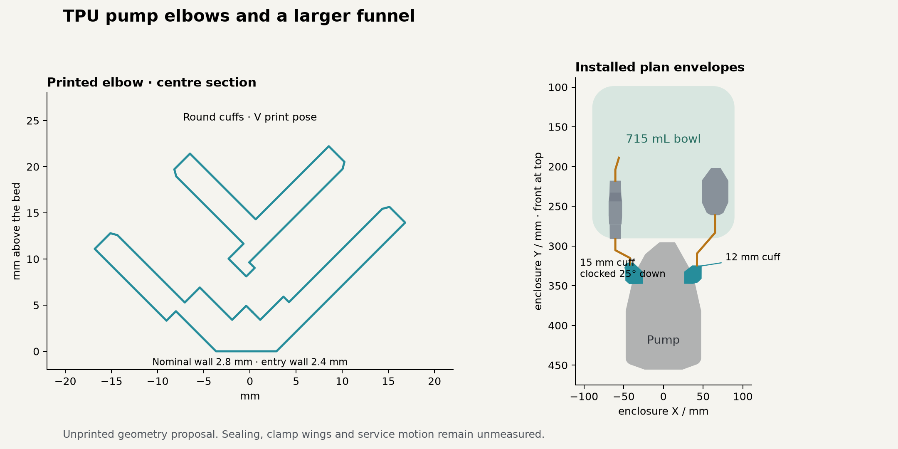

# TPU pump elbow and installed layout study

**Status: one compact V-shaped TPU 85A elbow started on Mark1.**
The selected geometry is the rounded heel and smooth-neck fitting with its
integral flat foot. This job uses the user-reported glued Engineering Plate
and zero user Z trim. Mark1 accepted task 1337517926 on 2026-10-13 at
21:09:41 CDT. Physical printing success and fitting results remain pending.
The compact layout study includes the water connections and a 715 mL funnel
proposal. Its occupancy result applies to the compact fitting envelopes.
Printed fit, pressure holding, retained grip and lifetime remain unmeasured.

The customer outcome is a larger filling bowl in a compact appliance, with
durable joints that require no customer retightening. Elbow lengths, clocking,
the water check, its cap cradle, tube bends, funnel frame, roof opening and
neighboring hardware are considered together.



## Files

- [Compact elbow and Mark1 preparation](prints/2026-10-13-compact-single-tpu85a-engineering-z000-mark1/README.md)
  identify one 15 mm elbow, the editable project, native sliced
  archive, TPU 85A recipe, right fixed 0.6 mm nozzle, Engineering Plate and
  zero user Z trim. Its native estimate is 62 minutes / 4.30 g.
- [Suction elbow](suction-elbow.stl) and [discharge elbow](discharge-elbow.stl)
  are the compact fitting envelopes used by the installed layout study. The
  selected print trial uses the same compact geometry. Installed expansion
  remains an envelope estimate, with no loaded-deformation acceptance.
- [Installed proposal](installed-proposal.step) shows the pump, elbows, bands,
  water check and cradle, tubes, source valves, expanded bowl and frame, and
  relocated upper hardware. The [revised back-top](back-top-funnel-opening.step)
  carries its roof opening and hardware mounts.
- [715 mL silicone bowl](funnel-715ml.step) and
  [matching rigid frame](funnel-frame-715ml.step) and
  [lift-off cover](funnel-cover-715ml.step) are separate native parts.
- [Placement record](placement.json), [elbow geometry](geometry.json) and
  [native slice](native-slice.json) bind the measurements and evidence limits.

## Why printing TPU is a credible route

Stano, Arleo and Percoco printed TPU 95A air connectors and reported no bubbles
in submerged tests up to 7 bar, including repeated pressure changes and a
15-minute hold. Seven bar is approximately 102 psi, close to the pump's
advertised 110 psi. Their connector used a different sealing interface and
stood vertically during printing. Their horizontal specimens leaked. This
supports feasibility and attention to orientation; it supplies no rating for
these angled cuffs. [Primary study, 2020](https://pmc.ncbi.nlm.nih.gov/articles/PMC7281577/).

A 2026 manufacturing preprint reports that extrusion-path architecture can
matter more than nominal thickness: three narrow paths sealed better than two
wider paths in its compared specimens. Its process values belong to that
printer and material. This motivates continuous wall paths and a native
toolpath review, rather than treating infill percentage as a sealing result.
[Abboodi, 2026](https://arxiv.org/pdf/2608.13233).

TPU grade selection also requires its response under sustained compression.
Covestro identifies compression set as a sealing variable and describes its
dependence on formulation and temperature. Shore hardness and elongation at
break do not establish retained sealing force. Neither a 95A nor an 85A shop
filament has a relaxation result for these cuffs.
[Covestro mechanical properties](https://solutions.covestro.com/en/highlights/articles/theme/product-technology/mechanical-properties-tpu).

## Sealing design

The compact layout model has a continuous circular socket and a broad
external clamp band at both interfaces. The clamp compresses TPU against the mating plastic. The pump barb's
crests provide geometric retention; the smooth LLDPE end relies on retained
friction unless an additional retention feature is established. Stops keep
both inserted ends clear of the corner passage.

| Feature | Candidate dimension and basis |
| --- | --- |
| Pump socket | Ø9.00 mm, 11 mm insertion. The independently scanned ports reach Ø10.26 mm inside this span; nominal crest stretch is 14%. This is a fit hypothesis. |
| Tube socket | Ø6.10 mm for nominal Ø6.35 mm LLDPE; 0.25 mm diametral interference. |
| Suction tube insertion / mouth from barb axis | 15 / 18.5 mm |
| Discharge tube insertion / mouth from barb axis | 15 / 18.5 mm |
| Tube axis beyond barb tip | 4.916 mm; includes 1 mm nominal air between the closed 9 mm barb band and the perpendicular tube leg. |
| Nominal radial wall / lead-in wall | 2.8 / 2.4 mm |
| Corner passage | Ø4.40 mm, formed by overlapping cylinders; both sockets remain round. |
| Estimated installed cuff ODs | 15.407 mm on the barb and 11.832 mm on the tube, using conserved annular area. |
| Clamp band | 9 mm width; closed-band geometry only. Wing, screw and opening envelopes are unmeasured. |

The compact fitting envelope follows the large cuff into a spherical heel and a smooth,
6.5 mm long reduction into the smaller tube leg. The reduction has zero slope
and curvature at its circular ends. The heel has one integral flat foot,
approximately 88.9 mm². Each clamp retains a complete circular 9 mm seat;
the tube band starts 9.5 mm above the barb axis, beyond the installed barb's
7.703 mm radial envelope. The exact minimum wall is 2.40 mm at the entries.
The conservative installed envelope expands the cuffs and extends the smooth
neck to 7.5 mm; it supplies occupancy geometry, not a strain prediction.

The scanned pump and tube observations retain their scope in the
[pump reference](../../hardware/reference/g-ganen-pump/README.md),
[tube reference](../../hardware/reference/lldpe-tubes/README.md) and
[mechanical evidence register](../../hardware/mechanical-qualification/README.md).
Scanner residuals are not manufacturing tolerances. Conserved annular area is
placement geometry, not a prediction of contact pressure or strain.

At 110 psi, pressure times the projected seal area is approximately **24 N** at
the 6.35 mm tube and **63 N** at a 10.26 mm barb. These are conservative static
separating-load estimates, not retention capacities. Tube bending and handling
add loads. A joint that seals initially can still lose tube retention.

The owned butterfly clamps are fit-trial hardware. Their published low-pressure
description does not establish suitability for permanent pump service. A
production clamp needs maintained compression, suitable wet exposure and an
established duty rating. The observed hose arrangement and clamp guidance are
in the [pump sleeve record](../../hardware/printed-parts/diaphragm-pump-sleeve/README.md).

The shop has Siptenk tube stiffeners. A compatible insert can support the
LLDPE against clamp-induced ovalization; its actual bore and insertion geometry
must suit this end. A stiffener provides support, not axial retention.
John Guest recommends tube inserts for soft or thin-wall tube in compression
applications. That guidance supports evaluating an insert if tube deformation
limits grip; it is not validation of this custom cuff.
[John Guest fluid-system catalog](https://www.johnguest.com/sites/default/files/files/JohnGuest-Fluid%20System-Catalog-2025.pdf).

## Printing and geometry options

The selected single specimen has both mouths upward at 45°, a rounded heel,
a smooth neck and one 88.9 mm² integral flat foot. Its 9 mm circular clamp
seats remain exposed. The selected filament is the user-reported TPU 85A.
The [TPU for AMS trial](prints/2026-10-13-compact-single-tpuams-mark1/physical-result.json)
is reported too stiff; its record supplies no sealing or pressure acceptance.

The native archive contains one body, one normal volume, one object and one
build instance, with a 5 mm outer brim. The manufacturer's H2C 0.6 mm TPU 85A
filament profile uses 225°C nozzle, 35°C Engineering Plate, flow ratio 1.0,
and 2.2 mm³/s maximum flow. Requested process settings are 0.20 mm first /
0.12 mm normal layers, six walls, 100% zig-zag infill, 0% seam gap and 25 mm/s
walls. Spiral mode and supports are off.

This print uses Bambu's unmodified stock H2C machine-start template with
**zero user Z trim**. Engineering Plate and the 0.6 mm nozzle emit only
`G29.1 Z0`; the readback contains no other Z-trim value. The native estimate
is **62 minutes / 4.30 g**. This setting is local to the identified print job.

The [downward-filled candidate](prints/2026-10-13-downward-fill-single-tpu85a-mark1/README.md)
is prepared but not selected or submitted. It contains only stock beneath the
original roof and no annular air gaps, with a 423.338 mm² flat base. That
stock occupies the lower circular clamp paths, so its sealing arrangement and
installed clearance are unqualified.

The [rejected convex-stock trial](prints/2026-10-13-full-base-single-tpu85a-mark1/physical-result.json)
is stopped. Its broad footprint did not supply uninterrupted stock beneath the
cuffs: the annular channels cut through that stock. Its native layer checks do
not resolve this rejected geometry.

The identified [two-elbow print failed](prints/2026-10-13-continuous-body-tpu85a-mark1/physical-result.json)
according to Derek's report. Its failure mechanism is unmeasured. Print trials
use one specimen at a time.

At a nominal 45° wall, a 0.12 mm layer advances approximately 0.12 mm laterally;
with 0.62 mm beads, nominal overlap is about 81%. This gives a geometric print
margin. Extrusion continuity and cooling still determine the printed result.
Drying history, physical adhesion and extrusion continuity remain unmeasured
for the identified article. The selected material is TPU 85A; the cited
TPU 95A research establishes no rating for this grade or interface. Socket fit and pressure holding remain
unmeasured.

| Geometry or process option | Application and decision |
| --- | --- |
| Smooth circular cuffs and V print | Selected first prototype. Broad clamp contact and an accessible open lumen. |
| Teardrop flow passage | A useful option for a locally shallower roof. A noncircular sealing socket would leave a gap around the round mating plastic. |
| Broad integral sealing bands | Can concentrate contact load. Their ramps, added insertion force and local overhangs need a comparison if the smooth cuff fails at the interface. |
| Thin lips or pressure-energized seals | Require controlled containment, extrusion clearance and repeatable small sections. They do not supply tube retention. |
| Separate soft liners with a constrained body | Can separate surface conformity from pressure support. Adds interfaces and assembly; useful if the one-piece body balloons or relaxes. |
| Cast elastomer | Removes FFF bead gaps. Molding, material grade, clamp retention and pressure qualification still require evidence. |

The exact filament's wet-service suitability is open. Covestro describes
different hydrolysis behavior for polyester and polyether TPUs. A generic TPU
label supplies neither the formulation nor potable-water suitability of the
printed article. [Covestro chemical properties](https://solutions.covestro.com/en/highlights/articles/theme/product-technology/chemical-properties-tpu).

## Installed connections and the larger funnel

The suction elbow faces forward. The discharge elbow is clocked **25° downward
from forward** so its line passes below the gravity-drain route. The water
check sits at **X−60.5, Y252.8, Z268.1 mm**, with its inlet facing aft and its
outlet facing forward. Its actual cap rib is carried to that station.

| Connection | Exposed developed tube length | Minimum bend radius |
| --- | ---: | ---: |
| Suction elbow to V-K outlet | 70.163 mm | 14 mm |
| Discharge elbow to PP010822E / water check | 40.302 mm | 14 mm |
| Water-check outlet to core water inlet | 38.143 mm | 14 mm |

These are exposed route lengths. A cut blank also includes the known TPU
insertion and each actual fitting's fully seated engagement. The native port
stations do not establish a hidden collet stop depth.

The silicone collar extends 60 mm aft while its front brim and drain stay at
their existing stations. Its calculated capacity is **715.057 mL**, about
260 mL more than the nominal 455 mL bowl. The enclosure envelope is retained.
This is liquid cavity volume in CAD, not a physical fill result.

The matching proposal includes:

- The existing front frame, rail and drain interfaces, with an upper rear
  bearing extension above Z329 and a named clearance passage for water-2.
- A matching rear roof opening, frame clearance and local hardware reliefs.
- A matching lift-off cover with the source cover's skirt and four friction pads.
- A carbonated-water route behind the bowl, with R14 bends and the real core
  and meter ends.
- The CO2 check and adapters 12 mm aft, a matching tied cradle, and both
  connected CO2 routes. Their fittings and gas materials retain their roles.
- Relay 1 and the ground stack 85 mm aft, lifted 5.5 and 3.5 mm respectively,
  with insert mounts generated from their actual hole patterns.

The packing records compare the candidates against 164 installed bodies,
including nine printed enclosure pieces, and compare the revised candidates
with one another. Reported material intersections are zero after the declared
replacements. Clamp wings, harness slack, tool approach, loaded deformation and
the complete assembly/service motions remain outside this static result.
The close upper relay/roof interface is a nominal fit candidate.

## Physical decision and bounded screening procedure

The first physical decision is whether the identified print and clamp can
seal and retain both mating plastics. This small article can answer that before
committing material and assembly time to the larger frame and mold.

Use the owned BEAMNOVA hydro pump, SENCTRL 0–200 psi gauge, KOOTANS nipple,
square-cut LLDPE, actual pump ports and the selected clamps. Temporary
pressure-rated NPT/PTC adapters, a tee for the gauge and a metal end plug make
an isolated water-filled fixture. Confirm its specific connections and available
parts before a run; keep the carbonator out of this fixture.

1. Bind the article to its STL, native slice, filament, printer/nozzle, drying
   state and clamp. Seat the pump socket to its stop. Mark and seat the tube
   to 15 mm. Record insertion, the clamp position and any tube ovalization.
2. Fill and bleed the fixture completely. Hydrostatic screening uses water.
   Verify every component's applicable pressure limit before selecting a
   pressure; 80 psi on suction and the advertised 110 psi on discharge are
   provisional screening targets, not established system pressure ratings.
3. Increase pressure gradually, checking dry witness paper separately under
   each interface and the printed body. After temperature settles, isolate
   the source and record the gauge. Hold for 30 minutes. Stop on leakage,
   movement, ballooning, clamp damage or tube deformation.
4. Record each leak location and the tube mark against the mouth. Acceptance
   for this screening is no visible wetting, no resolvable pressure loss after
   settling, and no visible mark movement at 0.5 mm observation resolution.
   The 15 mm cuff leaves 6 mm beyond its 9 mm band; 0.5 mm is a screening
   detection limit, not permissible service slip.
5. Leave the fitted article clamped and water-filled for 24 hours, then repeat
   the applicable pressure hold without retightening. This checks early
   relaxation only. A passing short trial establishes neither a lifetime nor
   a production operating/fault/transient envelope.

Wetting on the body directs work to the printing process. Wetting at a cuff
directs work to interference and compression. Movement without wetting directs
work to retention and tube support. Endurance and water-contact qualification
belong to the selected material, clamp and actual operating envelope.

## Reproduce the study

Run the standalone scripts from the repository root:

```sh
HSM_NO_BUILD_LOCK=1 tools/cad-venv/bin/python future/pump-elbow-exploration/snapshot.py
HSM_NO_BUILD_LOCK=1 tools/cad-venv/bin/python future/pump-elbow-exploration/layout.py
HSM_NO_BUILD_LOCK=1 tools/cad-venv/bin/python future/pump-elbow-exploration/funnel_layout.py
HSM_NO_BUILD_LOCK=1 tools/cad-venv/bin/python future/pump-elbow-exploration/prepare_print.py
HSM_NO_BUILD_LOCK=1 tools/cad-venv/bin/python future/pump-elbow-exploration/finalize.py
```

The snapshot and intermediate B-reps are local working data under
`.cache/pump-elbow-exploration/`. This proposal is separate from the production
assembly and its physical acceptance records. Its scripts run on request.
