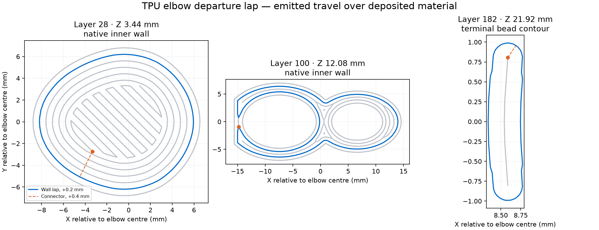

# TPU elbow departure-lap trial — Mark1

**Status: stopped; Derek reports no improvement and insufficient apparent nozzle clearance.**
The [launch receipt](launch.json) records RUNNING at startup, with no errors,
on **2026-10-15 at 23:15:25 CDT**. The [startup spacing record](startup-spacing.json)
identifies Mark2’s existing job and the interval before this acceptance.
 Two compact elbows use Derek's
reported black Bambu TPU 85A on Mark1's right fixed 0.6 mm hotend and glued
Engineering Plate. This trial assesses strands between objects, at wall starts
and inside the bores, with exterior quality and socket fit also unassessed.

The [editable project](2026-10-15-elbow-pair-tpu85a-lap020-right06-z000-mark1.3mf)
retains the Siraya pair's exact child mesh bytes, V orientation and centres at
(177.5, 148.5) and (177.5, 171.5) mm. Conservative native bead envelopes leave
2.708 mm between brims and 135.695 mm inside the right nozzle's usable bed area.

The material recipe is the [corrected Bambu 85A candidate](../2026-10-13-compact-single-tpu85a-overhang10-engineering-z000-mark1/README.md):
225°C nozzle, 35°C Engineering Plate, zero user Z trim, 0.20 mm first / 0.12 mm
normal layers, 1.00 flow ratio, 2.2 mm³/s maximum flow, 1 mm retraction and
10 mm/s retract/unretract. Part and auxiliary cooling retain that recipe's
100% settings. Requested outer and relevant overhang speeds are 10 mm/s;
inner walls are 25 mm/s. Six walls, 100% zigzag infill, 5 mm outer brim and
supports off are retained. Nearest seams, wall-crossing avoidance and explicit
native wipe off complete the native recipe. The [native readback](native-readback.json)
records every difference against the Bambu single's emitted settings.
Zero trim is local to this elbow recipe.

## Inserted movement

[`departure_lap.py`](../../departure_lap.py) inserts a block immediately after
the final standing retraction in each object block:

1. Lift to 0.4 mm above the printed layer and reach the selected wall loop.
2. Lower to 0.2 mm above the layer and travel once around it at 10 mm/s,
   without extruding.
3. Lift to 0.4 mm clearance, return to the native departure XY, restore the
   native modal feed and continue with the slicer's original travel.

There are **368 laps**, one per object on each of 184 layers. Of these,
350 follow closed native inner-wall runs, ten follow native outer-wall runs
on thin terminal layers, and eight follow a closed contour 0.15 mm inside
the final four layers' deposited terminal beads. Selection uses the largest
nearby closed wall, within 3 mm of the nearest candidate's distance. Every
low lap is above deposited material of the departing object. Connections to
and from it use full hop height. Native intra-object leg transfers, crossings
between objects and photo trips remain unchanged.

The [lap record](lap-review.json) binds every route and height to the exact
processed archive. The [independent command review](emitted-command-review.json)
compares 3,958 native extrusion runs: coordinates and modal speeds match.
Every native line is unchanged and in order; replay also preserves all
124,015 E-command start/end positions and feeds. Only the G-code member and
its MD5 member differ between the native and processed archives. Complete
exterior loops on layers 17–33 command 10 mm/s.

The [native slice](https://github.com/derekbreden/homesodamachine/blob/33d50d2ecd2a0fb6b518483a44c8031e3a0c1617/future/pump-elbow-exploration/prints/2026-10-15-departure-lap-tpu85a-mark1/2026-10-15-elbow-pair-tpu85a-lap020-right06-z000-mark1-native.gcode.3mf)
estimates **121 minutes / 8.57 g**. Inserted motion adds approximately
**32.5 minutes**, for a planning estimate of **about 2 hours 35 minutes**,
excluding acceleration overhead. Native thumbnails and displayed time
estimates do not include the inserted moves. The
[processed archive](https://github.com/derekbreden/homesodamachine/blob/33d50d2ecd2a0fb6b518483a44c8031e3a0c1617/future/pump-elbow-exploration/prints/2026-10-15-departure-lap-tpu85a-mark1/2026-10-15-elbow-pair-tpu85a-lap020-right06-z000-mark1.gcode.3mf)
is the print file. Reslicing the editable project does not retain the laps.

`prepare_mark1.py` slices offline and invokes the post-processor. It neither
connects to a printer nor changes a global preset. Submission uses a separate
copy of the reviewed processed archive in Bambu Connect, with Timelapse On,
Bed Leveling On, Flow Calibration Auto and Nozzle Offset Auto. Keep the selected
import copy untouched until submission completes.

The [physical record](physical-result.json) records Derek’s report: “It’s not
helping, and I don’t think it’s getting away from the print.” Physical contact
and the printed stop layer are unestablished. The
[0.4 mm Normal Lift trial](../2026-10-16-departure-lap040-normal-lift-tpu85a-mark1/README.md)
uses the same lap routes at full hop height. The useful outcome is fewer strands
across bores and between objects, without added rim damage or projecting
wall-start strands. The Siraya exterior acceptance and rough
Bambu article's manual-fit acceptance retain their separate scopes. This
trial supplies no pressure, retention or lifetime qualification.
