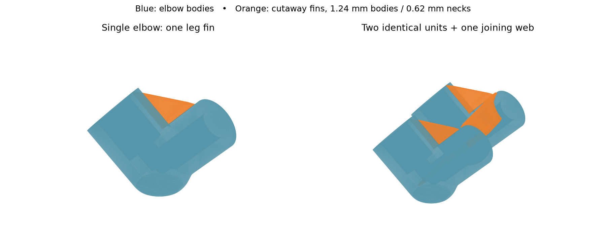

# TPU elbows with cutaway fins — Mark1

**Status: stopped for vertical centre-web revision; physical result unassessed.** The
[launch receipt](launch.json) records RUNNING without errors at startup on
2026-10-16 at 00:49:17 CDT. The [startup spacing record](startup-spacing.json)
identifies Mark2’s continuing task and the interval before acceptance.
The print contains two
identical elbow-and-fin units, with one additional web joining the units.
There are three fins: one between each elbow's legs and one between elbows.
The [standalone STL](single-elbow-with-fin.stl) and
[standalone editable project](single-elbow-with-fin.3mf) retain the leg fin.
The [vertical centre-web trial](../2026-10-16-vertical-center-web-tpu85a-mark1/README.md)
contains the selected joining geometry. This archive retains the following-leg web
and its original launch record.

## Geometry and removal

The dimensional source is the archived compact elbow from the
[0.4 mm lap trial](../2026-10-16-departure-lap040-normal-lift-tpu85a-mark1/README.md).
The pair retains its 23 mm pitch, V orientation and centres at (177.5, 148.5)
and (177.5, 171.5) mm. The original elbow stock is retained; added web material
has zero intersection with the modeled functional cavities extended through
the socket mouths. The [geometry review](geometry-review.json) and
[single-unit review](single-geometry-review.json) find one connected island
at all 184 nominal layer section planes in both versions.

Fins have **1.24 mm bodies and 0.62 mm attachment necks**, tapering over up to
2 mm in plan. The leg fins start in the heel before the legs separate and
continue through their split layers. The joining web grows from the bed and
attaches on the outside of one leg of each elbow. These are solid printed
fins, with no interface gap. The widths target two beads and one bead with
the 0.6 mm nozzle; Arachne controls the emitted variable widths.

The narrow attachments are accessible cut lines. Removal by tearing is
unqualified: the flexible TPU can stretch instead of breaking at the neck.
Assess removal by whether the fins can be cut away without tearing into the
original cuff or leaving material in a passage. Stability and clean removal
remain physical results, as does string reduction inside the bores and
between elbows. The specimen supplies no pressure, retention or lifetime
qualification.

## Actual travel

The [editable pair project](2026-10-16-elbow-pair-cutaway-web-tpu85a-right06-z000-mark1.3mf)
uses wall-crossing avoidance, unlimited detour length, 0.4 mm Normal Lift and
a 0.1 mm travel-distance threshold. The local timelapse template is empty,
and submission selects **Timelapse Off**. There are no `M9711` photo-trip
commands and no departure laps.

[`wall_travel.py`](../../wall_travel.py) manually replaces 53 native travel
shortcuts. Its [route review](wall-travel-review.json) assesses all 4,144
part travels against emitted bead envelopes. Stock includes the departing,
arriving and preceding layers. Routes prefer the current walls; six at
layers 48 and 56 use the printed preceding-layer floor where a cavity first
opens. Both unchanged and rerouted paths have zero measured travel outside
that available stock. The method allows 0.03 mm numerical tolerance and
excludes startup, shutdown and firmware interventions. It does not establish
contact with ooze, physical clearance above curl, or a string-free result.

The [independent command review](emitted-command-review.json) confirms all
4,082 extrusion runs retain their native coordinates and modal speeds. All
135,841 E-command states and feeds are retained. Only the G-code and its MD5
archive members change. The conservative full-bead envelope is at least
135.66 mm inside the right nozzle's usable bed area.

The [native slice](https://github.com/derekbreden/homesodamachine/blob/33d50d2ecd2a0fb6b518483a44c8031e3a0c1617/future/pump-elbow-exploration/prints/2026-10-16-cutaway-web-tpu85a-mark1/2026-10-16-elbow-pair-cutaway-web-tpu85a-right06-z000-mark1-native.gcode.3mf)
estimates **2 hours 17 minutes / 9.14 g**. Routing adds short detours and lifts;
allow roughly **2 hours 20 minutes**. Native preview travel and time estimates
exclude the replaced routes. The
[processed archive](https://github.com/derekbreden/homesodamachine/blob/33d50d2ecd2a0fb6b518483a44c8031e3a0c1617/future/pump-elbow-exploration/prints/2026-10-16-cutaway-web-tpu85a-mark1/2026-10-16-elbow-pair-cutaway-web-tpu85a-right06-z000-mark1.gcode.3mf)
is the selected print file. `prepare_mark1.py` builds both models, slices the
pair and invokes the manual router. Reslicing the editable project omits
that routing step.

The remaining recipe is Bambu TPU 85A Black, right fixed 0.6 mm, glued
Engineering Plate, zero local user Z trim, 225°C nozzle / 35°C plate, 0.20 mm
first and 0.12 mm normal layers, six walls, 100% zigzag infill, 5 mm brim,
supports off, 1.00 flow and 2.2 mm³/s maximum flow. Retraction/unretraction is
1 mm at 10 mm/s. Outer and relevant overhang speeds request 10 mm/s; inner
walls request 25 mm/s. Part and auxiliary cooling remain 100%. The
[native readback](native-readback.json) records the complete setting differences.
Bed Leveling On, Flow Calibration Auto and Nozzle Offset Auto are retained.

## Related evidence

A [maker's firsthand 70A TPU report](https://www.reddit.com/r/FixMyPrint/comments/1g50z55/)
describes connecting parts with a cutaway sprue and using Cura combing to
keep travel inside it. The author reports clean parts and notes that thin
connectors did not receive the desired routing. This is a related physical
anecdote, not validation of this geometry or Bambu recipe.

[Prusa's routing documentation](https://help.prusa3d.com/article/layers-and-perimeters_1748?product=prusaslicer)
describes routing within an island while avoiding holes and using a direct
crossing between separate islands. [CuraEngine's explanation](https://github.com/Ultimaker/CuraEngine/wiki/Generating-Paths)
describes combing and its choice of crossing locations. These support
checking both layer connectivity and emitted travel rather than relying on
the one-object label.

The prior H2C lap file contains 184 executable `M9711 … U262 V162` commands
and was submitted with Timelapse On. [Bambu's source](https://github.com/bambulab/BambuStudio/blob/v02.08.02.61/src/libslic3r/GCode.cpp#L4080-L4149)
identifies the safe-position branch as head relocation through firmware
`M9711`. This establishes commanded photo detours, not observed camera motion.
The [prior physical record](../2026-10-16-departure-lap040-normal-lift-tpu85a-mark1/physical-result.json)
reports persistent threads with a possible small reduction in thickness.

The [layer-49 G-code comparison](../2026-10-16-vertical-center-web-tpu85a-mark1/travel-opening-review.json)
identifies a 3.84 mm crossing of a small model opening in this submitted file.
The archived bead-envelope review fills holes below 5 mm² and includes
preceding-layer stock. Its zero off-stock result does not establish travel
within every current-layer wall or around every bore.
