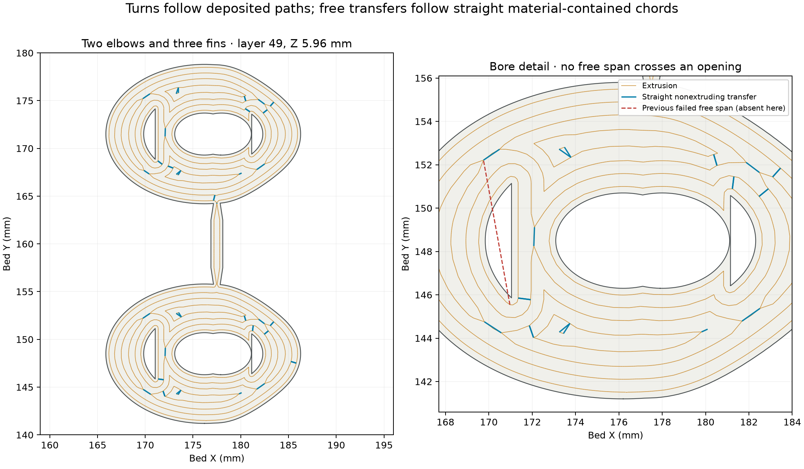

# Deposited-path Siraya elbow trial — Mark1

**Status: accepted by Mark1; physical stringing result pending.** Task
**1344414329** entered PREPARE without print errors on 2026-10-16 at
03:57 CDT. The [launch receipt](launch.json) identifies the submitted
`2026-10-16-elbows-siraya-links.gcode.3mf`, a byte-identical copy of the
[reviewed print archive](https://github.com/derekbreden/homesodamachine/blob/33d50d2ecd2a0fb6b518483a44c8031e3a0c1617/future/pump-elbow-exploration/prints/2026-10-16-deposited-links-siraya85a-mark1/2026-10-16-elbows-deposited-links-siraya85a-right06-z000-mark1.gcode.3mf).
Allow approximately **2 hours / 8.55 g**. Native archive previews and timing
describe the source slice; the figure below reads the processed G-code.

A loose strand can straighten between its attachment points even while the
nozzle follows a bent wall detour. This trial splices the native deposition
paths into a tour of each layer. The nozzle prints the existing walls and
fins through the turns. Transfers between deposited paths are straight chords
contained within material. No part retraction or Z hop interrupts these tours;
each layer starts and ends on the vertical centre joining sheet.

[`deposited_links.py`](../../deposited_links.py) builds a graph from the native
extrusion paths, joins nearby paths with contained straight links, pairs open
endpoints and walks an Euler circuit. Existing closed paths act as the
deposited connection between areas. The additional 36.376 mm of filament,
about **1.21% / 0.10 g**, retraces native inner-wall paths. No added deposition
crosses a bore or changes an outer-wall path. Arcs become short straight
segments, with a measured maximum path difference of 0.00134 mm.

The [independent emitted-command review](emitted-command-review.json) accounts
for every one of the source slice's **126,402 deposition commands**, preserving
its filament volume, width and feature while allowing reversal and reordering.
Nine tiny commands slow to retain the 2.2 mm³/s flow cap; other native speeds
are retained. All **6,118 nonextruding transfers**, including layer transitions,
have zero commanded route or attachment chord outside the native material
sections. Every opening is retained in these sections. The same chord check
passes when extrusion runs shorter than **1 mm** are ignored as possible
attachments. This is a conservative geometric check, not a measurement of
actual strand adhesion. The full bead envelope is at least **135.67 mm** inside
the usable right-nozzle bed boundary.

The geometry comprises two identical elbow-and-fin units and one vertical
joining fin. The [geometry qualification](../2026-10-16-vertical-center-web-tpu85a-mark1/geometry-review.json)
and [standalone model](../2026-10-16-vertical-center-web-tpu85a-mark1/single-elbow-with-fin.3mf)
cover the retained geometry: connected sections through all 184 layers,
1.24 mm web bodies, 0.62 mm attachment necks, no added material in the
modeled functional cavities and preserved original elbow stock. The pair
centres are (177.5, 148.5) and (177.5, 171.5) mm. The
[editable project](2026-10-16-elbows-deposited-links-siraya85a-right06-z000-mark1.3mf)
contains this geometry and the Siraya recipe; reslicing it alone omits the
path processing.

The material is **Siraya Tech Flex TPU 85A Clear**, loaded by Derek on the
right external spool and printed through Mark1's fixed **0.6 mm** nozzle.
The [accepted single-elbow recipe](../2026-10-14-compact-single-siraya85a-overhang10-engineering-z000-mark1/README.md)
supplies **225°C first layer, 215°C normal layers, 35°C bed**, 0.96 flow,
2.2 mm³/s cap, 100% part cooling and zero auxiliary cooling. The glued
Engineering Plate uses **zero local user Z trim**. Layers are 0.20 / 0.12 mm,
with six walls, 100% infill, an attached 5 mm outer brim and no supports.
The Siraya [manufacturer guide](https://siraya.tech/pages/flex-tpu-85a-filament-user-guide)
is the material reference; the local recipe's physical acceptance is exterior
quality on the single elbow, with internal stringing reported separately.

The [send dialog record](launch-dialog.json) confirms **Ext TPU R**, Timelapse
Off, Bed Leveling On, Flow Calibration Auto and Nozzle Offset Calibration Auto.
The production filament picker selected the visible right-spool popover
automatically and verified its result without resizing the window.
The [prelaunch record](prelaunch.json) binds Derek's readiness/material report,
both printer states and shared-circuit spacing. Camera trips are absent from
the G-code. Startup and shutdown remain native and are outside the in-part
strand review.

Run `prepare_mark1.py` with `tools/cad-venv/bin/python` to create the editable
project, source slice and processed archive. Run `verify_mark1.py` separately
for this manual emitted-path assessment. These scripts do not send a print or
run on commits/builds. [deposition-review.json](deposition-review.json) records
the per-layer tour and added material; [native-readback.json](native-readback.json)
records the source slice and recipe.

The [physical result record](physical-result.json) is pending. Assess strings
inside both bores and from exterior edges to all three fins. Deposited path
planning does not establish ooze attachment, fin removal, fit, pressure holding,
retention or lifetime. The [Bambu finned trial's failure](../2026-10-16-vertical-center-web-tpu85a-mark1/physical-result.json)
remains the evidence for bent nonextruding detours; this Siraya trial also changes
material, so it cannot isolate the path change's effect quantitatively.
