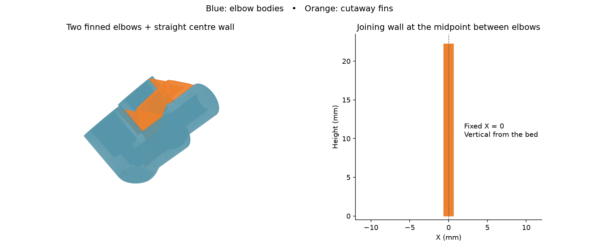
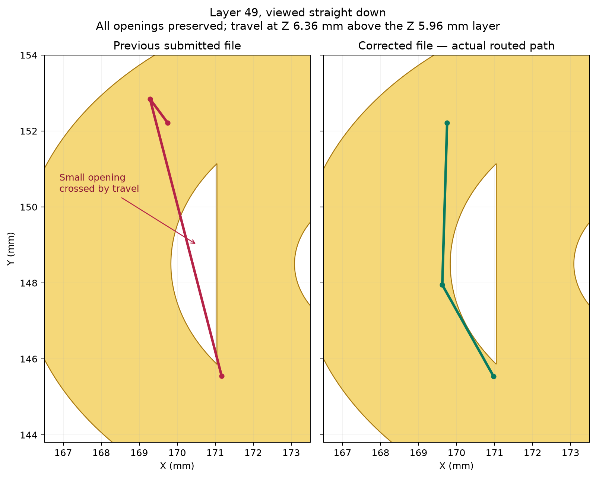
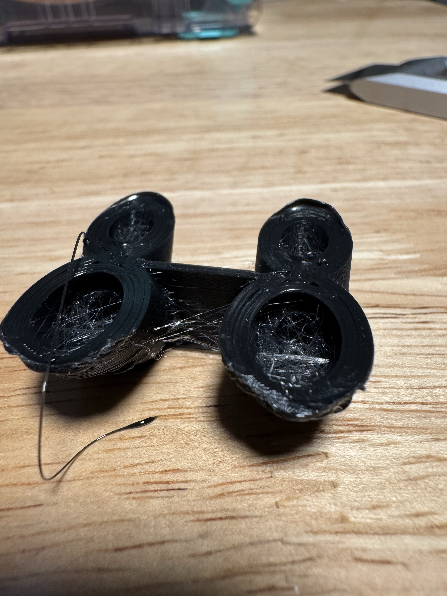

# TPU elbow pair with a vertical centre web — Mark1

**Status: stringing trial failed; dense bore and exterior-to-fin strands remain.** Two identical
elbow-and-fin units connect through one straight vertical joining web. The
[launch receipt](launch.json) records PREPARE without errors at
2026-10-16 01:43:15 CDT. Derek selected the right external TPU spool in
Bambu Connect. The submitted name is `2026-10-16-elbows-center-wall.gcode.3mf`,
a byte-identical copy of the archived print file.

The joining web's centre remains at **X=0 from the bed to its top**. Its
midspan is 1.24 mm thick, with 0.62 mm attachment necks. The fin on each elbow
reaches this centre wall through all printed layers, including the highest
layers of the remaining leg. Both the
[standalone model](single-elbow-with-fin.3mf) and the pair have one connected
island at all 184 nominal section heights. There are three fins total.

The [geometry review](geometry-review.json) records zero lateral shift of
the joining web and zero added material within the modeled functional
cavities extended through the mouths. Original elbow stock is retained.
The [standalone geometry review](single-geometry-review.json) covers the unit
used twice in the pair. The dimensional source and the 23 mm pitch retain
the compact elbow pair's geometry and placement, at (177.5, 148.5) and
(177.5, 171.5) mm.

The [editable pair](2026-10-16-elbow-pair-vertical-center-web-tpu85a-right06-z000-mark1.3mf),
[standalone STL](single-elbow-with-fin.stl) and [pair STL](connected-pair.stl)
contain the fins. `prepare_mark1.py` builds the models, slices the pair and
invokes the manual [`wall_travel.py`](../../wall_travel.py) router.
The [processed archive](https://github.com/derekbreden/homesodamachine/blob/33d50d2ecd2a0fb6b518483a44c8031e3a0c1617/future/pump-elbow-exploration/prints/2026-10-16-vertical-center-web-tpu85a-mark1/2026-10-16-elbow-pair-vertical-center-web-tpu85a-right06-z000-mark1.gcode.3mf)
is the print file. Reslicing the editable project omits that routing step.

The recipe uses black Bambu TPU 85A, Mark1's right fixed 0.6 mm hotend,
glued Engineering Plate and zero local user Z trim. Nozzle / bed temperatures
are 225°C / 35°C. Layers are 0.20 mm first and 0.12 mm normal; six walls,
100% zigzag infill, a 5 mm outer brim with zero object gap and supports off
are used. The attached brim connects first-layer travel to the part. Flow is 1.00
with a 2.2 mm³/s cap, and retraction/unretraction is 1 mm at 10 mm/s. Outer
and relevant overhang speeds request 10 mm/s, inner walls 25 mm/s, with
100% part and auxiliary cooling. Travel uses wall-crossing avoidance,
unlimited detour length, a 0.1 mm threshold and 0.4 mm Normal Lift.

Timelapse is Off, and the local timelapse template emits no photo trips.
Bed Leveling On, Flow Calibration Auto and Nozzle Offset Auto are retained.
The [native readback](native-readback.json) records the emitted settings
and estimate: **about 2 hours 19 minutes / 9.25 g**. Allow roughly
**2 hours 20 minutes** with routed travel. Native previews and timing omit
the replaced travel paths.

The [route review](wall-travel-review.json) covers all 4,140 part travels and
replaces 118 native shortcuts. Paths stay within material sections read from
the native 3MF, retaining **every hole**. Same-layer travel uses that layer's
outline; layer changes use the departing and arriving sections. The first
layer includes the attached outer brim. No preceding-layer floor fallback or
small-hole filling is used. The numerical length tolerance is 0.00001 mm per
travel. Startup, shutdown and firmware interventions are outside this review.
The outlines describe the model's wall footprint, not the order in which beads
are deposited.

The [independent command review](emitted-command-review.json) replays the
rewritten G-code and measures zero travel outside those outlines. All 4,073
extrusion runs retain their native coordinates and modal speeds; all 134,641
E-command states and feeds are retained. Only the G-code and its MD5 archive
members change. The conservative bead envelope is at least 135.67 mm inside
the usable right-nozzle bed boundary.

The [layer-49 comparison](travel-opening-review.json) matches the circled
travel in the previous submitted file to a 3.84 mm crossing of an actual
opening. The archived bead-envelope method fills holes below 5 mm² and is
unsuitable for claiming no bore crossings. Its 0.4 mm Z hop also displaces
travel visually in an angled preview. The corrected file's actual detour is
shown here:

The [physical record](physical-result.json) binds the reported failure to
Mark1 task 1344201657 and the photograph. The joining web is present, but dense
strands remain inside the bores and between exterior edges and fins.

The [free-strand review](free-strand-review.json) measures the straight spans
between the endpoints of the 118 rerouted nonextruding transitions. Of those,
78 have a potential taut span crossing more than 0.1 mm of a bore and 19 have
one crossing more than 0.1 mm of exterior air. These sets can overlap. At layer
49, the nozzle detour stays inside the model while its endpoint chord crosses
3.98 mm of a bore; the emitted detour contains no extrusion command to make a
new attachment at the bend.

A free strand can straighten between its attachment point and the moving
nozzle. Model connectivity and a bent travel above walls do not constrain it to
follow the nozzle's route. Continuous extrusion through the connection, or a
reliable new deposited attachment before a direction change, is the proposed
anchoring mechanism. It is not demonstrated by this trial. The chord survey
identifies opportunities for this failure, not the path of each photographed
strand. Fin removal, socket fit, pressure, retention and lifetime remain
unqualified.
