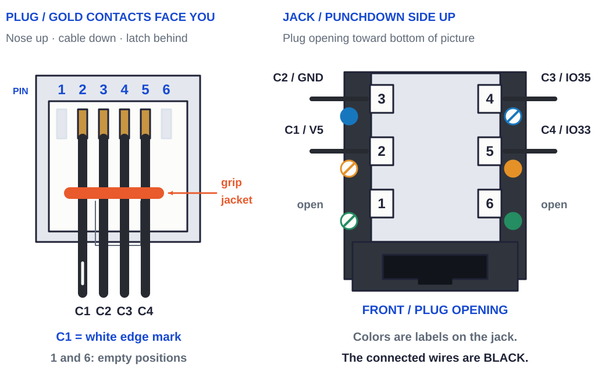

# Cable assemblies

The bench-fabrication procedure for the appliance's internal low-voltage harnesses. Every cable assembly is **built complete and tested off the chassis**, then landed during [`wiring.md`](/hardware/assembly/wiring.md). This doc is the *fabrication* view (cut, terminate, sleeve, test); `wiring.md` is the *install* view (route, land, strain-relieve).

## Why pre-built, tested assemblies

The appliance ships sealed and is **not field-serviced** — a fault returns the whole unit, and the repair is to swap the affected cable assembly for a freshly-built, tested one, never to trace and re-crimp a single conductor (if one termination failed, the assembly is suspect end-to-end). Two consequences drive every choice below:

- **A loom is ribbon, cut to its longest leg.** The [AC wiring schedule](/hardware/wiring/ac-wiring-schedule.md) supplies conservative preparation lengths with termination and dressing reserve; trim each conductor at its landing. The [installed wiring model](/hardware/wiring/README.md) records the nominal paths separately. A loom's conductors leave the board together and part only where the branch is: one ribbon cut keeps the shared cruise together. The stock is sold in 3P, 4P and 5P, and one or two of them make every count the board's wafers ask for — see § Ribbon pairs. Bulk wire supplies the branches downstream of the lever nuts.
- **All-black wire.** Per-conductor color is a field-tech's fault-tracing aid, which this model never uses: the build is jig-and-test, the repair is replace-the-assembly, and the conductors are splayed during crimping where color does nothing. All-black also matches the appliance's monochrome language (PET-GF, PCB, John Guest fittings, LLDPE). **Exception — AC mains:** black hot / white neutral / green ground, a safety/code convention (not a service aid) for the line-voltage runs, and hidden inside the black sleeve anyway.

## Scope

In: the cut list (lengths + terminations) from [`/hardware/wiring/ac-wiring-schedule.md`](/hardware/wiring/ac-wiring-schedule.md) "Run table"; the assembly endpoints (board connectors J1–J11 + J13) from [`/hardware/pcb/pcba/pcba.tsx`](/hardware/pcb/pcba/pcba.tsx); bulk wire, sleeve, ferrules, terminals, and Wago lever nuts from [`/hardware/ledger/bom.md`](/hardware/ledger/bom.md) §11.

Out: a set of labelled, continuity-tested cable assemblies, ready to land per [`wiring.md`](/hardware/assembly/wiring.md).

Not in scope: routing, strain-relief, and landing into the chassis ([`wiring.md`](/hardware/assembly/wiring.md)); the AC mains in-place runs; firmware.

## Stock & tooling

Every loom is **BNTECHGO 22 AWG black silicone ribbon** — 3P, 4P and 5P, one or two ribbons per loom (§ Ribbon pairs). Its conductors are hand-crimped into **SXH-001T-P0.6** contacts and seated in the XH housing its wafer takes; [`/hardware/ledger/bom.md`](/hardware/ledger/bom.md) §11 carries housings and loose terminals in 4, 5, 6, 7 and 9-way kits. Bulk silicone, 600 V, cut-to-length covers what a loom is not: **22 AWG black** for the fan-out branches downstream of the lever nuts — a valve's COM leg, a reed's GND leg, XH at neither end — **28 AWG 4P black ribbon** for the umbilical, and **16 AWG stranded 5-color** (pump leads and green ground bonds), plus **16 AWG solid black/white/green** for the fixed runs AC-1/2/3 and DC-1/2/4. The other bought multiconductor run is the GEARit 18 AWG SJOOW 3-conductor compressor lead. A ribbon pair lies flat where a cut bundle lies round, so the sleeve sizes to the pair.

Terminations: stripped solid copper directly into screw cages and WAGO clamps on AC-1/2/3 and DC-1/2/4; insulated bootlace ferrules (Preciva kit) for the retained stranded screw-cage landings; female Faston disconnects (6.3 mm / 4.8 mm) at valves, motors, and fan; the current Frigidaire donor's factory-external electrical interface is Open item 1 in [`wiring.md`](/hardware/assembly/wiring.md); ring terminals to the ground bus + the compressor's terminal-box earth screw; JST-XH housings at the main board's labeled wafers — every loom XH, J7 (REEDS B) included. J7 and J4 (SENSORS) share the same 7P housing, so **label both looms at the housing** and dress them to their own edges: a swapped pair would put J4's 3V3/5V on J7's MCP reed inputs. Distribution / fan-out: **221-413** for the rear mains H/N/G blocks and the core-lid sensor, reed and DC commons; **221-415** for MANIFOLD B COM; **221-420** for MANIFOLD A COM.

Dress: **black PET braided sleeve** — 1/2" for most bundles, 3/4" for the manifold trunk, 1/4" for thin runs; every cut sleeve end finished with heat-shrink so it can't fray; black UV-nylon zip ties, **flush-cut** (no proud tail). Keep DC-5's ribbon bare from the +X flank to the motor tabs: below the funnel frame, through the lead bore and in the clamp's lead slot and crown grooves. Tools: ferrule crimper (Preciva 28–5), Faston/insulated-terminal crimper (Haisstronica 22–10), JST-XH crimper (iCrimp SN-2549), impact punchdown tool (Klein VDV427-300) and modular-plug crimper (VCE) for the SIG-6 rear keystone and separate umbilical plug, wire stripper (Klein 11063W), flush cutters, heat gun, multimeter — see [`/hardware/ledger/tools.md`](/hardware/ledger/tools.md).

### Ribbon pairs

The stock is 3P, 4P and 5P. One or two of them make every count from three to ten — 6 = 3+3,
7 = 3+4, 8 = 4+4, 9 = 4+5, 10 = 5+5 — and the board's wafers ask for {4, 5, 6, 7, 9}, so every
loom in the box is one ribbon or two side by side. A 6P is made in this gauge and is not bought:
two 3P cover the one six-way wafer and reach four counts besides.

| Loom | Conductors | Ribbon | Preparation cut per ribbon | Carries |
|---|---:|---|---|---|
| J1 MANIFOLD A | [9](J1_PINS) | 5P + 4P | [550 mm](LOOM_J1) | `OUT1`–`OUT8` to the eight coils, `COM` to the 221-420 |
| J2 MANIFOLD B | [6](J2_PINS) | 3P + 3P | [650 mm](LOOM_J2) | five populated; the conductor that would land in contact 3 is trimmed at the housing, not crimped; FAN sets the blank length |
| J3 FAUCET | [4](J3_PINS) | 4P | [400 mm](LOOM_J3) | the inboard half only, board to the keystone on the +Y wall |
| J4 SENSORS | [7](J4_PINS) | 4P + 3P | [650 mm](LOOM_J4) | the 1-wire and flow pairs (`3V3`/`IO26`, `V5`/`IO25`) on the 4P; the shared `GND` on the 3P, two reserved conductors trimmed at the housing |
| J5 RELAYS | [4](J5_PINS) | 4P | [300 mm](LOOM_J5) | both Teyleten modules |
| J6 REEDS A | [5](J6_PINS) | 5P | [600 mm](LOOM_J6) | reservoir A's column entire — four reeds and the common |
| J7 REEDS B | [7](J7_PINS) | 5P + 3P | [500 mm](LOOM_J7) | reservoir B's column on the 5P; `CLO`/`CHI` on the 3P, third conductor trimmed |
| J9 DISPLAY | [4](J9_PINS) | 4P | [400 mm](LOOM_J9) | the 4.3B's RS485 pair and its 12 V |
| J11 GAS | [4](J11_PINS) | 4P | [600 mm](LOOM_J11) | the MQ-6 |
| J13 PUMPS | [4](J13_PINS) | 4P | [500 mm](LOOM_J13) | both pumps' motor tabs, the pump end split into one pair per pump |

A pair is two ribbons, not a spliced one: they are cut to the same length, laid edge to edge and
dressed as one until the branch point. **Which ribbon carries which conductor is set by where the
conductors part, not by the wafer's pin order** — J7's 5P is the five that climb reservoir B's reed
channel together; J4's reserved IO23/IO27 contacts are unpopulated and its shared ground is retained. Where a pair overfills its wafer by one — J2 and J7 — the
spare conductor is trimmed back at the housing and never crimped.

A loom is cut to its longest leg and the shorter legs are peeled off the web early and trimmed.
Both J2 blanks retain the FAN allowance; its shorter valve and common legs are trimmed at fitting.
The 50 ft spool supplies 15.24 m, so these looms require no length splice. Final connections
between the quadrants are made through the open funnel aperture before its frame and silicone
drop in.

The [installed wiring model](../wiring/README.md) gives each conductor a stable
ID in the populated enclosure, including its attachment direction, proposed
route and modeled length. Its [worksheet](../wiring/enclosure-wiring.csv) is a
routing record, not a finished cut list. Each reservoir column uses one continuous
common with four insulated reed taps; the carbonator pair shares a separate
common. Their Wagos join the column/pair commons to the board return.

### XH contacts

Every board-end termination inside the enclosure is hand-crimped: a ribbon conductor cannot arrive
pre-crimped, since the crimp is what joins it to the housing it shares with its neighbours. The
contact is **SXH-001T-P0.6** — conductor #28 to #22, insulation OD 0.9 to 1.9 mm, tin — and the
ribbon's 1.7 mm conductor sits mid-range in it. Housings and loose terminals come in the CQRobot
XH kits, 4, 5, 6, 7 and 9-way ([`/hardware/ledger/bom.md`](/hardware/ledger/bom.md) §11).

What holds a contact square in the die is a **locator**, and no low-cost tool has one: the contact
is placed by hand and held there. JST's own hand tools do — **WC-110** (#22–#28, side entry) covers
both gauges in this build. With a ratcheting tool and no locator, close the ratchet one click onto
the contact so it is captive, then feed the wire. Splay the ribbon's conductors at the housing end
before crimping so each one enters its die straight; a conductor still webbed to its neighbour
enters at an angle. Rework on a 28 AWG XH termination has a second contact option:
**SXH-002T-P0.6** is the #30 to #26 part, insulation OD 0.9 to 1.3 mm, and its barrel closes on
0.08 mm² near the middle of its range rather than at the floor of the -001T's.

## Procedure (per assembly)

The [J2 bench map](harnesses/j2.md) and [interactive J2 guide](https://homesodamachine.com/cost#j2-harness)
put one complete harness, its ribbon-edge assignment, dressing order, far-end
terminations and provisional attended-time estimate together. Its ribbon and
stripe assignment is a proposed build convention, not an observation of the
completed reference sample.

For each cable assembly in the schedule below:

1. **Cut to length.** For a loom, take the pair and preparation length in § Ribbon pairs; those blanks include termination and dressing reserve. Trim the shorter conductors at their landings. For a fan-out branch or an AC run, use its preparation length from the AC wiring schedule. All-black except the AC mains trio.
2. **Strip & terminate.** Strip to the termination's barrel length and land each end: bare stripped solid for AC-1/2/3 and DC-1/2/4, or an insulated ferrule for a stranded screw landing (correct barrel length, one conductor per ferrule unless a specified twin ferrule joins two stranded leads); a female Faston at a valve/motor tab; a ring at a ground stud; an XH pin into its housing. No solder splices on any field-serviceable branch.
3. **Fan-out / distribution.** Where a shared rail feeds many devices, land the feed and all branches in the assembly's Wago lever nut. The manifold COM blocks sit in front-top's east-wall holders. The sensor, reed and DC common blocks sit on the core lid; the three mains blocks sit on the rear wall. Seat each block in its holder with its ports and levers accessible. Reservoir A's continuous common returns directly to J6. The stations are tabled in [`ac-wiring-schedule.md`](/hardware/wiring/ac-wiring-schedule.md) "Loom terminations".
4. **Sleeve & dress.** Lay a pair edge to edge, web flat, and slip it into black braided sleeve sized to the pair; heat-shrink each cut end; flush-cut every zip tie. A ribbon needs no combing. Keep DC-5 bare end to end.
5. **Test.** Continuity end-to-end, pin-to-pin against the schedule; confirm no short between adjacent conductors; on the manifold and reed assemblies verify the Wago commons exactly the intended pins. **Label the assembly by name, not per-conductor.**
6. **Bag & stage** for [`wiring.md`](/hardware/assembly/wiring.md).

## Assembly schedule

Conductor counts are the main board's connector pin counts (`pcba.tsx` J1–J11 = {[9](J1_PINS), [6](J2_PINS), [4](J3_PINS), [7](J4_PINS), [4](J5_PINS), [5](J6_PINS), [7](J7_PINS), [4](J8_PINS), [4](J9_PINS), [2](J10_PINS), [4](J11_PINS)}, J13 = [4](J13_PINS); there is no J12, and J14 is the USB programming port — no loom). The fan-out to the 11 valves (10 manifold + V-K) / many reeds happens **at the device end**, downstream of the connector — so each trunk carries its connector's count, never the fanned-out total.

| Assembly | Board conn. | Conductors | Wire | Terminations | Sleeve |
|---|---|---|---|---|---|
| Manifold A | J1 | [9](J1_PINS) (8 OUT + COM) | 22 AWG black 5P + 4P ribbon | Fastons at 8 valves; COM → **221-420** fan-out at the manifold | 3/4" |
| Manifold B | J2 | 5 of [6](J2_PINS) (2 OUT + FAN + COM + OUT3) | 22 AWG black 3P + 3P ribbon | **XHP-6 housing, contact 3 (`OUT4`) left empty** — see below; Fastons at 2 valves + fan; `OUT3` + a `COM` tap to V-K on back-top’s east sidewall mount (DC-9); COM → **221-415** | 1/2" |
| Reservoir A reeds | J6 | [5](J6_PINS) (4 reed + GND) | 22 AWG black 5P ribbon | one ribbon board to column, a conductor given up at each reed height; continuous GND returns directly to J6 | 1/4" |
| Reservoir B + carb reeds | J7 | [7](J7_PINS) (6 reed + GND) | 22 AWG black 5P + 3P ribbon | reservoir B's column on the 5P, the two carbonator reeds on the 3P; female JST-XH housing (XHP-7) + XH contacts — the same 7P housing as SENSORS (J4), so **label both looms at the housing** (a swap would put J4's 3V3/5V on the MCP reed inputs); GND → **221-413** on the core lid aft of the PCB | 1/4" |
| Sensors | J4 | [7](J4_PINS) | 22 AWG black 4P + 3P ribbon | the DS18B20 and flow pairs on the 4P; shared GND on the 3P with its reserved pair trimmed; GND → **221-413** on the core lid forward of the PCB | 1/4" |
| Relays | J5 | [4](J5_PINS) (`IO19` / `IO2` / `V5` / GND) | 22 AWG black 4P ribbon | XH at J5; screw terminals at both relay modules, `V5`/GND teed to both at the relay end (LV-1/2/3 — lands in the column at [`electronics-bay.md`](/hardware/assembly/electronics-bay.md)) | 1/4" |
| Faucet display | J3 / SIG-6 | [4](J3_PINS) (TX / RX / 5 V / GND) | 22 AWG black 4P ribbon | **Ends at the wall, not at the faucet** — XH on J3, 110 IDC on the back of the keystone jack the umbilical plugs into. The ribbon outboard of that jack is the umbilical's, built at [`faucet-and-umbilical.md`](/hardware/assembly/faucet-and-umbilical.md). **The TTL lines are ESD-clamped on the main board at U1** (D10/D11, 2× low-cap TVS — see the ESD note below); a faucet-end TVS is now optional | 1/2" |
| Enclosure display | J9 / SIG-7 | [4](J9_PINS) (`B` / `A` / GND / `V12`) | 22 AWG black 4P ribbon | A/B pair to the 4.3B's RS485 terminals; `V12` + GND to its 7–36 V screw input on the same loom | 1/2" |
| Gas sensor | J11 | [4](J11_PINS) (GND / `V5` / `DOUT` / `AOUT`) | 22 AWG black 4P ribbon | MQ-6 leads | 1/4" |
| Pumps | J13 / DC-5 | [4](J13_PINS) (`AM2` / `AM1` / `BM2` / `BM1`) | 22 AWG black 4P ribbon, [500 mm](LOOM_J13) | XH contacts at J13; four insulated female Fastons on the pump-motor tabs, crimped after the free end passes front-top's lead bore | — |
| 12 V input | J10 / DC-4 | [2](J10_PINS) (`V12` / GND) | 16 AWG solid | bare solid copper in the J10 screw cages; from the electronics bay's 12 V distribution block (lands in the column at [`electronics-bay.md`](/hardware/assembly/electronics-bay.md)) | — |
| AC mains | AC-1…6 | per run | 16 AWG solid on AC-1/2/3; stranded on earth bonds; 18 AWG SJOOW | bare solid or the specified stranded termination → **221-413**; current-donor external-interface connector TBD at compressor; rings to ground | SJOOW jacket on the compressor lead |

### Faucet display (SIG-6)

Build the [400 mm](LOOM_J3) inboard loom from **black 22 AWG 4P ribbon**. Its XH housing plugs
into J3; its other end punches down onto the **RiteAV CAT3 USOC jack**.
The separate [1 m](EXTERNAL_SIG6) outboard ribbon is black 28 AWG: mark one edge white at both free ends,
call that edge **C1**, and count C1-C4 across from it before separating wires.

| Inboard J3 lead | Jack IDC pin and printed label | Outboard plug pin | Outboard ribbon wire | Display pad |
| --- | --- | ---: | --- | --- |
| Pin 3 / V5 | 2 / white-orange | 2 | C1, white index mark | VBUS / P1-1 |
| Pin 4 / GND | 3 / blue | 3 | C2 | GND / P1-3 |
| Pin 2 / IO35, main RX | 4 / white-blue | 4 | C3 | TXD / P1-5, GPIO43 |
| Pin 1 / IO33, main TX | 5 / orange | 5 | C4 | RXD / P1-7, GPIO44 |

All four inboard leads are black; the colors in this table identify **labels
printed on the jack**. Punch the insulated lead from **J3 3/V5 into jack 2,
J3 4/GND into jack 3, J3 2/IO35 into jack 4 and J3 1/IO33 into jack 5**.
Leave jack terminals 1 and 6 open. Use the 110 tool with its cutting edge
outward and refit the dust cover after trimming. At the outboard plug, gold
contacts face you, nose up, cable down and latch behind: **C1-C4 occupy
positions 2-5 left to right**, with positions 1 and 6 empty.

With the PCB component side up and J3 on the lower edge, its silk reads
**GND, V5, IO35, IO33 left to right**, corresponding to physical pins
**4, 3, 2, 1**. The wafer's 180-degree rotation is included in those numbers
([`pcba.tsx`](../pcb/pcba/pcba.tsx), [`parts.tsx`](../pcb/pcba/parts.tsx)).
Pages [2](https://homesodamachine.com/read/faucet-assembly-guide/faucet-assembly-guide.pdf#page=2)
and [15](https://homesodamachine.com/read/faucet-assembly-guide/faucet-assembly-guide.pdf#page=15)
show the same assignment at the display and wall connector.

### Pump leads — DC-5

One [500 mm](LOOM_J13) piece of the BNTECHGO 22 AWG 4P ribbon runs from J13 to both pumps'
motor tabs: J13's XH contacts at one end, and at the other the ribbon peeled into its two pairs
back 70 mm, each conductor ending in an insulated female Faston receptacle. From the board it
lies along the bay bulkhead's crown below the funnel frame and turns into front-top's
[lead bore](/hardware/printed-parts/enclosure/enclosure/README.md#the-pump-lead) through the tee
wall. Across the frame gap it enters the top clamp's lead slot and rises through the crown, where
each pair turns along its own crown groove into its pump's terminal well. Feed the free end
through the bore before crimping the Fastons; the [J13 bench guide](harnesses/j13.md) gives the
complete piece.

The ribbon passes the bore and the slot in J13 order, read in machine X with its striped edge
at +X:

| conductor, +X to −X | J13 net | Device |
|---:|---|---|
| A1, striped | `AM2` | pump A, +X |
| A2 | `AM1` | pump A, +X |
| A3 | `BM2` | pump B, −X |
| A4 | `BM1` | pump B, −X |

Ring out each XH cavity to its Faston before the Fastons land, verify no adjacent short, and
verify J13 net-to-tab polarity. The pump's stated normal current is ~0.8 A. Each DRV8870's ISEN
returns through a 0.2 Ω sense resistor ([`pcba.tsx`](/hardware/pcb/pcba/pcba.tsx)), which holds
a starting or stalled pump at 1.65 A nominal, 1.54–1.81 A across tolerances; batch-1 and
batch-2 boards ground ISEN and are bounded only by the driver's 3.7–6.4 A overcurrent
protection.

### MANIFOLD B — the empty contact

J2 is the one loom whose housing is wider than its conductor count. The main board's wafer is [6](J2_PINS)-way, labelled from contact 1 `COM`, `FAN`, `OUT4`, `OUT3`, `OUT2`, `OUT1` ([`pcba.tsx`](/hardware/pcb/pcba/pcba.tsx)) — and `OUT4` drives no valve. It is a fully-routed spare channel, so the harness crimps **five contacts into an XHP-6 and leaves contact 3 empty**.

**Contact 3 is in the middle of the housing, not on an end.** Crimp the five in their labelled positions and skip the third; do not close the gap. A loom that fills contacts 1–5 consecutively lands every conductor one position off — `FAN` on `OUT4`, `COM` on `FAN` — which puts the shared 12 V rail on a driver output. The empty cavity is the guard, so leave it empty and verify it at the step-5 continuity test.

## Faucet-display ESD protection (SIG-6)

The faucet flavor LCD is the one user-touched surface at the far end of a ~1 m umbilical, so its
TTL UART pins are the main board's most exposed ESD path. The **primary** clamp is now **on the main board, at
the ESP32** — so no cable-assembly step is required for ESD; the faucet-end TVS drops to an optional
belt-and-braces extra. The protection is:

- **On the main board (primary — required, already placed):** each faucet TTL line is clamped at U1 by a
  low-capacitance TVS shunting the U1-side of its series resistor to the GND plane — **D10 on IO33
  (TX) and D11 on IO35 (RX)**, onsemi **ESD9B3.3ST5G** (SOD-923, 3.3 V working / bidirectional,
  ~15 pF, LCSC C96512). Each sits after its series resistor (topology: J3 → 220 Ω → clamp-at-the-IC →
  U1), with the shunt riding a **via-in-pad straight to the GND plane** — the shortest possible loop,
  which is what sets clamp effectiveness. A strike arriving up the ribbon is current-limited by the
  220 Ω and clamped to ~3.3 V at the ESP32 pin. See `pcb/pcba/jlcpcb-parts.md` (D10/D11) and
  `pcb/pcba/pcba.tsx` (FAUCET block). This mirrors the RS485 side, where D1 (SM712) clamps the A/B
  pair at J9.
- **At the driver end (series backstop — already on the main board):** R26 (IO33) and R27 (IO35), ~220 Ω
  0402 in series in each line, give series damping on the long-cable edges and set the current limit
  that lets the on-board clamp do its job. They are the series element of the clamp topology, not a
  standalone protection.
- **At the faucet-display end (optional — NOT required):** because the main board now clamps the ESP32
  pin, a cable-end TVS is no longer needed. If a builder wants defense-in-depth at the user-touch
  source, the same low-cap part class works: **2× ESD9B3.3-class / PESD3V3-class, ≤ 15 pF, SOD-923**
  (e.g. onsemi ESD9B3.3ST5G or Nexperia PESD3V3L1BA), one from each TTL line to the faucet-side GND on
  the last ~10 mm of ribbon, shortest loop. This is a build-time option, not a build requirement.

The 5 V and GND ribbon conductors need no clamp (5 V is a rail, GND is the return); only the two TTL
signals are protected.

## Sources
[value](NAME) texts are updated by:
- `/hardware/assembly/_cable_assemblies_sync.py`
