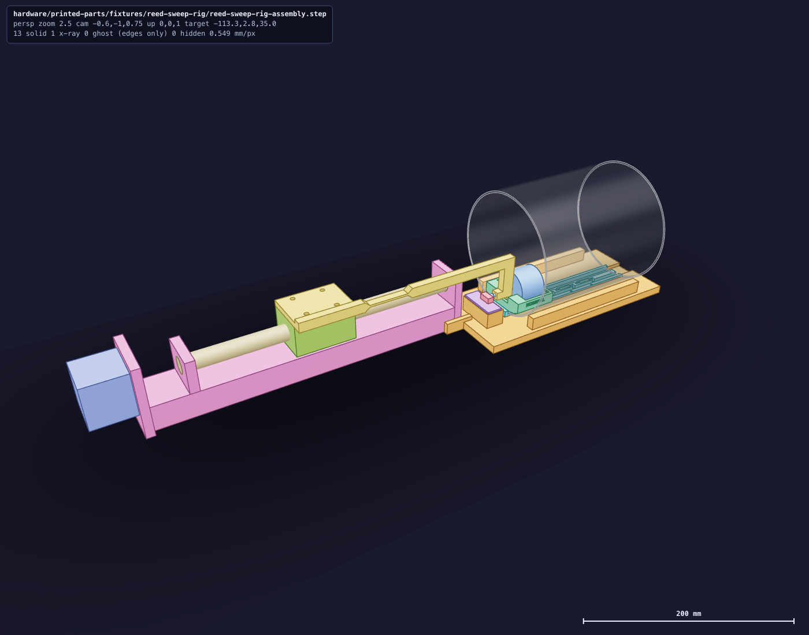
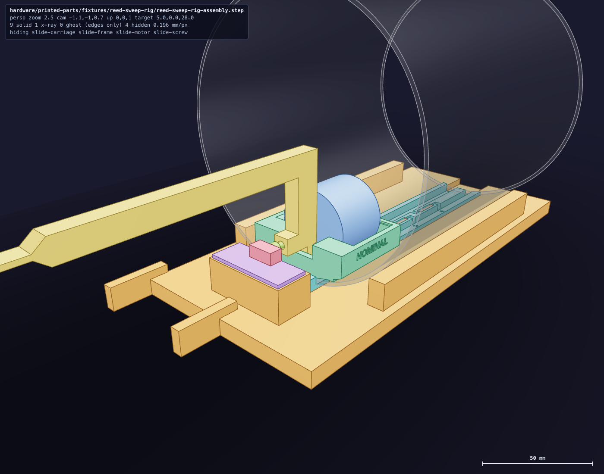
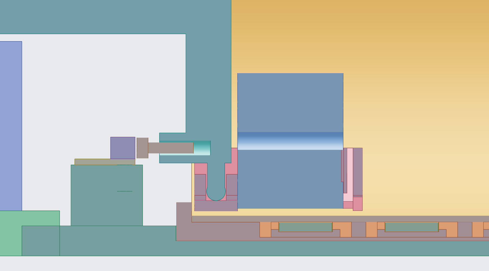

# Reed sweep rig

This bench rig measures where a level reed closes and opens as the float's magnet passes it. A
ball-screw slide pushes a finished Aero float along a bare carbonator tube. The reeds lie under
the tube's wall on a printed comb. A controller counts the slide's steps and logs every reed
change against the count.

It does by motor the sweep in step 3 of the float's
[reed calibration](/hardware/printed-parts/cold-core/magnetic-float/all-aero/installation.md#reed-calibration),
and what it measures goes in
[`reed-calibration.json`](/hardware/printed-parts/cold-core/magnetic-float/all-aero/reed-calibration.json).

**Status.** The bought parts are on order and nothing is printed. The controller's program is
written and has run on no board. The log reader is not written.

## What it is made of

| Element | Part |
|---|---|
| Motion | Befenybay BE069-2 ball-screw slide with its NEMA 17 motor and lead |
| Drive | BIGTREETECH TMC2209 V1.3 on one ZXXP driver carrier |
| Motor power | BTF-LIGHTING 12 V adapter and its female barrel connector |
| Controller | one DORHEA ESP32 on its screw-terminal breakout, powered and read over USB-C |
| Home | one R REIFENG endstop switch with its lead |
| Under test | a bare carbonator tube, a finished Aero float, up to four reeds |
| Printed | cradle, reed comb, push rod and three float sleds, in PET-GF |
| From stock | three ruthex M3 inserts, two 316 stainless M3 × 8, one 304 stainless M3 × 12, four M4 screws and washers from the SVLING kit, Dupont jumper wires |

The orders are in [purchases.md §12](/hardware/ledger/purchases.md). The printed pieces, their
print files and the fits that have not met the bench are in
[`fixtures/reed-sweep-rig/`](/hardware/printed-parts/fixtures/reed-sweep-rig/README.md).

## Keep steel away from the float

The reeds answer the float's magnet, and steel near either bends the field. The rod is as long
as it is so the slide's screw and bearings stay clear. Build the rig on a wooden or plastic
top. The three screws near the tube's mouth are stainless: use the ones named. While a sweep
runs, keep tools, rules and loose screws a hand's width from the tube.

## Print

Two plates of black PET-GF, no supports: the cradle, and the rod, comb and three sleds. Each is
sliced for Mark1 and for Mark2, and the slices are linked from the
[fixture's print table](/hardware/printed-parts/fixtures/reed-sweep-rig/README.md#print).

## Build

1. **Inserts.** Melt a ruthex M3 insert into each of the two holes on top of the cradle's
   switch pad, and one into the hole in the end of the rod's finger.
2. **Home switch.** Lay the endstop board on the pad with its switch toward the tube and screw
   it down through the two holes that flank the switch, with the two 316 stainless M3 × 8.
3. **Striker.** Thread the 304 stainless M3 × 12 into the finger's insert, head toward the
   switch, most of the way in. Its head is what presses the switch, and step 12 sets it.
4. **Rod on the carriage.** Turn the slide's coupling by hand until the carriage stands near
   the middle. Lay the rod's pad on the carriage with the bar hanging off the carriage's side
   and the leg at the end away from the motor, pointing down. Fasten it with four M4 screws
   and washers. A screw must stand out under the pad by less than the carriage's thread is
   deep: try one in a bare hole first, and add washers under its head if it bottoms.
5. **The rod is a hinge.** The thin stretch beside the pad lets the rod's far end rise and
   fall. Lift the rod only by that end, and only as far as a sled needs.
6. **Reeds.** Each reed lies in a numbered pocket of the comb with its glass pushed toward the
   comb's tab. Its lead on the tab side runs out along a slit and turns into the wide groove:
   solder a thin jumper wire to it there. That is the reed's signal wire. Its other lead turns
   into the narrow groove: solder one return wire along that groove to every reed's lead. Trim
   each lead so it ends in its groove. Support the lead with pliers between the glass and any
   bend. All wires leave by the comb's end away from the tab. Nothing may stand above the
   comb's middle strip, where the tube rests.
7. **Comb and tube.** Set the cradle on a level top. Drop the comb into its pocket, tab toward
   the cradle's switch pad, wires out through the trough. Lay the tube on the comb between the
   keepers with its weld seam up, and push its rim against the tab.
8. **Slide.** Stand the slide's end away from its motor between the cradle's two cheeks and
   push its end plate against the cradle. The bar runs over the switch pad into the tube's
   mouth.
9. **Float in a sled.** Start with the sled marked `NOMINAL`. Press the float's bottom face,
   the face that was on the print bed, against the sled's datum wall, which is the wall beside
   the slot. Push it down into the vee past the leaf.
10. **Sled in the tube.** Slide the sled into the tube from the far end, slot first, until it
    stands at the mouth. Lift the rod's end, bring the sled under it, and lower the roller into
    the slot.
11. **Read the float's gap.** From the tube's far end, slide a gauge pin or a drill's shank
    under the float through the window in the sled's back wall. The gap it finds is the
    sled's `float off the wall` line in the program's `--fits` report.
12. **Set the striker.** Hold a bank card between the sled's near face and the comb's tab, and
    turn the coupling by hand until the sled just grips it. With your fingers, turn the striker
    screw out toward the switch until the switch clicks, then draw the card out. The switch now
    trips a card's thickness before the sled reaches the tab, and that is where the controller
    takes home to be.

## Wiring

The breakout's screw terminals carry the ESP32's pin names. The driver carrier has a
three-by-three header: its row `S` holds the three signals, `V` the logic supply and `G` ground.

| From | To |
|---|---|
| Breakout `3V3` | carrier header `V`; endstop lead, red |
| Breakout `GND` | carrier header `G`; endstop lead, black; the reeds' return wire |
| Breakout `P25` | carrier header `S` under `STEP` |
| Breakout `P26` | carrier header `S` under `DIR` |
| Breakout `P27` | carrier header `S` under `EN` |
| Breakout `P33` | endstop lead, green |
| Breakout `P16`, `P17`, `P18`, `P19` | signal wires of the reeds at stations 1, 2, 3, 4 |
| Barrel connector `+` / `−` | carrier terminal `VIN` / `GND` |
| Motor lead | carrier's white socket |
| ESP32 USB-C | the Mac |

The 12 V adapter feeds only the carrier's `VIN`. Never bring 12 V to the breakout. The
carrier's `V` takes the breakout's 3.3 V, so the driver's inputs sit at the ESP32's level.

Before the first power:

- **Driver.** Plug the TMC2209 into the carrier with its pin names over the carrier's: its `EN`
  corner at the carrier's `EN`, its `VS` corner at `VIN`. A driver put in backwards burns.
- **Microsteps.** Leave all three of the carrier's switches off. The driver then makes eight
  microsteps to a full step.
- **Motor lead.** The motor has two coils: by the slide's listing, black with green and blue
  with red. Each coil's two wires belong on `1A`/`1B` or on `2A`/`2B`. A lead whose pairs are
  split across those makes the motor buzz without turning. Plug and unplug the motor lead only
  with the 12 V adapter off.
- **Current.** With the motor lead out and both supplies on, measure from the driver's trimmer
  to ground and turn the trimmer clockwise until it reads about half a volt. The screw turns
  the motor's torque into a push many times what the sled needs. At the setting the driver
  comes with, that push could snap the rod's stem if the home switch were ever missed.
- **Home switch.** Press the switch's lever by hand. The board's light answers.

## Controller

The ESP32 runs the rig's own program, [`firmware/src_reed_rig/`](/firmware/src_reed_rig/README.md).
Its pins are the wiring table's, and its commands and the lines it prints are in that README.
Flash it over the board's USB-C:

    pio run -e reed_rig -t upload --upload-port <port>

The console is the same USB at 115200 baud. `help` lists the commands.

## First run

With the sled in the tube near its middle and the roller in the slot:

1. **Reeds.** Lift the rod's end and slide the sled along the tube by hand. The console prints
   an `R` line each time a reed changes, with its station's number.
2. **Home switch.** Send `status` with the lever free and again with it held down. It reads
   `home free`, then `home pressed`. If it reads them the other way round, send
   `homelevel low`.
3. **Direction.** Send `jog 5`. The sled moves into the tube. If it moves toward the slide,
   send `dirinvert on`.
4. **Home.** Send `home`. The sled comes back to the switch, backs off, creeps onto it and
   stops. The controller refuses to seek a switch it has not seen change since power-up, so
   step 2 comes first.
5. **A sweep.** Send `sweep 2 100`. The sled runs out to 100 mm from the tab and back at the
   controller's own sweep speed, and the console prints a `P` line as each leg begins, an `R`
   line at each reed change and an `E` line as the leg ends.

Any line sent while the sled moves stops it.

The lines of a sweep are its whole record. Turning them into each reed's closing and opening
places along the tube takes
[`reed-sweep-rig-datums.json`](/hardware/printed-parts/fixtures/reed-sweep-rig/reed-sweep-rig-datums.json)
and a log reader, which is not written.
