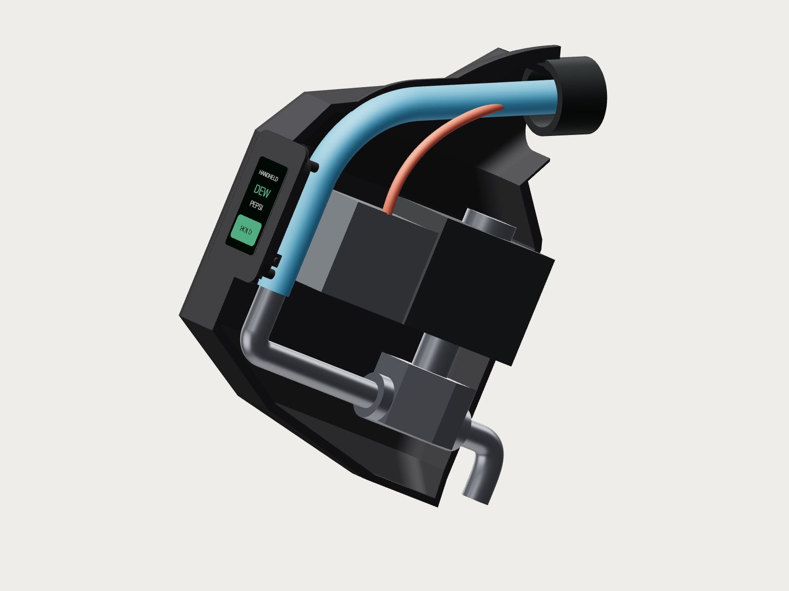
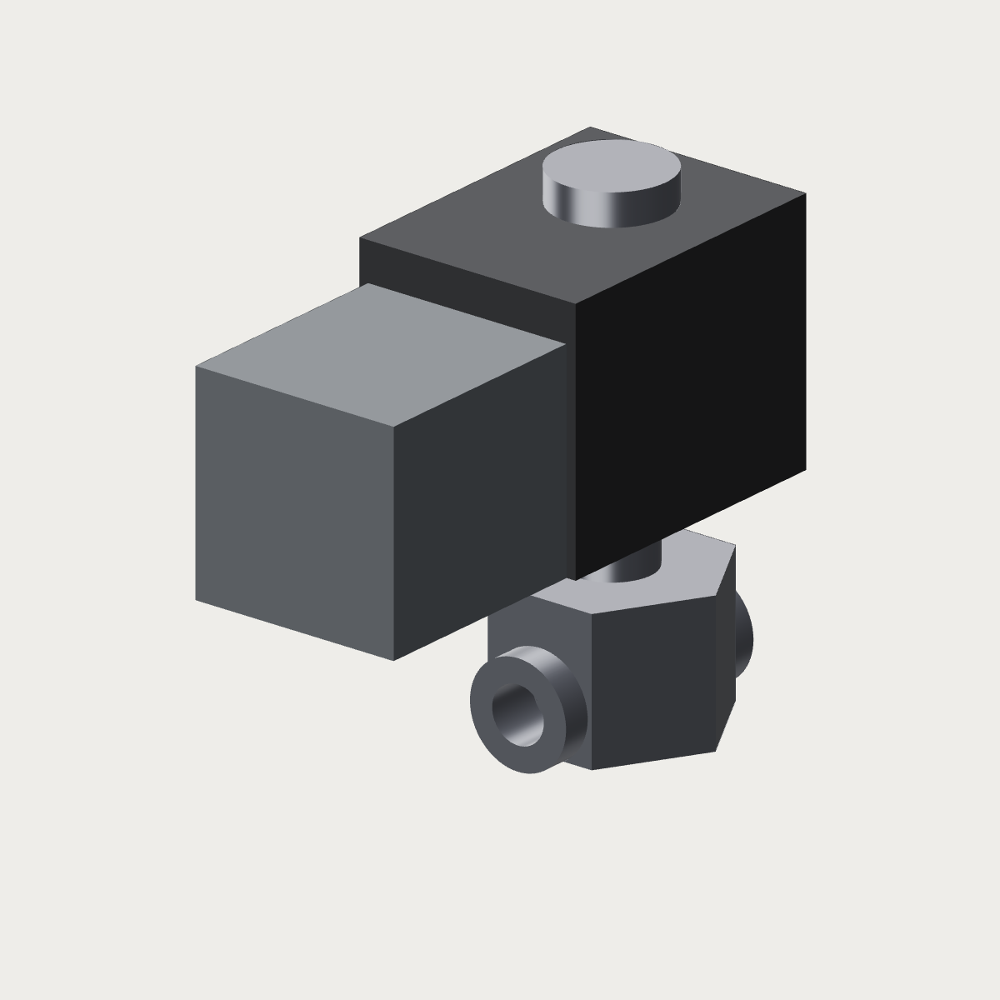
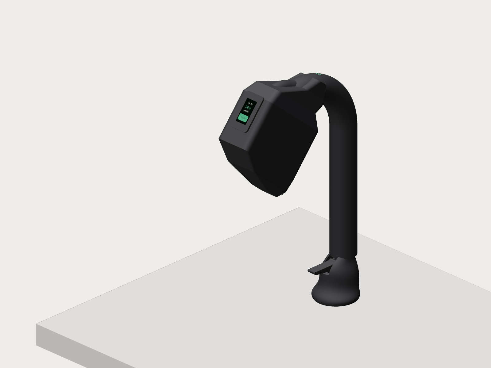
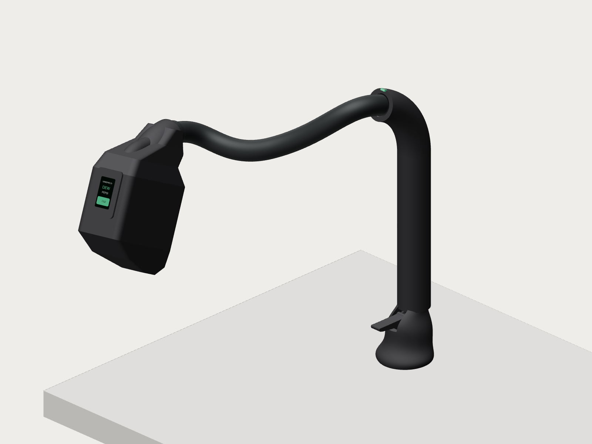
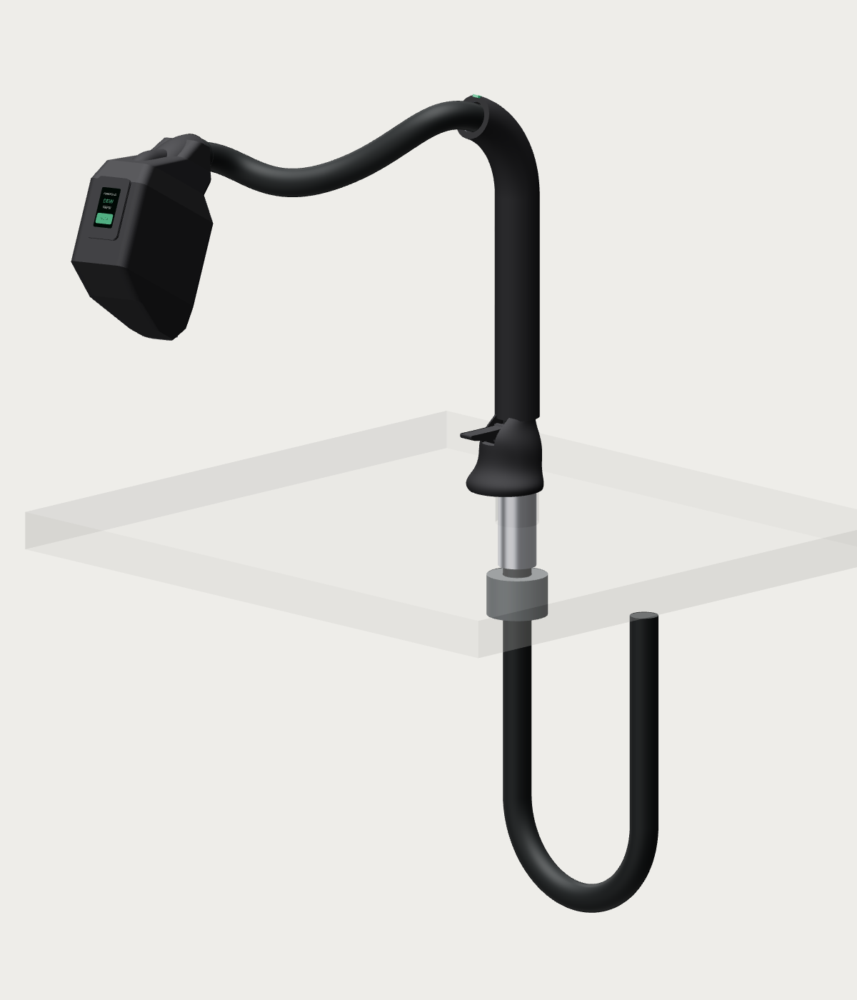
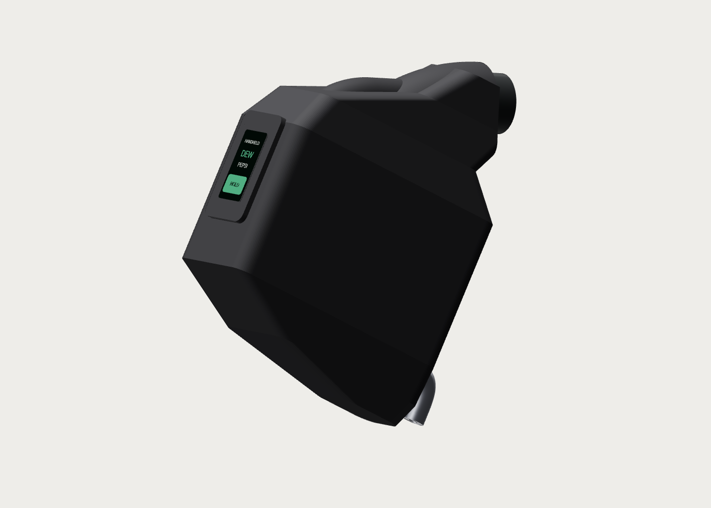

# Pull-out Sculpted faucet concept

The curved front of the Sculpted faucet pulls out with its display and dispense
face. Its keyed magnetic seat stands at the crown. Docked, the base lever commands
dispensing; undocked, the display offers flavor selection and hold-to-pour control.
A presence sensor in the seat selects the mode. The fluids stay connected while
the head moves, and their outlets remain separate at the dispense face.

The study imports the current faucet's lower shell, lever and display. A fuller,
taller neck surrounds a smooth sliding-bundle passage. The removable head contains
an electronic water shutoff, its connector, the display, an inlet adapter and a
short outlet nozzle. The extended straight stem restores glass clearance under
the larger head. The lever stands in its familiar position as an electrical
input. The valve closes in the head so the moving soda hose remains pressurized
between pours.

## Selected electronic valve

Use the ODE **21L1K1T25U24** for the wet prototype. It is a normally closed,
direct-acting stainless valve with a PTFE seal. ODE's
[series sheet](https://filemanager.ode.it/web/en/general-catalog-page_21L-series.pdf)
permits mounting in any position and gives the operating differential for the
selected coil. Its [individual data
sheet](https://cdn.shopify.com/s/files/1/0503/8833/6813/files/21L1K1T25.pdf?v=1659735891)
includes drink service. The selected voltage, power, pressure, flow coefficient,
stock observation and price are recorded in [valve-selection.json](valve-selection.json).

[Hydronics Depot's selected stock option](https://hydronicsdepotinc.com/products/ode-21l1k1t25?variant=68184874483885)
includes the leaded DIN connector. Its product page shows real photographs;
[the shop's shipping policy](https://hydronicsdepotinc.com/pages/shipping-policy)
lists express service to the United States. Availability and price are the
recorded observation, not a delivery promise.

The cutaway reconstructs the valve's dimensional envelope from the drawings.
The DIN plug is a reserved envelope rather than a detailed supplier model. The
head puts the display above the plug and routes the soda hose above both the
coil and plug. Its hose path uses a straight run and a tangent circular bend.
A custom stainless inlet adapter turns into the valve's inlet. A short metal
nozzle leaves the opposite port. Valve power conductors return with the bundle.

The head is deliberately larger to contain this commercial valve. The
[fit observations](fit-review.json) bind the selected clearance questions to the
exported payload. These are packaging observations, not a print or beverage
qualification. The valve has not been tested with this machine. Coil heat,
pour rate, carbonation, shutoff leakage and residual outlet dripping need a wet
test. The flavor and drain routing, hose retention, mounts and seals still need
detailing. The valve's internal downstream passage and short nozzle can retain
water after closure, so locating the valve here does not establish a drip-free
outlet.

[Derek's observation of the working fixed faucet](physical-context.json) records
a quick stop of the main flow followed by fast and then slow outlet dripping
after releasing the lever. The pull-out design must control the much longer
downstream water volume. Closing only the enclosure end leaves the hose open to
the nozzle; pressure falls and dissolved carbon dioxide can leave solution,
driving afterflow and reducing carbonation in retained water. The
[gas-solubility reference](https://openstax.org/books/chemistry-2e/pages/11-3-solubility)
explains the pressure dependence; the expected hose behavior is a design inference,
not a measured pull-out result.

Below the counter, the bundle hangs freely with a return weight and connects to
the enclosure. Its low return bend forms the hanging loop. Pulling out the head
raises the loop and return weight. The enclosure connection supplies the fixed
anchor. No cabinet bracket hangs from the faucet.
The study keeps the loop's path length in balance with the exposed hose. The
weight, dock retention and travel are study parameters, not qualified hardware.

## Recommended hose construction

Make the bundle from separately stocked tubing, a flexible signal cable and a
continuous black protective sleeve. Keep the drink paths separate through the
head. Use flexible beverage tubing through the moving section, with stationary
transitions below the counter. The braid protects and gathers the lines; it is
not a pressure boundary. The drain, display conductors and valve power pair share the bundle.

- Soda: Accuflex Bev-Flex reinforced beverage hose, [sold by the foot at Parts
  Town](https://www.partstown.com/p/lancer/lan172-04102-77), or the blue-trace
  [stock coil at Installation Parts Supply](https://installationpartssupply.com/172-04122-77.html).
  [Accuflex's specification](https://www.accuflex.eu/wp-content/uploads/Bev-Flex-172-series.pdf)
  owns its dimensions, working pressure and bend radius.
- Flavor: [Tygon beverage tubing at U.S.
  Plastic](https://www.usplastic.com/catalog/item.aspx?catid=864&itemid=74410).
  The soft tube is for the pumped flavor path. Its diameter is close to the current
  flavor bore, and its pressure limit belongs to this line's design.
- Outer sleeve: [Techflex Flexo PET, black, by the foot at
  PacRad](https://www.pacrad.com/techflex-expandable-sleeving-pet3-4black.html).

Each linked shop listed the selected item in stock when this study was prepared.
The pages show actual product photos. The recommendation identifies prototype
stock; it makes no production-life or assembled-bundle qualification claim.
Insulation, flexible cable and flavor outlet control still need selection. The
drawn bundle is an envelope: its finished diameter and cold bending resistance
need a physical sample before committing to the neck or grip.

## Views

The published models use the normal Parts viewer:

- [Docked](https://homesodamachine.com/parts#step:faucet-layout%2Fpullout-concept%2Fdocked-above-counter.step)
- [Pulled out](https://homesodamachine.com/parts#step:faucet-layout%2Fpullout-concept%2Fpulled-out-above-counter.step)
- [Under the counter](https://homesodamachine.com/parts#step:faucet-layout%2Fpullout-concept%2Fpulled-out.step)
- [Handheld head](https://homesodamachine.com/parts#step:faucet-layout%2Fpullout-concept%2Fhandheld-detail.step)
- [Head valve cutaway](https://homesodamachine.com/parts#step:faucet-layout%2Fpullout-concept%2Fhead-valve-cutaway.step)
- [Selected electronic valve](https://homesodamachine.com/parts#step:faucet-layout%2Fpullout-concept%2Fselected-electronic-valve.step)













## Generate

`concept.rs` creates this visualization without changing the production faucet.
It is an explicit sandbox example outside the normal print build.

`render.json` fixes the comparison cameras and lights the display graphics. Its
under-counter picture makes the countertop translucent to expose the weight and
the bundle's enclosure end.

Run from the repository root:

```sh
tools/run -- cargo run --release --locked -j2 --manifest-path tools/hsm/Cargo.toml \
  -p hsm-sandbox --example faucet-pullout-concept -- hardware/faucet-layout/pullout-concept
tools/run -- hsm render --jobs hardware/faucet-layout/pullout-concept/render.json
hsm-publish --root .
```

This is an appearance, motion and valve packaging study. It is not a printable
assembly or implemented faucet firmware. The production faucet is unchanged.
