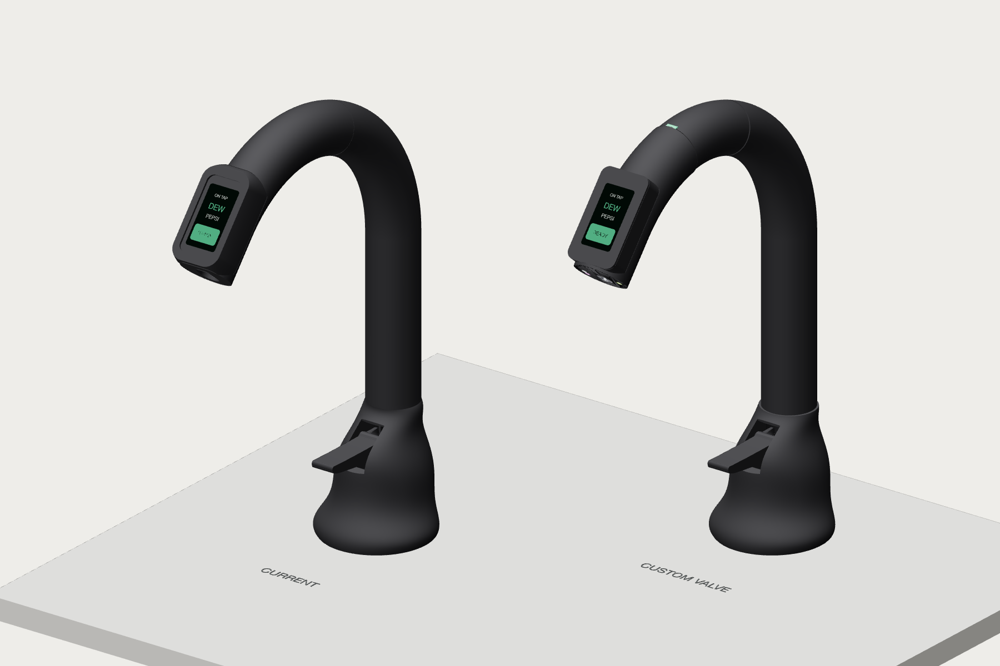
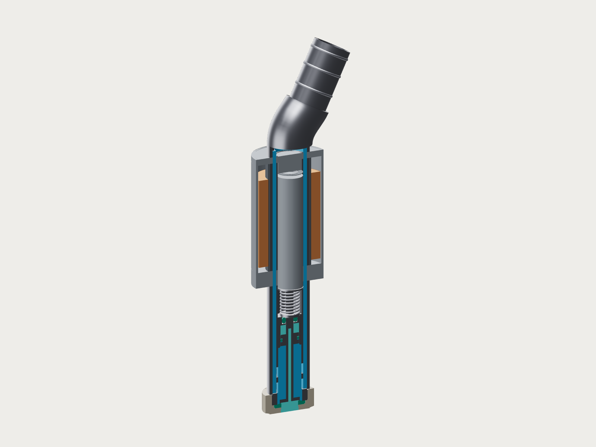

# Slim pull-out Sculpted faucet

This is the custom-valve configuration to aim to manufacture. The faucet keeps
its familiar height, reach, curved neck, base lever and display. Its front pulls
off on the descending side of the neck, carrying the electronic shutoff and
separate drink outlets. The original shell assembly split stays at the crown.
A fixed upper neck continues from that assembly split to the separate pull-out
dock, just behind the valve inlet and hose termination.
The dock sensor selects tap or handheld mode. The bundle stays connected while
the head moves.



[Rotate the comparison](https://homesodamachine.com/parts#step:faucet-layout%2Fpullout-concept%2Fprofile-comparison.step).
The reference and custom assemblies share the counter height and are placed
across the camera's horizontal axis so their heights compare directly.

## Custom valve

The valve stack runs lengthwise behind the existing display. Its pressure sleeve
feeds water around a sealed dry actuator well to the outlet chamber. A hollow
poppet stem connects the outlet to a small wet balance chamber. The balance seal
and outlet seat have matched effective pressure areas, cancelling most of the
hydraulic opening load. The return spring closes the face seal when current is
removed. The valve seat stands at the dispense face, keeping the downstream
liquid volume small while the long hose stays pressurized.

The coil has a closed magnetic return path. Flow-through magnetic spiders connect
the fixed pole and armature guide to the return yoke while passing water through
the cartridge. A separate rod seal isolates the dry armature and spring from the
wet balance chamber. The enclosure supplies current-regulated pull-in and holding
power through flexible conductors. The magnetic stop retains a nonmagnetic gap.

The [pressure-balancing reference](https://patents.google.com/patent/EP1597501A1/en)
describes the established use of matched areas and an outlet-connected bore.
It supports the architecture; it does not validate this valve's geometry or its
use with beverages.


[Rotate the head cutaway](https://homesodamachine.com/parts#step:faucet-layout%2Fpullout-concept%2Fhead-valve-cutaway.step).



[Closed valve](https://homesodamachine.com/parts#step:faucet-layout%2Fpullout-concept%2Fcustom-valve-closed.step)
and [open valve](https://homesodamachine.com/parts#step:faucet-layout%2Fpullout-concept%2Fcustom-valve-open.step)
show the poppet, balance piston, isolated spring, armature, pole bridges and
winding. Blue marks the supply-side water; turquoise marks the small wet balance
chamber. The near pressure walls and magnetic structure are cut for inspection.

## Bundle and dock

The moving bundle contains reinforced beverage hose, separate smaller flavor
lines, a fault drain, flexible signal and valve conductors, thin insulation and
continuous braid. The selected [Accuflex beverage
hose](https://www.partstown.com/p/lancer/lan172-04102-77) supplies the soda path;
its [manufacturer sheet](https://www.accuflex.eu/wp-content/uploads/Bev-Flex-172-series.pdf)
owns its pressure and bend limits. The small-bore flavor and drain lines are
part of this compact configuration and need their compound and flex-life
specification. A factory crimp secures the hose to the cartridge's integral barb.
The head pulls from its dock without opening a fluid joint.

The tubes fan from their compact bundle arrangement into separate lanes around
the actuator. The display moves outward slightly to retain clearance behind its
existing controller. A relieved cradle carries the display above the actuator.
The dry mechanism and the selected tube envelopes fit within the cosmetic shell;
[fit observations](fit-review.json) bind the focused clearance questions to the
exported geometry.


[Rotate the pulled-out faucet](https://homesodamachine.com/parts#step:faucet-layout%2Fpullout-concept%2Fpulled-out-above-counter.step).

Below the counter the weighted bundle hangs freely and returns to the enclosure.
Its low bend rises as the head is pulled. The enclosure connection supplies the
fixed end. The illustrated travel, weight and dock retention are design parameters.

## What the study establishes

[Custom valve design data](custom-valve-design.json) records the source-authored
dimensions, flow and force budgets, winding estimate, pressure target and nominal
outlet-connected liquid volume. The geometry demonstrates the compact packaging.
Electromagnetic force over stroke and temperature, actual seal friction, leak
tightness, pressure qualification, carbonation, sanitation and service life remain
engineering requirements. The volume calculation does not establish a drip-free
outlet. The trim, seals, joining processes and service retention need fabrication
detail before manufacturing.

[Derek's physical observations](physical-context.json) describe the working fixed
faucet, including its flow stop and subsequent dripping. They are not observations
of this custom valve. The production faucet remains the source of the imported
base, lever and display geometry.

## Generate

`concept.rs` creates the native visualization and its design data through the
explicit sandbox example. `render.json` fixes the cameras and display lighting.
The comparison uses the current faucet's exported solids as its reference.

```sh
tools/run -- cargo run --release --locked -j2 --manifest-path tools/hsm/Cargo.toml \
  -p hsm-sandbox --example faucet-pullout-concept -- hardware/faucet-layout/pullout-concept
tools/run -- hsm render --jobs hardware/faucet-layout/pullout-concept/render.json
hsm-publish --root .
```
