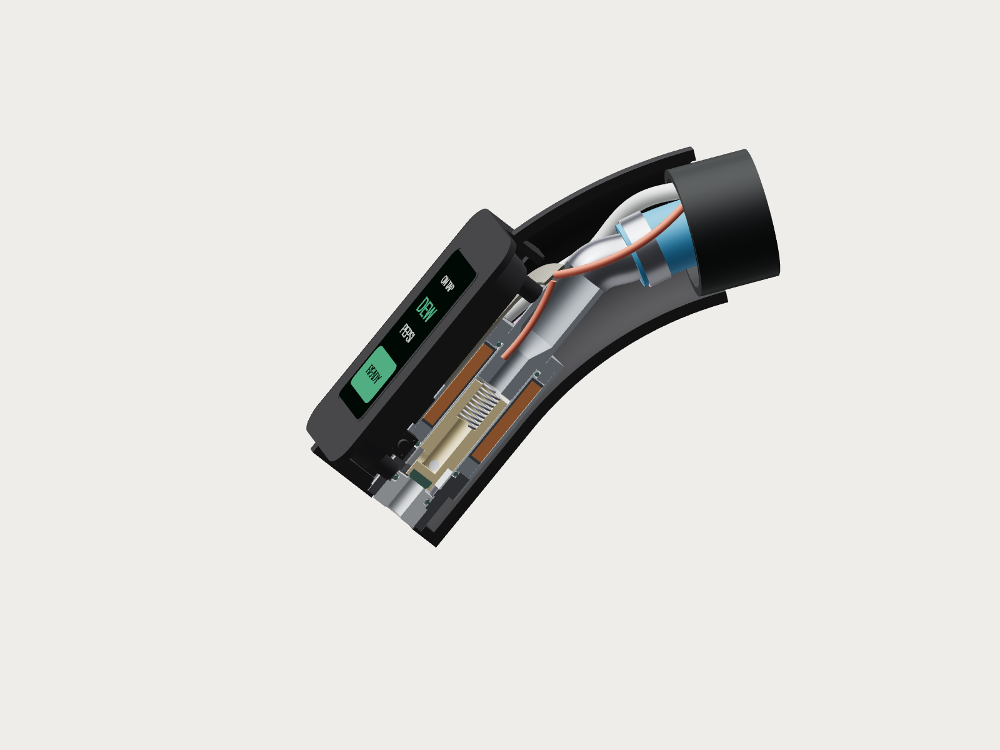
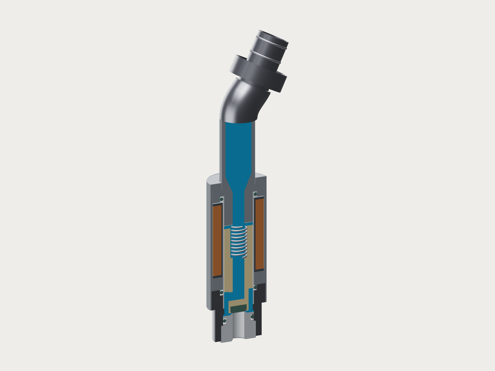
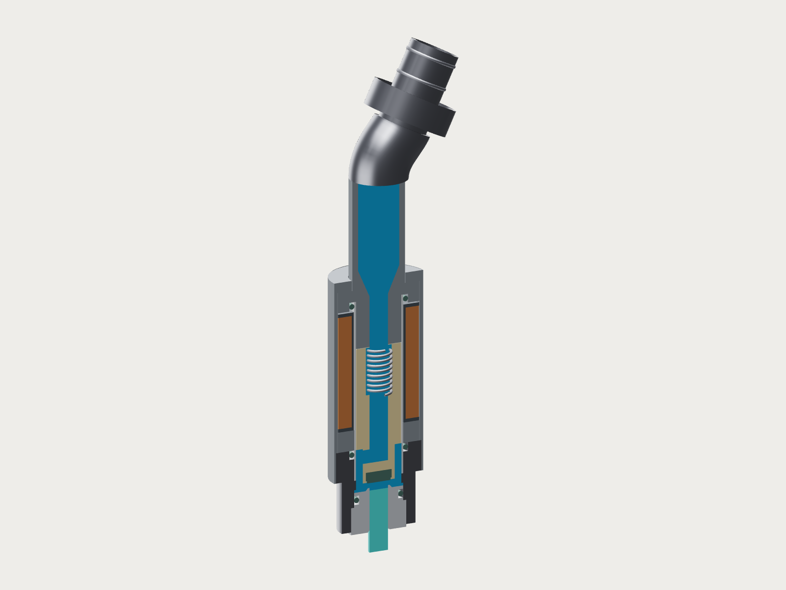
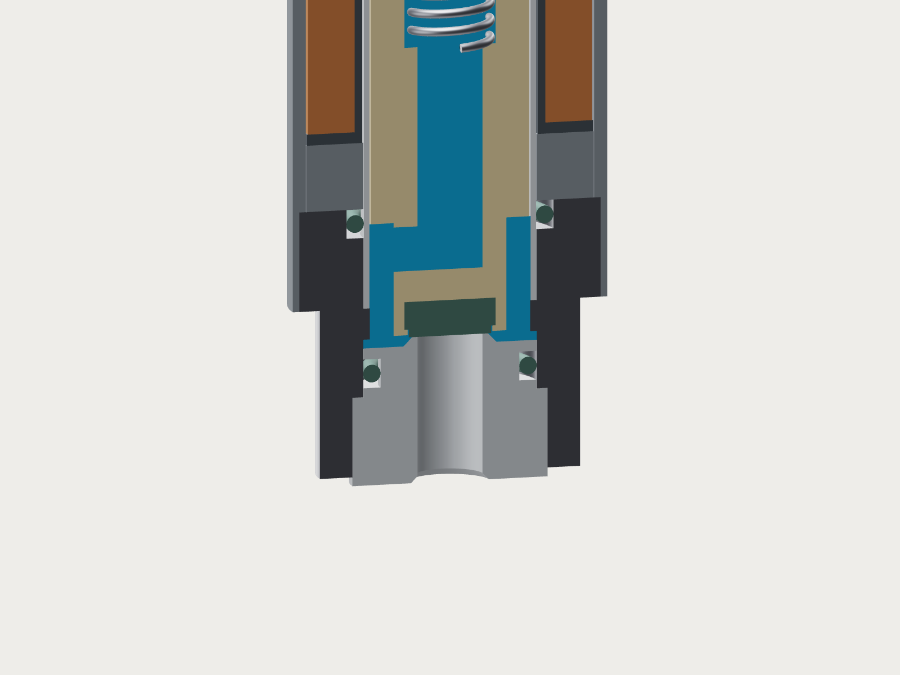
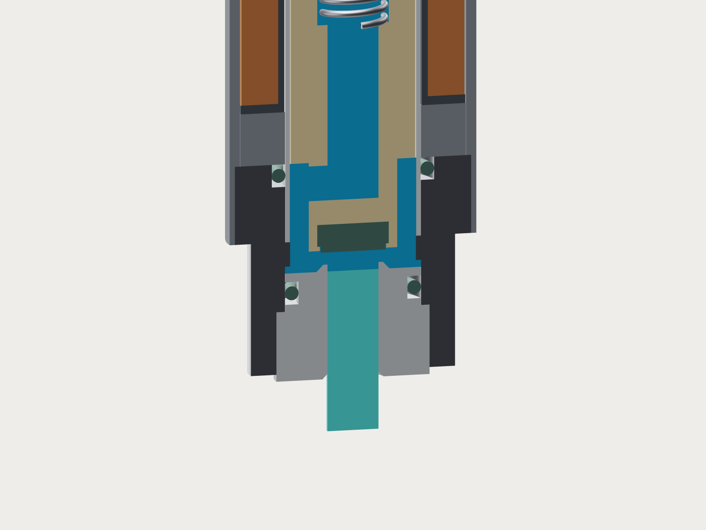
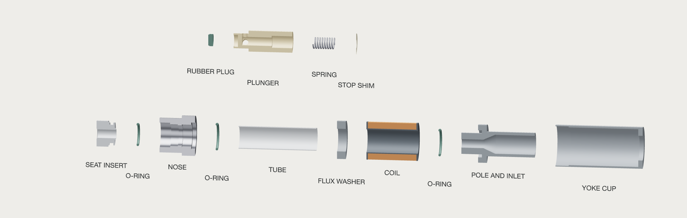

# Direct head valve

This is a shutoff valve with one moving part for the head of the
[pull-out faucet](../README.md). It stands on the concept's valve axis behind the display,
with its seat at the dispense face, and takes the concept's inlet elbow, barb and hose.



[Rotate the head cutaway](https://homesodamachine.com/parts#step:faucet-layout%2Fpullout-concept%2Fdirect-valve%2Fhead-direct-valve-cutaway.step)
or [the whole head](https://homesodamachine.com/parts#step:faucet-layout%2Fpullout-concept%2Fdirect-valve%2Fhead-direct-valve.step).

## How it works

Soda comes down the middle. It enters through the pole, passes inside the spring and along
the plunger's bore, leaves through the plunger's cross holes into the chamber round its nose,
and stands at the seat. The spring and the soda's own pressure hold the plunger's rubber plug
on the seat's raised lip, and the hose behind it stays at pressure.

Current in the winding pulls the
[plunger](https://homesodamachine.com/3d#step:faucet-layout%2Fpullout-concept%2Fdirect-valve%2Fdirect-valve-closed.step?find=solid%3A%20head_valve_plunger)
back onto the pole. The plug lifts off the lip and soda leaves through the seat's bore. With
the current off, the spring returns the plunger. A thin shim on the pole's face keeps the
plunger from holding on after the current stops.

The winding, its bobbin, the flux washer and the yoke cup are dry: they stand outside the
[plunger tube](https://homesodamachine.com/3d#step:faucet-layout%2Fpullout-concept%2Fdirect-valve%2Fdirect-valve-closed.step?find=solid%3A%20head_valve_plunger_tube),
which holds the pressure. The pole, the plunger, the washer and the cup carry the magnetic
flux, and it crosses the tube's wall at the washer. Every seal is an O-ring that stays
still: one on the seat insert and one at each end of the tube. Past the seat there is only
the seat's own bore.





[Closed](https://homesodamachine.com/parts#step:faucet-layout%2Fpullout-concept%2Fdirect-valve%2Fdirect-valve-closed.step)
and [open](https://homesodamachine.com/parts#step:faucet-layout%2Fpullout-concept%2Fdirect-valve%2Fdirect-valve-open.step)
are cut along the axis. The seat, at the same camera:





## The pieces



[Rotate the pieces](https://homesodamachine.com/parts#step:faucet-layout%2Fpullout-concept%2Fdirect-valve%2Fdirect-valve-parts.step).

| Piece | Material | How it is made |
| --- | --- | --- |
| Seat insert | 316L stainless | Turned. Its lip is the seat; it threads into the nose from the dispense face |
| Nose | 316L stainless | Turned, threaded inside for the insert and outside for the cup |
| Plunger tube | Thin-wall stainless tube | Cut from stock tube and squared |
| Plunger | Magnetic stainless | Turned and bored, then cross-drilled in a jig |
| Rubber plug | EPDM | Punched from sheet, pressed into the plunger's pocket, held by a lip rolled over its edge |
| Return spring | Stainless spring wire | Stock compression spring |
| Stop shim | Nonmagnetic stainless shim | Punched |
| Pole and inlet | Magnetic stainless | Turned and bored |
| Flux washer | Magnetic stainless | Turned |
| Coil | Polymer bobbin, magnet wire | Turned bobbin, wound |
| Yoke cup | Magnetic stainless | Turned and bored, threaded at its mouth |
| O-rings | EPDM | Stock |

## Assembly and setting

The tube stands between a shoulder in the nose and the pole's flange, with an O-ring round
each end. The washer and coil slide over it. The yoke cup goes on from the hose end and
threads onto the nose, drawing the pole, the tube and the nose together. The plunger, its
spring and the shim are inside the tube before the pole closes it.

The seat insert threads into the nose last, and its thread sets the plunger's lift: the
insert is run in until the plunger meets the pole, backed out by the lift, and locked.
No piece has to be machined to the lift.

## What the study establishes

[Design data](direct-valve-design.json) records the drawn sizes and their first-order
budgets: the force of the soda on the seat at the machine's regulator feed, across the
Lillium's inlet range and at the relief valve's setting, the spring, the winding and an
estimated pull. [Fit observations](fit-review.json) bind the clearances in the head to the
exported geometry. The geometry shows that the valve fits the concept's head on the
concept's axis.

The pull is an estimate from a one-loop magnetic circuit; a field solution and a bench pull
test have not been done. The valve is drawn open to the pour: where the supply pressure is
shed ahead of the seat, and the outlet's shape, decide foam and the stream, and neither is
drawn. Leak tightness, life, and magnetic stainless and EPDM in cold carbonated water need
tests. The thin tube needs confirming as a stocked size. The elbow's joint to the pole, the
lock on the seat insert and the coil's sealing against condensation need fabrication detail.

## Generate

`direct_valve.rs` draws the valve and writes its design data. It takes the grip, display,
lines and hose end from the concept's exported docked model, so the concept is generated first.
`render.json` fixes the cameras.

```sh
tools/run -- cargo run --release --locked -j2 --manifest-path tools/hsm/Cargo.toml \
  -p hsm-sandbox --example faucet-direct-valve -- hardware/faucet-layout/pullout-concept/direct-valve
tools/run -- hsm render --jobs hardware/faucet-layout/pullout-concept/direct-valve/render.json
hsm-publish --root .
```
