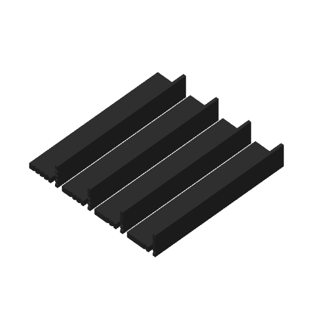
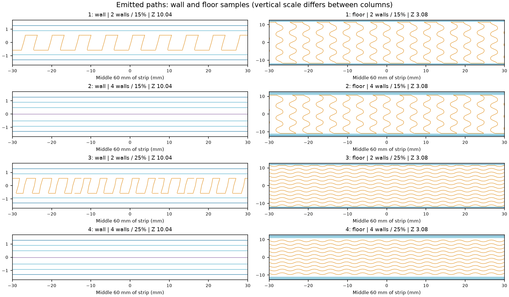

# Enclosure gyroid comparison

The production recipe is **two wall loops and 15% gyroid**. Local solid
reinforcement, six-wall surface bands and part-specific recipes keep their
specified settings. That baseline remains in use unless Derek explicitly asks
for a change. A completed comparison, an observation or no response does not
change it.

This manual comparison asks whether additional walls or denser infill make a
worthwhile difference in hand feel or equal-load bending. Each setting has a
150 × 25 × 3 mm wall strip printed standing and a 150 × 25 × 6 mm floor strip
printed flat. These represent the ordinary wall and floor sections, with the
shared PET-GF process, solid skins and their respective print orientations.

| Notches at one end | Wall loops requested | Gyroid infill |
| --- | --- | --- |
| 1 | 2 | 15% — production baseline |
| 2 | 4 | 15% |
| 3 | 2 | 25% |
| 4 | 4 | 25% |

The shallow identification notches occupy the first millimetre of length.
Every strip has the same central test section. Compare pieces of the same
thickness: 1 against 2 isolates wall count, 1 against 3 isolates density, and
2 against 4 checks density with four walls requested.

After removing any brim, compare bending and twisting by hand. For an optional
equal-load comparison, lay each strip broad-face down across the same two
supports, 120 mm apart with 15 mm overhang at each end. Apply the same centered
load through the same contact and compare deflection after the same interval.
Use the same face up throughout each set; let an unloaded strip recover before
comparing again. Existing blocks or books and a filled bottle are sufficient.
No load, failure force or subjective threshold is required: the decision is
whether Derek finds a worthwhile difference. No reply leaves the production
recipe in place.

The strips compare local sections. Their cut edges, narrow width and free ends
differ from a complete enclosure, which also has corners, ribs and reinforced
joints. Their results do not establish complete-machine lifting or drop capacity.

## Mark2 v1

The [reviewed native archive](mark2-v1/native.gcode.3mf) uses the fixed left
hardened standard-flow 0.4 mm nozzle, external black PET-GF, Textured PEI and
Mark2's +0.04 mm requested/+0.02 mm emitted trim. It estimates **2 h 37 min**
and **116 g** at the PET-GF15 density of 1.43 g/cm³; the saved profile's
1.29 g/cm³ density reports 104.56 g.
The [launch receipt](mark2-v1/launch.json) records Mark2 task **1359897271**,
accepted at **2026-10-21 05:32 UTC**, reporting RUNNING with no printer error.

The [emitted-path review](mark2-v1/review.json) confirms all eight object
recipes, no support extrusion and at least 86.5 mm of deposited edge clearance.
In the middle of the standing 3 mm strips, two requested loops produce four
wall roads across the section. Four requested loops produce six wall roads and
central gap fill, leaving no sparse infill. Thus the 15% and 25% settings have
no sparse interior to change in that four-wall section. The flat floor strips
retain their sparse interiors and produce four or eight wall roads at the
reviewed midspan section.





The [preparation](mark2-v1/preparation.json), [slicer result](mark2-v1/slice-result.json)
and [preflight](mark2-v1/preflight.json) identify the geometry, settings, native
hashes and printer readings. The launch receipt records submission separately.

Preparation is manual and sends nothing:

```sh
tools/cad-venv/bin/python hardware/print-tests/enclosure-infill/prepare.py --slice
```

The output is immutable once prepared. A further comparison uses its own
named revision and print record.
