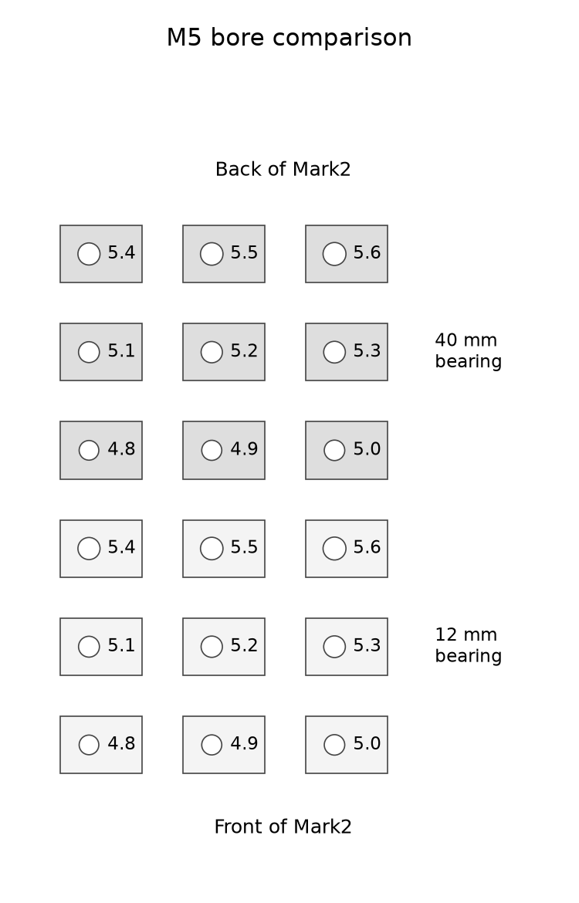

# M5 seam-bearing comparison

The selected printed M5 threaded passage is **Ø5.2 mm**. The
[physical result](physical-result.json) records a push-through fit over 12 mm,
occasional resistance requiring screw rotation over 40 mm, and turning throughout
the Ø5.1 sample. Derek selects Ø5.2 to accommodate the variation he wants to allow.
The shared dimension is `cadlib/fits.py:m5_thread_pass_dia`.

This plate compares lateral support and insertion resistance. It uses the acquired **SVLING M5 × 0.8 ×
50 mm fully threaded screws**, listed in [fixture inventory](../../ledger/inventory.md#fab-fixture)
and [purchases](../../ledger/purchases.md). A screw's brand and nominal size do not
establish its measured outside diameter.

There are **18 separate labeled blocks**: Ø4.8–5.6 mm in 0.1 mm steps, each with a
12 mm and a 40 mm straight bearing. Ø5.6 is the comparison control. The
smaller sizes deliberately include candidates that may require turning the screw.
The number engraved on each top is its nominal bore diameter in millimetres. The
short blocks are at the front of the plate; the tall blocks are behind them.



The bores print vertically, matching the front quadrants' +Z build and back-top's
inverted vertical bores. Each plain block is 20 × 14 mm, with its label beside the
bore. A 0.6 mm conical lead-in opens the underside, excluding the first bed layers'
hole-edge bulge from the straight bearing. Total block heights are 12.6 and 40.6 mm.
The top entry and complete straight bearing retain the specified diameter.

## Mark2 print

Mark2 accepted **task 1378515009** at **17:32:05 CDT on October 26, 2026**.
The [launch receipt](mark2/2026-10-26-m5-seam-bearing-mark2-be46870c/launch.json)
identifies the submitted archive and its reviewed G-code hash. The send dialog
verified left external PET-GF mapping, Timelapse On, Bed Leveling On, Flow
Calibration Auto and Nozzle Offset Calibration Auto. The physical result is linked above.

The plate uses the current enclosure PET-GF recipe: **black Polymaker Fiberon
PET-GF15 on the fixed left hardened 0.4 mm Standard hotend**, Textured PEI,
Mark2's +0.04 mm user trim, 0.20 mm first layer and 0.24 mm later layers.
There are two wall loops. Each small coupon uses 100% zig-zag infill to represent
the enclosure's locally dense bearing hosts. Tree(auto)/Default, automatic brim,
and the current localized cooling remain selected.

[print-job.json](print-job.json) identifies the editable project, native slice,
print-only archive and manual review. The native estimate is **4 h 14 min and
153.35 g**. All 18 objects are included, there are no emitted support paths,
and the complete bead envelope stays at least **92.85 mm** from the usable bed
edge. The emitted textured-plate trim is +0.02 mm. Preparation sends no command to a printer. The intended setup
requires the left 0.4 mm hardened hotend and black PET-GF; the clear-PETG reservoir's
left 0.8 mm setup is a different configuration.

Generate and prepare manually:

```sh
HSM_BUILD_SUPERSEDE=0 tools/cad-venv/bin/python hardware/print-tests/m5-seam-bearing/build.py
tools/cad-venv/bin/python hardware/print-tests/m5-seam-bearing/prepare.py Mark2
```

## Compare with the screws already on hand

Use the 50 mm screws and their supplied 4 mm hand hex key. No measuring fixture or
additional purchase is needed. Test from the labeled top and start with Ø5.6,
working toward the smaller diameters.

1. Try the short block by pushing the screw gently through by hand. If it needs
   rotation, turn it with the hand key and note that distinction. Leave drilling,
   reaming and powered driving out of this comparison.
2. Try the matching tall block over its full 40 mm bearing. Compare insertion and
   withdrawal resistance, then hold the block and rock the exposed screw sideways.
   Judge how much knock or looseness remains beside the Ø5.6 control.
3. For the preferred sizes, repeat five insertion/removal cycles and try another
   screw from the pack. Note whether the fit remains firm and usable, or produces
   loose debris, damaged ridges or cracking.

A useful candidate combines the preferred low lateral play with repeatable hand
assembly through the long block and no visible damage during that comparison.
Light screw-thread marking is a separate observation from heavy thread-forming
resistance. Record the preferred diameter, whether it pushed or needed turning,
and whether its feel changed. [observations.csv](observations.csv) starts blank.

These blocks compare local fit and insertion length. They do not measure a complete
three-knuckle joint's stiffness, clamp preload, load capacity or lifetime. A 40 mm
passage does not establish the resistance through the production joint's full
100 mm screw path. The selected diameter carries the qualitative fit scope above.
