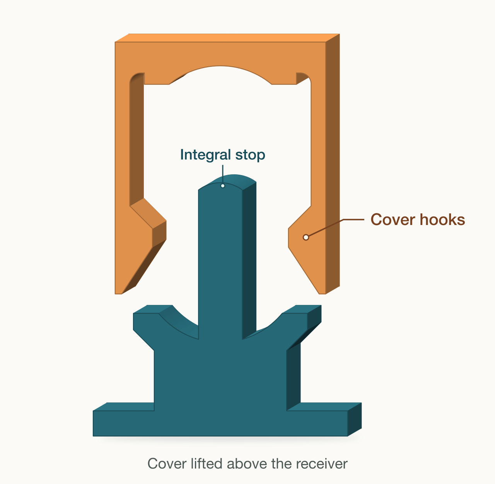
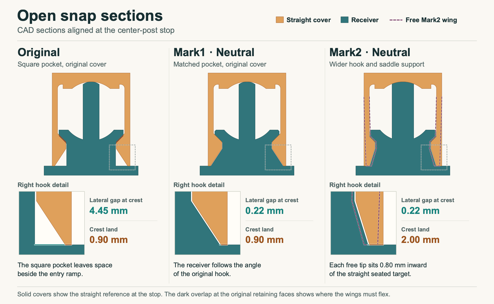
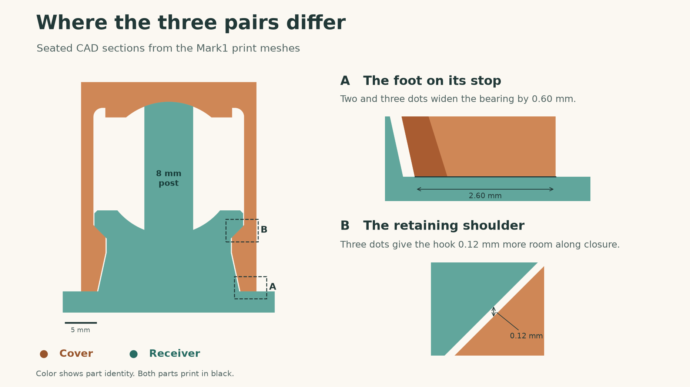
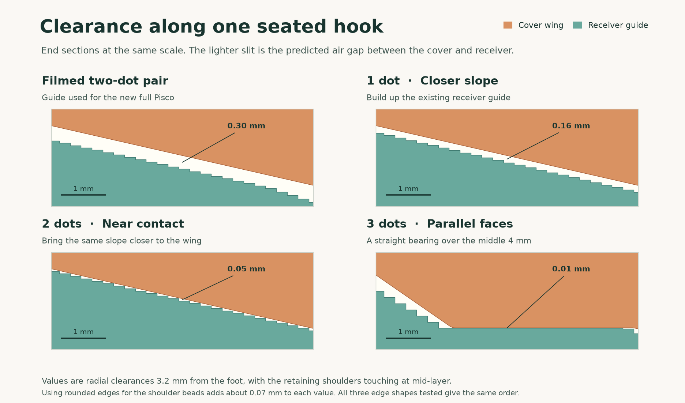

# Open snap section

This two-piece coupon lets you watch both hooks and the underside of the cover while pressing it into the receiver. The cover and receiver are each 12 mm long, about 29% of the full Pisco cover. Both ends expose the same cross section. The regulator is represented by a rounded post printed as part of the receiver.



## First stop height

The two pieces use the fitted Pisco section at the widest part of the scanned regulator. The cover keeps the +0.40 mm crests, spring roots and saddle. The receiver keeps the original inclined catches and pocket roofs. The thinner axial section can take less hand force than the complete cover. [Production fit measurements](../../printed-parts/enclosure/rear-equipment-caps/production-fit.json) · [Flow-meter fit and cross-section photographs](../../printed-parts/enclosure/rear-equipment-caps/prints/2026-11-24-meter-040-relief-mark2/physical-result.json)

The center of the post stands **34.68 mm above the receiver’s flat print face**. At this height its rounded nose touches the center of the saddle at the same modeled closure as the two wing crests reach their pockets. That is 0.10 mm of travel from the cover’s nominal installed position. The 6 mm-wide post has a 5 mm nose radius and leaves 0.58 mm of modeled clearance at each shoulder when centered. This gives the cover a place to bear while leaving both wings free to bend. [Section dimensions and print orientations](parts/geometry.json)

Press the cover on from above with the receiver resting on its flat back. Look into an open end and press alternately over the two wings. Compare the gap at each tip, contact at the center post and whether either wing shifts and stays in a second position after release. A firm hold with a small visible gap is the equipment reference for this trial.

In the Mark2 bench test, the upper tip lifted under hand pressure. Both hooks stayed captured when Derek let go, and he saw the cover return to its previous position. He confirmed that the coupon reproduces the equipment fit. [Filmed result and four stills](prints/2026-11-24-mark2/physical-result.json)

## Comparing the three changes

The Mark2 comparison plate carries the three variants and a fresh copy of the filmed pair. From the printer door, the two covers are in front. The original is on the left and the relieved cover is on the right. In the next row the receivers are, from left to right, the original, the shorter post, and the filled corners. The stepped cooling wall sits behind them. [Plate key](prints/2026-11-24-comparisons-mark2/plate-key.png) · [Mark2 job](prints/2026-11-24-comparisons-mark2/print-job.json)

Fit the two originals first. With the same cover, try the receiver whose center post is 0.48 mm shorter and feel for a change in spring-back. Then try the receiver with the 3 × 3 mm corner fills and compare entry and release. Return to the original receiver and try the cover with 0.20 mm relieved along closure on each retaining face. Compare wing seating and grip. Both covers keep the +0.40 mm crests. [Design and model predictions](proposed-comparisons.json) · [Contact surfaces in the submitted toolpaths](prints/2026-11-24-comparisons-mark2/section-check.json)

In the comparison video, daylight opens between the shorter post and the saddle, and Derek feels more sideways movement. The relieved cover still sits at about the same angle. Light passes between each filled corner and the hook beside it. The filmed fit establishes the full-height post as the reference for the next two plates. [Comparison video observations and stills](prints/2026-11-24-comparisons-mark2/physical-result.json)

## Straight wings and matching pockets

Both designs carry the pocket wall along the angled face of the hook, leaving 0.22 mm of lateral room for entry. On the filmed receiver, that space widens to about 4.45 mm beside the crest when the original cover is drawn straight. The new retaining faces meet the straight wings at the closure where the crests and saddle reach their stops. [Coupon geometry](parts/flush-geometry.json)



| Plate | Cover | Receiver |
| --- | --- | --- |
| Mark1 | The filmed cover, including its 0.90 mm flat crests. | Matches the existing hooks and keeps the original 6 mm-wide post. The hooks reach 2.60 mm past the catches at the straight design position. |
| Mark2 | 2.00 mm flat crests and an inward curve of 0.80 mm per free tip. | The 8 mm-wide post follows the regulator's radius at the same crown height. Each hook reaches 1.80 mm past its catch at the straight design position. |

On Mark2 the catch opens each curved wing as it seats. The wing can then push inward while the outside face looks straight. The wider flat crests give the cover two bearing surfaces farther apart than the center post, so pressure on one side can bear on that side's crest. In the model, moving the saddle sideways by 0.50 mm requires 0.20 mm of lift over the new crown, compared with 0.02 mm on the original. In the sliced paths the edges of the broad crown meet the saddle about 0.01 mm before the crests reach their stops. An end-on look will show which surfaces bear on the print. [Insertion paths, spring travel and crown contact](flush-fit-check.json)

Keep each cover with its own plate. Fit the **one-notch receiver** first. It targets straight wings with the retaining faces just touching in CAD. The **two-notch receiver** moves each retaining face 0.12 mm toward the seated hook to test a firmer grip. On both plates the slicer puts the crest stop 0.11 mm above its CAD height. With the crests registered to this printed height, the commanded shoulders overlap the straight cover by about 0.11 mm radially on the one-notch receiver and 0.23 mm on the two-notch receiver at mid-layer. Both can therefore put some spring load into the wings.

With the receiver on its back, look at both crests end-on, press each side and let go, then compare the effort to release it. A pair that stays square, springs back and grips like the filmed original is the one to try at full equipment length. [Mark1 plate and print record](prints/2026-11-25-mark1-flush/print-job.json) · [Mark2 plate and print record](prints/2026-11-25-mark2-flush/print-job.json) · [Mark1 toolpath sections](prints/2026-11-25-mark1-flush/section-check.json) · [Mark2 toolpath sections](prints/2026-11-25-mark2-flush/section-check.json)

## Three marked Mark1 pairs

Derek felt the least rocking on the broad-foot Mark2 coupon with the one-notch receiver. Each of these three pairs starts with its 8 mm-wide center post, 2.00 mm spring walls and 0.80 mm of free inward curvature at each tip. The hooks extend 1.80 mm past the catches in the modeled square seat. Both open ends expose the hooks and the center contact. [Filmed Mark2 fit](prints/2026-11-25-mark2-flush/physical-result.json) · [Full-length Pisco on Mark2](../pisco-wide-snap/README.md)

Count the recessed dots on the outer back of the cover and the outer edge of the receiver base. Each pair tests one change relative to the preceding fit.

| Dots on both pieces | Change | What to look for |
| --- | --- | --- |
| One | The two 2.00 mm feet turn with the springs. Each free foot is angled 2.03° so it levels when its wing straightens. | Look into either end as the hooks engage. Check whether the full width of each foot meets its stop. |
| Two | The bearing at the end of each foot widens to 2.60 mm. | Press alternately over each wing. Compare how much the opposite foot lifts and whether it returns square. |
| Three | The feet keep the 2.60 mm bearings. Each receiver’s sloping retaining shoulder moves back 0.12 mm along the direction of closure. | Compare seating, grip and removal effort with pair two. |



The native paths give about 1.85 mm of bearing width on the first pair and 2.43 mm on the other two, measured 0.03 mm inside the squared foot. At mid-layer the retaining faces project about 0.11 mm into the hook in pairs one and two. Pair three has about 0.01 mm of clearance there. Each receiver shoulder is built from 0.24 mm courses, so these section measurements describe one height in each step. [Submitted contact surfaces](prints/2026-11-25-mark1-solid-pairs/section-check.json)

Each cover and its receiver share a dot count. The spring walls measure 2.00 mm throughout the bending section, and the cover has at least 5.01 mm of material under its dot patches. [Measured sections and insertion path](parts/solid-pairs/fit-check.json) · [Marks in the print paths](prints/2026-11-25-mark1-solid-pairs/native-paths.json)

The earlier plate with added key blades was stopped. [Reason for stopping the earlier plate](https://github.com/derekbreden/homesodamachine/blob/13cbca49379e124335d453e543eb243e80613245/hardware/print-tests/open-snap-section/prints/2026-11-25-mark1-trios/physical-result.json)

## Closing the gap along the hook

On the first dotted plate, Derek saw a smaller gap beside the three-dot hook and could rock that pair a little more than the two-dot pair. The next three start from the firm two-dot fit. Match the recessed dots on the cover back and receiver base. Both ends expose the sloping face in the video. [Filmed comparison](prints/2026-11-25-mark1-solid-pairs/physical-result.json)

| Dots | Change from the filmed two-dot pair | What to compare |
| --- | --- | --- |
| 1 | Move the retaining shoulder back 0.06 mm, halfway to the filmed three-dot pair. | Does the cover settle farther before you can feel it rock? |
| 2 | Bring the receiver wall 0.12 mm closer along the long guide face. Blend it back to the original opening at the nose. | Does the slit narrow while the cover still clicks in and releases cleanly? |
| 3 | Widen the solid foot on the cover from 2.60 to 2.76 mm. Its slope pivots about the existing hook nose. | Does the slit close near the tip while the cover stays square under alternating thumb pressure? |

The 2 and 3 pairs keep the filmed two-dot retaining shoulder. All three retain 2.00 mm wing stock and the 8 mm-wide center post. The geometry command below writes `parts/next-pairs`. Slice `snap-fit-refinements --printer Mark1`. [Measured coupon geometry](parts/next-pairs/geometry.json) · [Mark1 print](prints/2026-11-25-mark1-refinements/print-job.json) · [Fit sections](prints/2026-11-25-mark1-refinements/fit-sections.png)

## Bringing the guide up to the loaded wing

Derek found that the three refinements and the earlier two-dot pair all held well. On camera, light shows through the lower guide of the newer two-dot pair in one view and the same guide looks dark in another. The sliced sections put that pair closest at the middle of the guide, about 0.30 mm compared with 0.42 mm on the earlier two-dot pair. The three-dot foot comes closest near the toe. [C035 bench review](prints/2026-11-25-mark1-refinements/physical-result.json) · [Sections of the four filmed fits](prints/2026-11-25-mark1-refinements/section-check.json)

This Mark1 plate tests how closely the guide can follow the seated spring while the hook still carries the retaining load. Match the recessed dots on both pieces. The one-dot pair builds up the fully backed receiver slope. The two-dot pair brings the same slope another 0.11 mm toward the wing. The three-dot pair gives the middle 4 mm of the guide a straight bearing on both pieces. All three have 2.00 mm spring walls and 2.60 mm feet. Slice `snap-guide-contact --printer Mark1`. [Geometry](parts/guide-contact/geometry.json) · [Bench comparison](parts/guide-contact/bench.md) · [Mark1 plate](prints/2026-11-25-mark1-guide-contact/print-job.json)



## Returning to a straight push

In C036 the new pairs felt snug in the hand once seated. With the springs relaxed, their broad toes hit the flat at the receiver mouth. Derek showed an older cover sliding straight in under thumb pressure. The one-dot trial carries the seated guide from the two-dot pair he liked and gives each toe room to reach a ramp. The 2.00 mm spring and 2.60 mm foot continue through the full cover. [Hand comparison](prints/2026-11-25-mark1-guide-contact/physical-result.json) · [Entry sections](../pisco-wide-snap/prints/2026-11-26-mark2-easy-entry/entry.png)

The full Pisco and the one-dot coupon share a 1.20 mm nominal retaining shoulder. The two-dot coupon leaves the full 1.80 mm shoulder behind an open entrance. The three-dot coupon carries more of the lead on the cover itself and retains the full shoulder. All three pairs have recessed marks on both pieces. The eight trial parts share one Mark2 plate. [Coupon geometry](parts/easy-entry/geometry.json) · [Submitted plate](../pisco-wide-snap/prints/2026-11-26-mark2-easy-entry/print-job.json)

## Reproduce the pair

The source takes a constant section from the production bodies. To change only the center support in a later trial, change `FILLER_CONTACT_TRAVEL`. A larger value shortens the post and lets the cover travel farther before touching it. [Coupon source](coupon.rs)

```sh
tools/run -- cargo run --release --locked -j2 --manifest-path tools/hsm/Cargo.toml \
  -p hsm-sandbox --example open-snap-section -- hardware/print-tests/open-snap-section/parts
tools/run -- tools/hsm/target/release/enclosure-print-prep open-snap-section \
  --printer Mark2 --bed 'Textured PEI Plate' --slice --review
```

On the Mark2 plate the receiver sits on its flat back and the cover stands on one open end, matching their production layer directions. The third piece is a hollow cooling wall. Its wide section lasts until the fixed catches finish, then a narrow column continues alongside the center post. It gives the cover at least 23 seconds between layers and keeps the plate to about an hour. [Cooling measured from the toolpaths](prints/2026-11-24-mark2/cooling.json) · [Mark2 print record](prints/2026-11-24-mark2/print-job.json)

To reproduce the five comparison coupons on one plate, use `open-snap-comparisons` in the slicer command above. The geometry command writes the originals and the three variants together.

For the matching-pocket trials, use `open-snap-flush-mark1 --printer Mark1` and `open-snap-flush-mark2 --printer Mark2` with the same bed and review options. [Pocket and spring geometry source](flush.rs)

The geometry command also writes the three marked pairs to `parts/solid-pairs`. Select `solid-snap-pairs --printer Mark1` for their plate. Viewed from the printer door, the covers sit in front of their corresponding receivers. The one-, two- and three-dot pairs run left to right. [Plate layout](prints/2026-11-25-mark1-solid-pairs/plate-key.png) · [Part dimensions](parts/solid-pairs/geometry.json) · [Coupon source](solid_pairs.rs)
