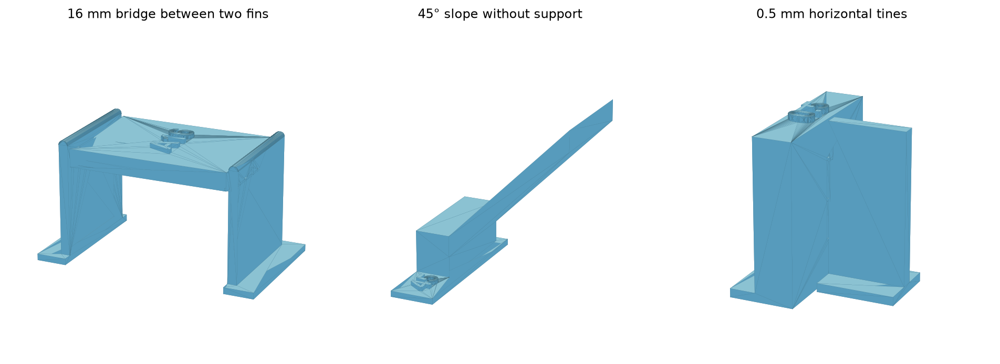

# PET-GF fins, bridges and slopes — Mark2

This screening plate measures the surface freedom available from removable fins:
how far a shelf can bridge between fin contacts, which unsupported slopes print
cleanly, and which horizontal tines release without tearing the retained part.
The customer outcomes are smooth sliding faces, clean visible surfaces and
practical support removal. The first run has an
[interrupted physical result](physical-result.json): A16, B16 and Y12 failed
as their roofs began, AI detection interrupted printing, and the user did not
continue. No usable bridge-span limit is established.

The saved G-code places those first three roof attempts on layer 44, Z10.52.
The ramps' last completed layer is 43, Z10.28. Their commanded reaches beyond
the post are about 12.28 mm for S30, 10.11 mm for S35 and 8.44 mm for S40,
each short of its planned 14 mm. Derek reports progressive edge sag and a
sagging/incomplete partial tip corner on S30, a lesser version on S35, and no
such edge defect on S40 at its printed extent. These are partial-ramp
observations, not completed angle qualifications. The
[stop-layer reconstruction](stop-layer-review.json) binds that scope to native
order; [photos](photos/01-plate.jpg) preserve the final physical state.

The [short-span follow-up](short-spans-v2/README.md) compares solid model
anchors with fin landings at 2–8 mm and fixed part-fan cooling. Its full-length
ramps finish before the bridge attempts begin. Its fan-off run establishes
stable C bridges with rejected underside finish, failed F roof formation, and
edge sag on four of the six full-length ramps; see its
[physical record](short-spans-v2/physical-result-fan0.json).

The [12 mm fusion and fin trial](bonding-and-fins-v4/README.md) uses both
printers: six isolated first bridge layers at fixed spacing with added
extrusion, two correctly landed fin roofs, and full-length ramps at 70%/100%
cooling. Both fin directions have all 28 main strokes' ends directly on prior
tooth beads, with bridge fill before walls. Its
[Mark1 physical result](bonding-and-fins-v4/mark1/physical-result.json) finds normal
N100/N125 visually preferred without a clear winner. The
[normal-flow/cooling follow-up](normal-flow-cooling-v5/README.md) compares
100%/115%/125% extrusion at 70%/100% fan on six normal bridge swatches. Its
[physical result](normal-flow-cooling-v5/mark1/physical-result.json) ranks
A125 (125%, 70% fan) first and B125 (125%, 100% fan) second for fewest gaps
when held to light. Sag and adjacent-line strength are unreported for that ranking.
The [Mark2 result](bonding-and-fins-v4/mark2/physical-result.json) establishes
formation of both fin roofs and the solid control, with unacceptable sag/finish.
Four ramps improve with residual sag and two look good; the 40° identification
is tentative. The [40-specimen finish comparison](finish-matrix-v6/README.md)
uses matched solid posts and opposing fins at 100%/125% volume, 15/25 mm/s and
70%/100% fan, plus 35–42.5° ramps facing both directions.
The [Mark1 flow bracket](flow-bracket-v7/README.md), task 1340334508, compares
125%/130%/135%/140% first-roof extrusion at 70% fan and 25 mm/s on isolated
first layers and completed five-course roofs. Its physical result is pending.

The plate contains 25 separate embossed specimens, centered on Mark2's left
nozzle bed. Facing the printer, A is the front row, then B, S and the contact
comparisons at the back. [Plate map](plate-layout.png).

| Specimens | Question |
| --- | --- |
| A4, A8, A12, A16, A24, A32 | 4, 8, 12, 16, 24 and 32 mm clear spans between small tooth contacts; 0.24 mm horizontal clearance between the shelf and each fin body. |
| B4, B8, B12, B16, B24, B32 | Identical clear spans with 0.48 mm horizontal body clearance. |
| S30, S35, S40, S45, S50, S55, S60 | Unsupported slopes measured **up from the bed**; lower angles are harder. Every ramp has 14 mm horizontal reach and 12 mm width. The embossed number is its angle. |
| T45, T50, T60, T80 | Three horizontal tines per edge-on fin, with nominal widths 0.45, 0.50, 0.60 and 0.80 mm. The stock's embossed number is the width in millimeters. All have 0.24 mm body clearance. |
| Y12 | A12 rotated 90° to bridge along bed Y. The other bridges run along X. |
| V | Upright untouched stock surface for a texture comparison. |

## What the bridge specimens measure

Each shelf is 1.92 mm thick and 12 mm deep. Two 1 mm fin walls stand on separate
3.2 × 14 mm feet; their tops are rounded. They hold the shelf through seven
small horizontal teeth per side immediately below the first shelf layer, plus
two higher rows of three side-contact tines. All teeth are 0.24 mm tall and
0.50 mm wide. The lower teeth extend 0.50 mm underneath the shelf's edges.
The label names the clear air distance between these opposing tooth tips.

There is no permanent model tower anchoring a bridge: the shelf starts on the
fin teeth. Its bottom plane is Z10.28; lower teeth print at nozzle Z10.28 and
the first shelf layer prints at Z10.52. Native bridge directions are set per
object and read back in [the path review](native-review.json).
The infill raster lands in perimeter beads, so its commanded move length is
shorter than the labeled clear span. The native record reports those lengths
separately. [First-layer paths](native-bridge-paths.png).

**A/B clearance is sideways, not a vertical support Z gap.** This plate screens
side fins and horizontal attachments. It does not select the vertical gap for
a prop wall under a ceiling, or reproduce the upstream gap coupon. Narrow spaces
between the individual lower teeth also require transverse bridging.

Classic wall generation needs a feature that survives slicing. A nominal
0.40 mm side tine produces no connecting path in the saved profile. The
contact comparison begins at 0.45 mm, with all three emitted contact layers
read explicitly. A CAD tine width is not necessarily the emitted bead width.

## Print process and evidence

- Polymaker Fiberon PET-GF15, left fixed hardened Standard 0.4 mm nozzle,
  external spool 254, Textured PEI.
- Mark2 +0.04 mm requested Z trim; emitted textured-plate adjustment +0.02 mm.
- 0.20 mm first layer, fixed 0.24 mm layers; no adaptive bands.
- Shared `hardware/printed-parts/petgf.3mf` temperatures, speeds, cooling,
  two walls and 15% grid infill. Normal temperature 280°C; first layer 265°C;
  bed 80°C. Cooling follows the saved profile's layer-time behavior.
- Slicer supports, skirts and brims disabled. The feet are part geometry.
- Density 1.43 g/cm³ for estimates, from
  [Polymaker's data sheet](https://fiberon.polymaker.com/wp-content/uploads/TDS_FIBERON-PET-GF15_V1.0_EN.pdf).
  PET-CF metadata identifies the printer's external PET-GF spool.

This is an as-printed comparison under the working production profile.
Polymaker recommends 280–310°C, 70–80°C bed and fan off; the saved first layer
and layer-time cooling are local print treatments. This plate varies geometry,
not temperature or cooling. It establishes no annealed behavior or strength.

The native estimate is **1 h 00 min 08 s**, **21.74 g**, across **121 printed layers**.
All fin-contact extrusions are 0.24 mm tall. Some native ramp bridge features
request a 0.40 mm extrusion height within the 0.24 mm layer-Z schedule; those
features retain the slicer's treatment and are identified in the native review.

The existing [PET-GF support results](../petgf-interface-edges/README.md)
establish clean tree release at the 0.48 mm planned vertical gap, with retained
loose bridge strands. The
[faucet lip record](../../printed-parts/faucet/finish-coupons/2026-10-10/README.md)
reports separation of the first model layer above supports. Those results
motivate scoring retained surface quality independently from release.

Mark2 accepted job **1339273130** at **11:42 CDT on 2026-10-14** through Bambu
Studio's saved-slice send. Timelapse and Bed Leveling are On; Flow Dynamics and
Nozzle Offset Calibration are Auto. The interrupted surface observations are
recorded above; fin-release behavior remains unreported.

The editable project, native archive and source/mesh hashes are bound in
`2026-10-14-fin-bridges-petgf-left04-z004-mark2.print.json` and `native-review.json`.
The `-print-only.gcode.3mf` archive preserves every reviewed G-code byte and
opens directly in Studio's Preview. [Launch record](launch.json) binds that
submitted archive to printer acceptance. `observations.csv` contains the
reported failures and partial-ramp observations; unmeasured readings stay blank.

## Assess the cooled plate

Use the existing calipers and a straightedge; fingers first, ordinary pliers
only if needed. Keep every embossed ID with its part. Do not sand before the
comparison. This procedure decides candidate fin spacing, side clearance and
tine width for a real sliding-joint/faucet trial.

1. Before removal, note a lifted foot, tilted fin, missing shelf, curled ramp
   or detached model strands. Photograph the bridge undersides while still held.
2. On A/B/Y, measure roof thickness along the front strip at both ends and
   center, avoiding the embossed label and lower teeth. Nominal roof thickness
   is 1.92 mm. Record the maximum downward projection below a straightedge
   across the end datums if the tools allow it. Keep readings separate from
   visual and tactile judgements.
3. Hold the shelf and bend each fin sideways, recording finger removal or the
   need for pliers. Record damage to the retained shelf separately from broken
   teeth, fin fragments or loose residue. Compare A/B at each span.
4. On the contact stocks, bend the edge-on fin and compare the three contact
   marks against V. Select the smallest **emitted** tine that stayed attached
   through printing and releases without tearing the stock.
5. Compare the slope undersides to V. A useful slope has no curling edge,
   projecting loose strands or catching when a finger travels along it.
   Choose the shallowest clean sample as a candidate for a real-part pose.

A useful bridge must complete with both fins held, preserve its complete
underside after removal, and have no loose strands or snagging texture. For
dimensional screening, 0.25 mm maximum downward projection uses the project's
existing extra mating allowance for supported surfaces as a provisional
ceiling. Exceeding it rules out that specimen for the same allowance; satisfying
it does not qualify sliding feel. The shortest failing span brackets the
range worth exploring, rather than assigning a universal PET-GF limit.

If fin release fails across a row, that row cannot cleanly separate bridge
quality from attachment damage. If A12 and Y12 differ, use the worse direction
for the next candidate until a repeat resolves it. A longer shelf that looks
better than a shorter one also needs a repeat before choosing a limit.

The 25-object layer return time, cooling, anchor pattern, 12 mm depth and
1.92 mm shelf section are part of this evidence. Taller fins, isolated parts,
curved roofs, enclosed removal paths, other layer heights and Mark1's distinct
Z trim require their own applicable result. This plate selects candidates;
a matched real joint must still demonstrate smooth full-travel motion and
retention at its intended clearance.

## Technique sources

[Matthew Trahan's tool](https://github.com/gittrahan/support-fins) automates
Slant3D's designed-in support technique. Its
[geometry specification](https://github.com/gittrahan/support-fins/blob/main/docs/FIN-SPEC.md)
describes deliberate small horizontal contacts, clearances, bed feet and
accessible placement. Its
[calibration notes](https://github.com/gittrahan/support-fins/blob/main/docs/CALIBRATION.md)
separate angle, gap, grip and span. Default PLA/PETG settings do not establish
PET-GF results. The tool also documents non-monotonic automatic wall coverage
and sagging flat shelves; actual fin spacing and native bridge direction matter.

These coupons are authored locally in CadQuery, with geometry chosen for the
working 0.20/0.24 mm layer schedule. They are not exports from PrintFins' automatic
placement engine and do not validate that engine.

## Reproduce by hand

From the repository root, run `tools/cad-venv/bin/python
hardware/print-tests/petgf-fins/build.py`. Slice the generated `.3mf` with the
installed Bambu Studio, `--arrange 0 --orient 0 --slice 0`, exporting a
`.gcode.3mf` to an **absolute** output directory. Run `review.py <native-archive>`
to read this plate's bead envelope, bridge directions and tine layers. These
commands are manual experiment tools and do not join a build or commit path.

Send the reviewed archive with `tools/cad-venv/bin/python tools/bambu_print.py
<native-archive> Mark2`, retaining Timelapse On, Bed Leveling On, Flow Calibration
Auto and Nozzle Offset Calibration Auto and the three-minute shared-circuit
spacing.
