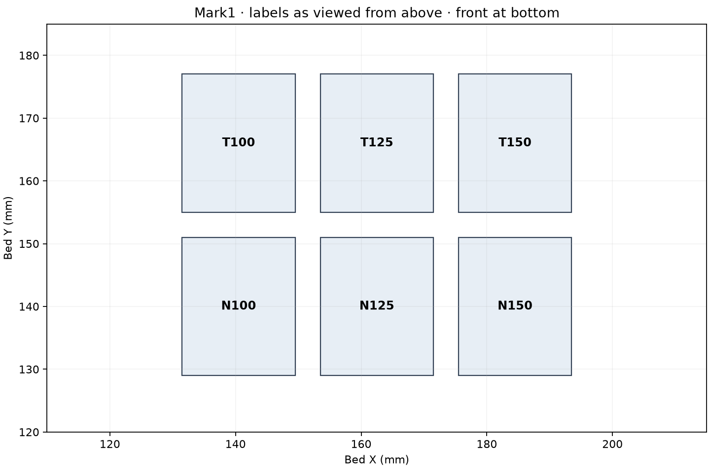
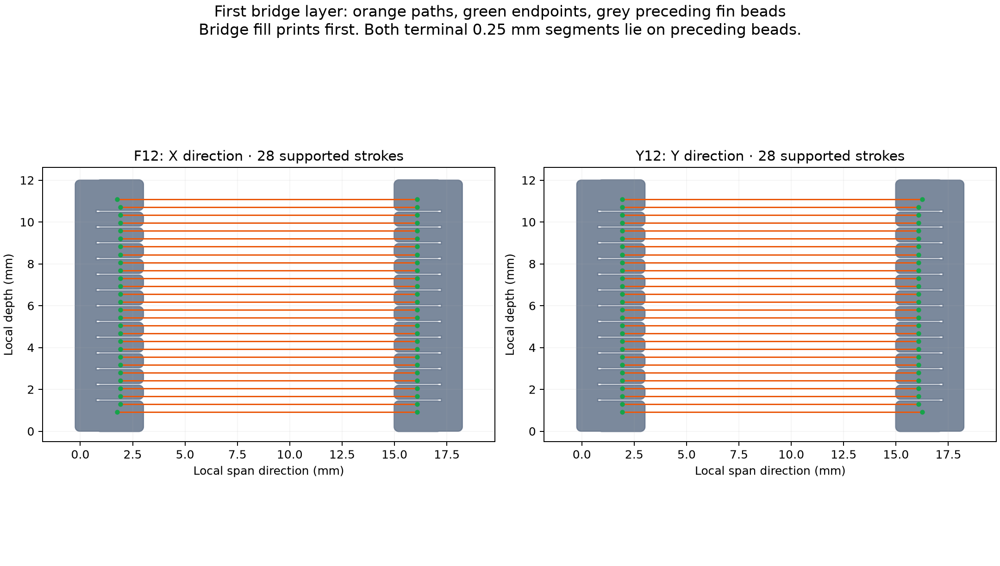
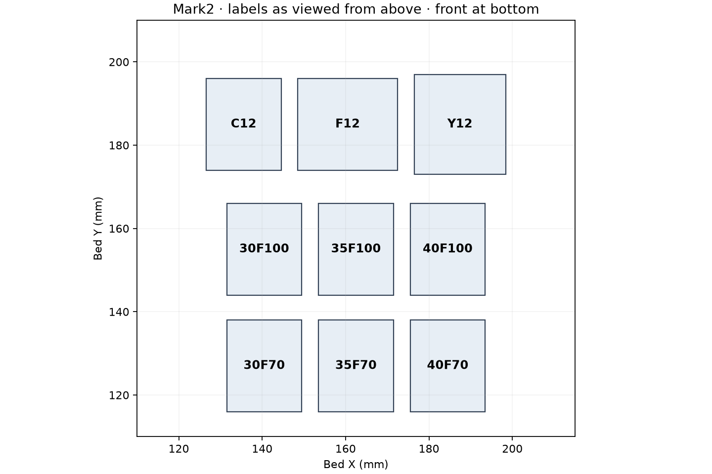

# PET-GF bridge fusion, fin formation and ramp cooling

Two small plates test a continuous first bridge layer, a roof started directly
on removable fin teeth, and clean unsupported ramp edges. The application is
retained visible/sliding surfaces with practical support removal.

| Printer | Plate | Native estimate | Launched job |
| --- | --- | --- | --- |
| Mark1 | Six 12 mm bridges, one roof layer each | 14 min 47 s; about 3.58 g including added extrusion | 1340084547 |
| Mark2 | Two fin bridges, solid-post control, six ramps | 28 min 02 s; about 8.39 g including added extrusion | 1340093238 |

The launch records bind the submitted print-only archives and G-code hashes to
printer acceptance: [Mark1](mark1/launch.json), [Mark2](mark2/launch.json).
Both use Bambu Connect's saved-slice send, Timelapse On, Bed Leveling On, Flow
Dynamics Auto and Nozzle Offset Calibration Auto. The starts are 221 seconds
apart. The [Mark1 physical result](mark1/physical-result.json) identifies N100
and N125 as the visually preferred pair, with no clear winner. Derek reports
better-looking line fusion than usual on the bottom-middle specimen, then notes
that bottom-left may be better and the two look similar. This is visual first-
layer evidence on permanent model posts. Mark2's fin/ramp physical result remains
unreported. The [normal-flow/cooling follow-up](../normal-flow-cooling-v5/README.md)
retains both preferred treatments and adds an intermediate flow and 100% fan.

## Mark1: line-to-line fusion at fixed spacing

All six specimens have a 12 mm clear span, 12 mm depth and permanent 3 mm model
posts. Their roof consists of one nominal 0.24 mm course at nozzle Z5.72, with
no subsequent layer to hide separated strands. Bridge fill prints before walls.
All bridge rasters run at 25 mm/s and 70% part cooling.

| Labels | Native bridge mode | Extrusion for first roof bridge fill | Raster pitch |
| --- | --- | --- | --- |
| N100 / N125 / N150 | Normal; 0.24 mm extrusion height | 1.00 / 1.25 / 1.50 times native E | 0.377–0.378 mm; 30 main strokes |
| T100 / T125 / T150 | Thick; 0.40 mm extrusion height | 1.00 / 1.25 / 1.50 times native E | 0.452–0.453 mm; 25 main strokes |

The number is an extrusion multiplier, not a fan percentage. Each trio retains
identical spacing and paths as extrusion rises. The comparison asks whether
additional volume joins adjacent strands and whether thick mode improves that
result. It does not vary temperature, speed and cooling simultaneously.
All main strokes have both endpoint centers and their first/last 0.25 mm over
previous post beads. [Native review](mark1/review.json).

The [volume calculation](mark1/strand-volume-review.json) gives equivalent
circular strand diameters of approximately 0.332/0.371/0.407 mm for N and
0.394/0.440/0.482 mm for T. This idealized volume model places 125 near contact
and 150 beyond the nominal pitch. Deposited shape and bonding are observations
for this print; these calculated diameters are not measurements.

## Mark2: bridge paths directly on fin contacts

F12 and Y12 each start a roof on two removable fins, with no permanent model
post. The clear air span between tooth tips is 12 mm. Y12 rotates the geometry
and bridge direction by 90°. Each fin has paired lower teeth with 2 mm nominal
roof underlap and upper side tines across a 0.24 mm lateral body clearance.
The roof is 1.20 mm thick. The first roof prints at Z16.28 over teeth at Z16.04.

**All 28 first-layer main bridge strokes in both orientations begin and end on
previous fin beads.** Their first and last 0.25 mm are fully within those nominal
bead footprints. Bridge fill prints before the transverse roof walls; it does
not depend on a new unsupported perimeter for its initial landing. The
[review](mark2/review.json) and plot read the submitted paths, including direction.

C12 has permanent model posts as a process control. C12/F12/Y12 use normal
bridge mode, first-roof bridge E ×1.50, 25 mm/s and 70% cooling. The shared
multiplier is a deliberate formation attempt; comparison with N150 on Mark1
is contextual, because printer, post height and multi-object return time differ.
The Mark2 control also has a five-course roof; it is not another isolated
first-layer fusion specimen.

The six ramps are 30°, 35° and 40° from the bed, each with full 14 mm horizontal
reach. Labels 30F70/35F70/40F70 identify fixed 70% part cooling;
30F100/35F100/40F100 identify fixed 100%. All model features after the first
three layers receive the labeled cooling, including overhang/bridge features.
All ramps finish by Z15.08, before the first fin/control roof attempt.

## Read the parts

- On Mark1, inspect each roof against light and gently press its center. Record
  whether adjacent lines form a sheet or remain individually movable strings.
  Keep sag, roughness and excess material separate from that joining assessment.
  Prefer the lowest extrusion that forms a joined sheet without an unacceptable
  surface; compare the N and T groups at their respective best settings.
- On F12/Y12, record whether the first roof establishes, then photograph the
  underside before cleanup. Remove fins with fingers first and record any roof
  tearing or retained teeth. Formation, easy release and a useful retained face
  are three separate outcomes. C12 is a comparison, not a verdict on fin finish.
- On ramps, compare both edges and the final corner across each matched angle.
  Record edge sag, a missing corner, raised curl or snagging texture. The useful
  result is the shallowest clean angle at each fan level over the entire reach.

[Observations](observations.csv) retain unmeasured results as blanks; the Mark1
physical record above preserves the reported visual preferences.
No fixtures or purchases are needed. Photographs and ordinary handling answer
this iteration's questions. Sliding-joint fit and structural durability remain
outside this coupon result.

## Research basis and process scope

[OrcaSlicer's bridge documentation](https://github.com/OrcaSlicer/OrcaSlicer/wiki/quality_settings_bridging)
identifies flow and density as ways to change strand volume and spacing. Thick
bridges use a different extrusion cross section. A
[published Orca experiment](https://github.com/OrcaSlicer/OrcaSlicer/discussions/11961)
demonstrates testing overlap/density with thick bridges; its PLA temperatures,
fan and long-span result are not PET-GF settings. Prusa's
[bridge troubleshooting](https://help.prusa3d.com/article/poor-bridging_1802)
also uses repeated bridge specimens with per-object flow or speed changes.

This experiment targets separated neighboring strands. Increasing E at fixed
pitch is the focused intervention. Bambu's
[flow implementation](https://github.com/bambulab/BambuStudio/blob/master/src/libslic3r/Flow.cpp)
couples some bridge flow calculations to the extrusion geometry; explicit local
G-code multipliers keep each group's actual path spacing fixed for this test.

Both plates retain PET-GF working-profile temperatures (265°C first layer,
280°C normal, 80°C bed), fixed left hardened Standard 0.4 mm nozzle and external
spool 254. PET-CF is the printer's metadata for the loaded PET-GF. Textured PEI
uses Mark1's +0.18 mm requested trim (`G29.1 Z0.16`) and Mark2's +0.04 mm
requested trim (`G29.1 Z0.02`). The first bed layer is 0.20 mm; subsequent Z
steps are 0.24 mm. Slicer supports, skirts and brims are disabled. The emitted
model-bead edge insets are at least 129 mm on Mark1 and 116 mm on Mark2.

Cooling is off for the first three layers. The local 70%/100% treatments are
surface experiments; the shared production material profile is unchanged.
Saved parameters and commanded paths establish neither physical bonding nor
load capacity. The [earlier physical record](../short-spans-v2/physical-result-fan0.json)
contains the rejected solid-bridge finish and failed fin starts; those failed
starts do not qualify a correctly deposited fin roof.

## Manual reproduction

`prepare.py Mark1` or `prepare.py Mark2` creates the editable project, STLs and
manifest. Slice with the installed Bambu Studio native CLI into the respective
`native.gcode.3mf`; `finish.py mark1` / `finish.py mark2` applies the named local
fan and first-roof E treatments and writes the path review. Use the repository's
`tools/cad-venv/bin/python` runtime for these scripts. `plot_paths.py` draws the
saved paths and plate maps. These are manual experiment tools.

The editable 3MF alone does not contain the E multipliers. The submitted final
G-code archives do. Each print-only package preserves all reviewed G-code bytes
and MD5 checksums; [packaging records](mark2/packaging.json) identify the removed
editable geometry entries. Reproduction must retain the finish step and read
the emitted fin landing paths before sending a newly sliced archive.
