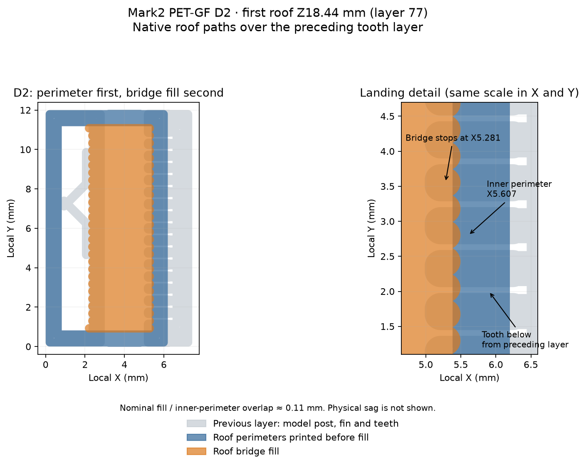

# Dense fin landing candidate — unprinted

This native-path candidate addresses the failed F-roof startup in
[Mark2 task 1339729875](../short-spans-v2/physical-result-fan0.json). It is
prepared for inspection and **has not been sent**. Stable C bridges in that run
have rejected underside finish, so landing formation alone does not establish
a useful surface. The prepared 30% comparison tests a fixed diagnostic level
against fan off. It does not increase cooling relative to the working recipe's
70% maximum; see the [cooling audit](../short-spans-v2/cooling-baseline-review.json).

D2/D4/D6/D8/D4Y have nineteen lower teeth: two 0.8 mm corner contacts and
seventeen 0.5 mm interior contacts at 0.6125 mm pitch. The body clearance is
0.24 mm, lower underlap 1.2 mm and tooth height 0.24 mm. Upper side tines,
roof dimensions, span stages, model post, fan-off treatment, nozzle and working
temperatures follow the short-span comparison. The tag reads DENSE 0.
The five C and six S/R test meshes and their placements are identical to the
fan-off comparison. [Plate map](plate-layout.png).

The [landing trace](landing-path-review.json) includes all 28 main first-roof
strokes on each D specimen. Every far-end nominal bead envelope intersects
preceding tooth beads; 24 far-end centers lie within them. The longest gap
along the inner landing wall's centerline is about 0.083 mm. The sparse F
pattern has only 6 covered centers, 14–16 touching endpoint envelopes, and
1.47 mm gaps. The perimeter still prints before the fill and the nominal
fill-to-inner-wall overlap remains about 0.11 mm.

This is geometric coverage, not a physical formation or removal result. The
nominal lower contact area under the roof is 12.12 mm² per fin versus the
sparse pattern's 4.92 mm². Extra bonding area may make removal worse or damage
the retained face. No physical F failure is marked resolved by these paths.
The candidate preserves the six ramps and C witnesses for a possible matched
diagnostic; it does not require another physical test to reject the already
reported C underside finish for visible or sliding surfaces.

Native estimate: about **56 min 58 s and 21.20 g**, 115 layers. The
`.native-review.json` records the embedded checksum, +0.02 mm emitted textured
plate trim, 101 mm bed-edge inset, zero support extrusions, fan-off paths and
25 mm/s axial roof fill. Some native ramp bridge features retain the slicer's
0.40 mm extrusion-height treatment within the fixed 0.24 mm Z schedule.

Run `make_plate.py` manually with `tools/cad-venv/bin/python`; it calls the
parameterized short-span generator and writes only this directory. Slice with
Bambu Studio `--arrange 0 --orient 0 --slice 0`, an absolute output directory,
and `--export-3mf`. The short-span `inspect_slice.py` and `trace_landing.py`
accept this directory through their Python entry points. These experiment
tools do not join a build or commit path. Physical formation, release and
retained finish remain unmeasured.
