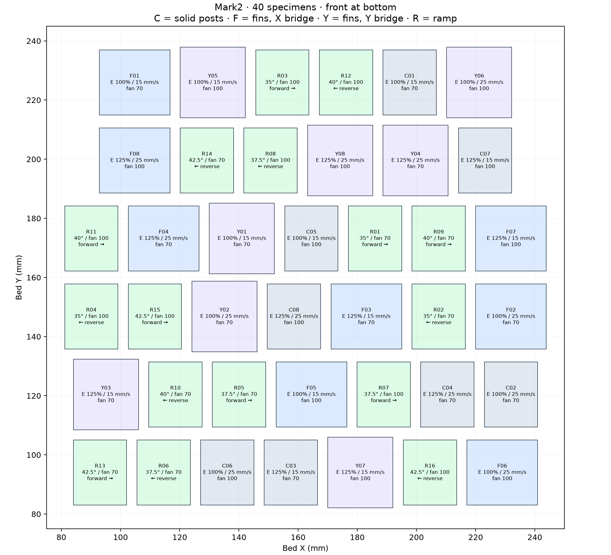
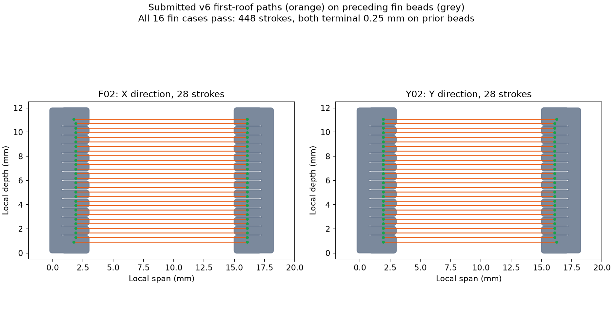
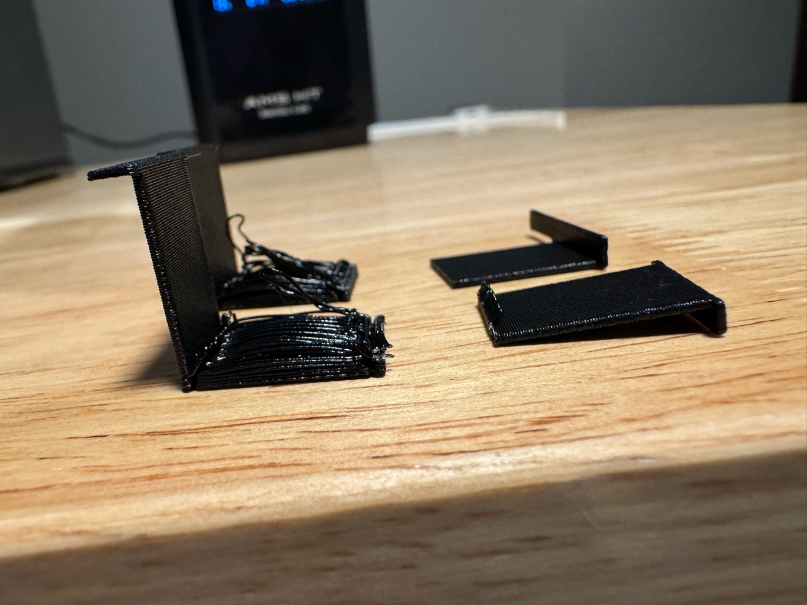

# PET-GF bridge finish and ramp angle — Mark2

This 40-specimen plate selects a useful retained bridge surface and a clean
unsupported ramp angle. The [completed Mark2 trial](../bonding-and-fins-v4/mark2/physical-result.json)
establishes formation of both fin roofs and the solid-post control. All three
have objectionable sag/finish: one substantially worse than the other two,
without identified labels. Four ramps improve with residual sag; two look good.
The 40° pair is a tentative identification of those two, not a confirmed result.

Mark2 accepted **task 1340201019** on 2026-10-14. The native estimate is
**2 h 05 min 04 s**, plus approximately **2 min 11 s** of nominal travel time
for the slower bridge treatment, and **44.35 g** including added extrusion.
Use **about 2 h 10 min** as the plate estimate; calibration/startup may add time.
[Launch record](mark2/launch.json). The printer completed all 85 layers.
The [physical result and eight photos](mark2/physical-result.json) accept the
surface appearance of **all 16 ramps** at this tested area. No bridge looks as
good as the latest Mark1 set. C02/C04 are candidates for passing; C03/C06/C07
are possible passes, with C07 also reported as a borderline failure with one
low-hanging thread. F01/F08/Y04/Y05 have severe reported failures and F07 is
worse than C07 but substantially less severe than F08/Y04. Other bridges have
no individual assessment; no fin specimen is identified as accepted.

The photos show bowed roof regions, loose looped strands and irregular contact
remnants, while the broad fin panels appear largely straight. Specimen labels
are not legible enough for photo-to-ID assignments. These post-print views do
not establish whether teeth deformed before bridging or what separated during
handling/removal. The [comparison with Mark1](mark2/comparison-with-mark1.json)
records matched bridge deposition and differing anchor/plate conditions.

## Bridge comparison: C, F and Y with matching suffixes

Every condition has three specimens: **C** bridges between permanent model
posts along X; **F** bridges between two removable fins along X; **Y** uses the
same opposing fins and bridges along Y. Matching numbers share their settings.

| Suffix | First-roof bridge extrusion | First-roof bridge speed | Part fan |
| --- | --- | --- | --- |
| 01 | 100% | 15 mm/s | 70% |
| 02 | 100% | 25 mm/s | 70% |
| 03 | 125% | 15 mm/s | 70% |
| 04 | 125% | 25 mm/s | 70% |
| 05 | 100% | 15 mm/s | 100% |
| 06 | 100% | 25 mm/s | 100% |
| 07 | 125% | 15 mm/s | 100% |
| 08 | 125% | 25 mm/s | 100% |

All 24 bridges use normal bridge mode, a 12 mm clear span, 12 mm depth and a
five-course, 1.20 mm roof. The first roof is nozzle Z19.16 over prior teeth/posts
at Z18.92. The fin contact geometry retains paired lower teeth with 2 mm
nominal underlap, a 0.24 mm lateral body gap and upper side tines.

The 100%/125% volume bracket comes from the visually preferred normal bridges
in the [Mark1 result](../bonding-and-fins-v4/mark1/physical-result.json), whose
relative ranking is unresolved. The slower bridge level asks whether additional
cooling time/tension improves the retained shape. The 25 mm/s level retains the
existing bridge speed. The same factors on C/F/Y distinguish general bridging
quality from fin contacts and direction effects within this plate.

The [Mark1 flow/cooling result](../normal-flow-cooling-v5/mark1/physical-result.json)
ranks 125% extrusion at 70% fan first and 125% at 100% fan second for optical
gap closure, both at 25 mm/s. C04/F04/Y04 use the preferred first-roof settings;
C03/F03/Y03 compare the slower speed. This plate's taller anchors, five-course
roofs and longer return time between objects make retained finish and fin
release the next questions, rather than an identical isolated-layer repeat.

Mark1 R125 and Mark2 C04 have the same 28 main strokes, pitch and commanded
volume per length at 125%, 25 mm/s and 70% fan. Mark1 has fully filled anchor
layers at roof underside Z5.48 on an eight-object plate; Mark2 retains 15%
grid infill in taller posts at Z18.92 on a 40-object plate. C04 has 8/28 main
strokes with both endpoint centers on nominal preceding beads, versus 28/28
for R125; its largest endpoint gap is 0.038 mm. This small nominal gap is a
comparison limitation, not a demonstrated cause of the physical difference.
The two plates do not isolate printer performance.

The first-roof E and speed treatments apply to positive XY Bridge-feature
extrusion on that course, including the raster connectors. All other extrusion
volumes and motion speeds retain the native slice. Native strand spacing is
held fixed as E changes. The roof's later layers retain the working process.

Every fin specimen has **28 main first-roof strokes directly on prior fin beads
at both ends**: **448 strokes** across the 16 fin specimens. Each stroke's first
and last 0.25 mm are within those nominal preceding-bead footprints. Fill prints
before roof walls. The [submitted path review](mark2/review.json) records every
specimen's coverage, actual speed, pitch and fan commands.

The lower teeth are one 0.24 mm course, projecting 2.24 mm horizontally beyond
the fin wall with 2 mm underlap beneath the roof. They must form before the
roof prints. Correct commanded landings do not establish the teeth's physical
position or bearing stiffness; deformation of these teeth is an unresolved
candidate mechanism. The photographs do not determine its timing.

## Ramp comparison: R01–R16

Each ramp has full 14 mm horizontal reach, 12 mm depth and a 2.4 mm vertical
section. Angles are measured from the bed. Each angle/fan condition is repeated
facing the opposite direction to expose one-sided edge defects. This is a
direction comparison, not two independent printers or independent print runs.

| Angle | Fan | Forward | Reverse |
| --- | --- | --- | --- |
| 35° | 70% | R01 | R02 |
| 35° | 100% | R03 | R04 |
| 37.5° | 70% | R05 | R06 |
| 37.5° | 100% | R07 | R08 |
| 40° | 70% | R09 | R10 |
| 40° | 100% | R11 | R12 |
| 42.5° | 70% | R13 | R14 |
| 42.5° | 100% | R15 | R16 |

All rows and both orientations have reported acceptable surface appearance
over the full 14 mm horizontal reach and 12 mm width. R09 (40°, 70% fan) is
among the best-looking. R05 (37.5°, 70%) is among the worst, possibly tied with
R01 (35°, 70%) and others. R03 (35°, 100%) looks better than R01, supporting
the reported modest general benefit from 100% cooling for these ramps. The
lowest accepted tested angle is 35° from the bed; 30° and larger reach/area
remain unqualified. This ramp cooling preference does not select bridge cooling.

Ramp speeds and extrusion retain the working recipe. They receive the labeled
fixed cooling on all model features after the first three bed layers. Their
last nozzle Z is at most 16.52, before the first bridge attempt at Z19.16.
An interruption at the bridge phase therefore preserves the completed ramps.

## Assess useful surfaces

Photograph the plate before cleanup, keeping IDs with the pieces. Compare the
matched C/F/Y numbers for sag, visible gaps and retained underside texture.
Select the best-looking conditions first; fin removal on the best few answers
more than force-testing every rough specimen. Peel with fingers first, record
whether the roof tears or teeth remain, and preserve a photo of the retained
face. Formation, release and surface quality are separate observations.

For ramps, inspect both edges and the final corner over the full reach. The
useful angle is the shallowest one with a complete tip and acceptable edges in
both orientations. Compare the 70%/100% pairs before selecting cooling.
The [observation sheet](observations.csv) records the ramp acceptance and the
specific tentative/failed bridge assessments. Unreported bridge outcomes and
fin release remain blank. No new fixtures, purchases or quantified force
measurements are requested.

The 40-object return time, fin height and five-course roof are part of this
result. A better surface here does not establish equal performance on a smaller
plate, first-model layers above a slicer support interface, or a finished sliding
joint. Measured inter-strand strength, structural capacity and lifetime remain
outside this surface comparison.

## Process and provenance

Polymaker Fiberon PET-GF15 uses the fixed left hardened Standard 0.4 mm nozzle,
external spool 254 (PET-CF metadata, colour 161616), Textured PEI and Mark2's
+0.04 mm requested trim, emitted `G29.1 Z0.02`. Working temperatures remain
265°C first layer, 280°C normal and 80°C bed. Bed layer one is 0.20 mm; subsequent
Z steps are 0.24 mm. Part cooling is off for the first three layers, then fixed
to 70%/100% on the specimen. Slicer supports, skirts and brims are disabled.
The complete emitted model-bead envelope stays at least **81.12 mm** inside
the usable bed boundary. Settings are distributed across the centered plate.

[Prusa's bridge troubleshooting](https://help.prusa3d.com/article/poor-bridging_1802)
uses repeated specimens with changed flow/speed and identifies cooling as a
bridge variable. The treatment range here follows this PET-GF physical evidence;
it is not a manufacturer's qualified PET-GF recipe. The shared production
material profile is unchanged.

Run `prepare.py` with `tools/cad-venv/bin/python`, slice the saved source with
Bambu Studio `--arrange 0 --orient 0 --slice 0 --outputdir <absolute mark2 folder>
--export-3mf native.gcode.3mf <absolute project>`, then run `finish.py` with the
same Python runtime. The latter applies the named local E/fan treatments and
first-roof speed changes, restoring native speed on other motion. The editable
3MF alone does not contain the final G-code treatments. These tools run manually.

The [packaging record](mark2/packaging.json) confirms the print-only archive has
identical reviewed G-code and embedded MD5. The launch binds its hash to printer
acceptance. Timelapse and Bed Leveling are On; Flow Dynamics and Nozzle Offset
Calibration are Auto. Startup spacing from the Mark1 job is recorded separately.
