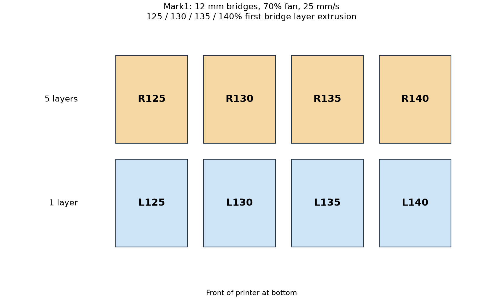

# PET-GF bridge flow bracket — Mark1

Eight 12 mm bridge swatches compare 125%, 130%, 135% and 140% of native
first-roof extrusion at fixed native strand spacing, 25 mm/s and 70% part fan.
The customer outcome is a joined underside with acceptable shape and finish.
The [Mark1 gap result](../normal-flow-cooling-v5/mark1/physical-result.json)
prefers 125% / 70% fan, with 125% / 100% fan second. The question here is whether
slightly more extrusion closes the remaining gaps without objectionable bowing.

Mark1 accepted **task 1340334508** at **18:40 CDT on 2026-10-14**, about
10 minutes after the request. The native estimate is **19 min 44 s** and
approximately **6.50 g** including added extrusion; allow about 30 minutes
with startup/calibration. The plate has 28 layers.
[Launch record](mark1/launch.json); [startup spacing and request window](startup-spacing.json).

| Front, one exposed roof course | Back, five roof courses | First bridge extrusion |
| --- | --- | --- |
| L125 | R125 | 125% |
| L130 | R130 | 130% |
| L135 | R135 | 135% |
| L140 | R140 | 140% |

L specimens isolate the first bridge layer for inspection against light. R
specimens have 1.20 mm completed roofs for inspecting the retained underside,
sag and edge shape after subsequent deposition. Each row has its own 125%
control. Compare extrusion levels within a row: native strand pitch can differ
between the single-course and five-course roofs. Later roof courses retain
native extrusion and speed.

All specimens use normal bridge mode, a 12 mm clear span, 12 mm depth and
permanent 3 mm model posts. The posts receive 100% infill and 23 bottom shell
layers so preceding anchor layers have solid fill. Their roof undersides are
Z5.48 and first roof nozzle Z5.72. The first bed layer is 0.20 mm; subsequent
Z steps are 0.24 mm. Cooling is off for the first three layers, then fixed at
70% on all model deposition. Temperatures remain 265°C first layer, 280°C
normal and 80°C bed.

Mark1 uses its fixed left hardened Standard 0.4 mm nozzle, external PET-GF spool
254, Textured PEI and +0.18 mm requested Z trim, emitted as `G29.1 Z0.16`.
The shared production material profile is unchanged. Slicer supports, skirts
and brims are disabled. The actual native bead envelope and bridge landings
are recorded in [review.json](mark1/review.json); local treatment integrity is
recorded in [local-treatments-review.json](mark1/local-treatments-review.json).
Every main first-roof stroke has both endpoint centers and its first/last
0.25 mm on nominal preceding beads, and bridge fill precedes roof walls. The
minimum full-bead bed inset is 120.5 mm. Timelapse and Bed Leveling are On;
Flow Dynamics and Nozzle Offset Calibration are Auto.

For inspection, retain the labels and original layout. Hold L125–L140 against
the same light to compare remaining gaps, and inspect their sag and corners.
Then inspect the matching R undersides for retained ridges, bowing and excess
material. Prefer the least extrusion that gives comparable joining and useful
shape. No new fixtures or purchases are needed. Appearance alone does not
measure adjacent-line strength. Physical results remain pending in the
[observation sheet](observations.csv).

The [Mark2 finish matrix](../finish-matrix-v6/README.md) supplies the matched fin,
speed, direction and ramp comparisons. This plate assesses permanent-post
bridges; fin removal and slicer support-interface finish have separate scope.

`prepare.py` creates the editable project and meshes using the existing v4
geometry helper. Slice with the installed Bambu Studio CLI, preserving
placement and orientation, to `mark1/native.gcode.3mf`. `finish.py` applies
only named first-roof Bridge-feature E multipliers and per-object fan commands.
Those local G-code treatments are absent from the editable project alone.
The [print-only packaging record](mark1/packaging.json) binds unchanged reviewed
G-code bytes to the submission archive.
