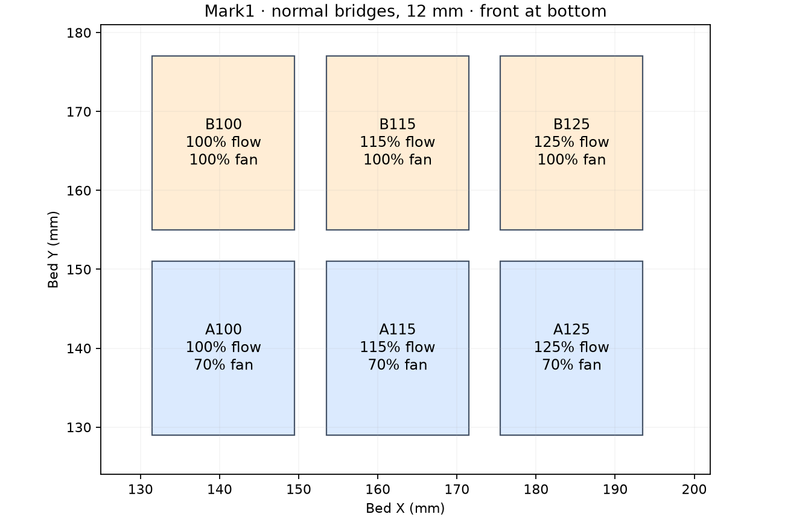

# Normal PET-GF bridge flow and cooling — Mark1

Six 12 mm bridge swatches refine the visually preferred N100/N125 pair in the
[completed Mark1 trial](../bonding-and-fins-v4/mark1/physical-result.json).
Derek finds the bottom-left and bottom-middle specimens similar, with no clear
winner; N100 may be better. The intended outcome is a joined first bridge layer
with a useful retained surface, without adding unnecessary material or bowing.

Mark1 accepted **task 1340156908** on 2026-10-14. The native estimate is
**14 min 53 s**, approximately **3.50 g** including the local extra extrusion.
[Launch record](mark1/launch.json). The [physical result](mark1/physical-result.json)
ranks bottom-right **A125 first** and top-right **B125 second** for fewest gaps
when held up to light; the other four are worse, without a reported order.
Both preferred pieces use 125% extrusion at 25 mm/s. A125 uses 70% fan and
B125 uses 100%. This selects A125 for optical gap closure; sag, retained finish
and adjacent-line strength remain unreported for this plate.

| Front row, 70% fan | Back row, 100% fan | First bridge fill extrusion |
| --- | --- | --- |
| A100 | B100 | 100% of native normal-bridge E |
| A115 | B115 | 115% |
| A125 | B125 | 125% |

**All six use normal bridge mode.** Each has the same 12 mm clear span, 12 mm
depth, permanent 3 mm posts and one nominal 0.24 mm roof course. A100 and A125
repeat the N100/N125 treatments; 115% is an intermediate volume. A/B counterparts
test whether increasing cooling improves shape while preserving line joining.
The repeated endpoints also provide a check on the earlier visual ranking.

The post height, native bridge spacing and speed are retained: roof underside
Z5.48, first roof nozzle Z5.72, 30 main strokes at 0.377–0.378 mm pitch and
25 mm/s. Bridge fill prints before the roof walls. In every specimen, both
endpoint centers and the first/last 0.25 mm of each main stroke lie on previous
post beads. [Submitted path review](mark1/review.json).

## Inspect the result

Compare neighboring strands against light and by gentle handling before cleanup.
Record visible gaps, independently moving strings, bowing and excess material
separately. Compare A100/A115/A125 to find the least extrusion with a useful
joined surface; compare each A/B pair to decide whether 100% cooling improves
that result. Equal quality favors the lower extrusion. This requires no new
fixtures or purchases. Do not infer measured bond strength from appearance.

The [observation sheet](observations.csv) records the reported gap ranking and
leaves other criteria blank. These roofs span permanent model posts. The
[Mark2 finish comparison](../finish-matrix-v6/README.md) contains the A125
first-roof settings in C04/F04/Y04 and the same extrusion/cooling at 15 mm/s in
C03/F03/Y03. Its five-course roofs assess retained shape and fin release.
This plate does not establish the first-model-layer finish above a
slicer-generated support interface or a production sliding fit.

## Settings and provenance

Polymaker Fiberon PET-GF15 uses Mark1's fixed left hardened Standard 0.4 mm nozzle,
external spool 254 (printer metadata PET-CF), Textured PEI and +0.18 mm requested
Z trim, emitted as `G29.1 Z0.16`. The working-profile temperatures are 265°C first
layer, 280°C normal and 80°C bed. Cooling is off for the first three layers,
then fixed to each specimen's 70%/100% treatment on all model extrusion.
The first bed layer is 0.20 mm; subsequent Z steps are 0.24 mm. Slicer supports,
skirts and brims are disabled. Native model-bead edge inset is at least 129 mm.
The shared material profile is unchanged.

The manufacturer troubleshooting basis for comparing flow and cooling on
repeated bridge specimens is [Prusa's bridge guidance](https://help.prusa3d.com/article/poor-bridging_1802).
The selected 100–125% range comes from this PET-GF physical result. More cooling
is a candidate to test, not an established improvement in line joining.

The editable project and meshes come from `prepare.py`, using the v4 geometry
helper with an explicit destination. Slice with the installed Bambu Studio CLI:
`--arrange 0 --orient 0 --slice 0 --outputdir <absolute mark1 directory>
--export-3mf native.gcode.3mf <absolute source project>`. Then run `finish.py`
with `tools/cad-venv/bin/python`. The finish step applies local first-roof
Bridge-feature E multipliers and labeled part-fan commands; the editable 3MF
alone does not contain those G-code treatments.

The print-only archive preserves every reviewed G-code byte and embedded MD5;
[packaging record](mark1/packaging.json). Timelapse and Bed Leveling are On;
Flow Dynamics and Nozzle Offset Calibration are Auto. The startup-spacing
record binds the start to the other printer's accepted job.
