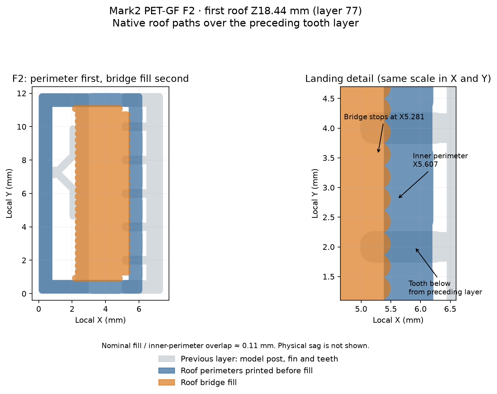

# PET-GF short bridges and full-length ramps — Mark2

This comparison asks whether small bridges form on dependable model anchors,
whether a removable fin provides a usable landing, and whether fixed part-fan
cooling improves the retained surface. The customer outcomes are clean visible
surfaces and smooth sliding faces after support removal.

The two plates use the same 16 test meshes and placements. A separate embossed
FAN 0 or FAN 30 tag identifies the cooling treatment. Mark2 accepted the fan-off
plate as **task 1339729875** on 2026-10-14; [its launch record](launch-fan0.json)
binds the submitted archive to acceptance and completion. The
[physical result](physical-result-fan0.json) records stable C bridges with
unacceptable retained underside finish and formation failure on every F bridge.
The 30% plate is prepared and unsubmitted. It compares fixed 30% cooling against
the deliberately fan-off plate; it is not an increase over the working profile's
maximum. Its F row retains the sparse landing geometry.
[Plate map](plate-layout.png).

Each native estimate is **about 56 min 42 s and 21.18 g**, across **115 layers**.
The complete emitted model-bead envelope stays at least **101 mm** inside the
usable bed boundary. The native review confirms 0%/30% part-fan commands on
every ramp feature and the first roof layers, with 25 mm/s axial bridge rasters.

| IDs | Geometry and question |
| --- | --- |
| C2, C4, C6, C8 | 2, 4, 6 and 8 mm clear bridges between two permanent 3 mm model posts. Both end anchor regions exist before the roof starts. |
| F2, F4, F6, F8 | The same clear spans from a permanent model post to seven one-layer teeth on a removable fin. The lower teeth reach 1.2 mm under the roof; the two corner teeth are 0.8 mm wide and the five interior teeth 0.5 mm wide. Six upper tines cross 0.24 mm side clearance. |
| C4Y, F4Y | 4 mm comparisons rotated 90° to bridge along bed Y. The others bridge along X. |
| S30, S35, S40 | Unsupported 30°, 35° and 40° ramps measured up from the bed, each with 14 mm horizontal reach and 12 mm depth. |
| R30, R35, R40 | The same ramps reversed 180° to compare the side that develops the edge defect. |

All IDs are embossed on bed feet. The roof is 1.92 mm thick and 12 mm deep.
Its underside starts at Z18.20 for the 2 mm span, Z20.60 for 4 mm, Z23.00 for
6 mm and Z25.40 for 8 mm. The first roof extrusions are respectively Z18.44,
Z20.84, Z23.24 and Z25.64. All ramps finish first; each shorter roof finishes
before the next span begins. An AI interruption at a longer span therefore
leaves the completed shorter roofs and ramps available for assessment.

The fin cases have one permanently anchored model end. They measure landing on
a fin after establishing a model anchor; they do not qualify a shelf that starts
entirely on two opposing fins. The C anchors hold their bridges in the reported
run. The F landings do not establish a roof, so those failures cannot select a
PET-GF free-span limit.

## Fan-off physical result and landing paths

Derek reports all five C specimens stable, with no F-style collapse. Their
bridged underside is strictly worse than a supported underside, which is itself
unsatisfactory. This demonstrates formation at the tested 2–8 mm spans and
4 mm rotated, without accepting their surface for a visible or sliding face.
[Photos](photos/04-result.jpg) preserve the retained strands and finish.

Every F specimen fails as the roof begins. Derek observes lower tines, then a
line across the tines, then bridge strands falling away. The
[native path trace](landing-path-review.json) identifies that line as a roof
perimeter printed before bridge fill. In F2, only 6 of 28 main raster far-end
centers lie over preceding tooth beads; 14 of 28 endpoint bead envelopes touch
those beads. The others depend on the freshly printed transverse perimeter.
Its centerline crosses gaps as long as 1.47 mm between preceding bead envelopes.
The middle fill stroke has about 0.11 mm nominal overlap with the inner
perimeter, so the saved paths do not establish a literal gap everywhere.
Physical collapse is consistent with an unreliable landing; actual deposited
width, sag and loss of contact are not measured.

All six ramps finish their planned 14 mm reach. Derek reports edge sag on four
of six. Assignment to S30/S35/R30/R35, leaving S40/R40 as the promising pair,
is an inference from that report, the angle-specific inspection and the
[ramp photo](photos/01-result.jpg); the latest report does not name each ID.
There is no sliding-face, bonding or strength acceptance.

The [dense-contact candidate](../dense-landing-v3/README.md) addresses landing
coverage in native paths. It is unprinted. The rejected C finish describes the
printed solid-post geometry and process; it does not establish the finish of a
correctly formed fin-supported roof. That roof and its release remain untested
in this run. The [12 mm follow-up](../bonding-and-fins-v4/README.md) has bridge
fill before walls and every main raster's two ends directly on previous fin
beads, alongside a separate first-layer fusion comparison and 70%/100% ramps.

## Basis and print process

The [first plate result](../physical-result.json) records AI interruption with
no continuation. The named failed bridges are its first three roof attempts
on layer 44, Z10.52. Its ramps have only their layer-43 extent, so S40's reported
clean edge concerns about 8.44 mm of commanded reach, not the planned 14 mm.

The [first shelf-path review](../shelf-start-review.json) shows perimeter paths
starting over sparse teeth before the axial bridge raster. A failed roof there
combines initial perimeter formation, attachment and clear-span bridging.
The C/F comparison gives those mechanisms distinct witnesses.

The [cooling audit](cooling-baseline-review.json) separates the working recipe
from this experiment's overrides:

| Recipe or print | Saved part-fan settings and emitted behavior |
| --- | --- |
| Shared `hardware/printed-parts/petgf.3mf` and current faucet projects | 0–70% normal part cooling, off for the first three layers. The current native faucet paths reach 70% during model extrusion. |
| First fin plate, completed layers 1–43 | Working-profile cooling. The emitted ramp paths range from 0–59% before the interruption. |
| This fan-off plate | Fixed 0% throughout model extrusion, an explicit local override. |
| Prepared 30% plate | Fixed 30% after the first three layers, including ramp bridge/overhang features. Unprinted. |

Thirty percent is an intermediate diagnostic level, not an established optimum
or a higher setting than the working recipe. These full-length ramp results
qualify only the fan-off treatment. The interrupted first plate provides no
complete working-profile ramp comparison. The paired 0%/30% archives do not
establish that cooling is increased relative to production, or that 30% improves
the production surface.

- Polymaker Fiberon PET-GF15, fixed left hardened Standard 0.4 mm nozzle,
  external spool 254, Textured PEI. PET-CF is its printer metadata.
- Mark2 +0.04 mm requested Z trim, emitted `G29.1 Z0.02` on textured PEI.
- 0.20 mm first layer and fixed 0.24 mm layers. Two walls, 15% grid infill,
  265°C first layer, 280°C normal temperature and 80°C bed from the working profile.
- Slicer supports, brims and skirts disabled. Feet belong to the model geometry.
- Part fan held at either 0% or 30% after the first three layers, including
  overhangs and bridges. Auxiliary-fan setting remains 0%; other working-profile
  temperatures, speeds, exhaust settings and layer-time slowdown remain the same.
- The 30% treatment is a surface-quality experiment local to this plate.
  [Polymaker's data sheet](https://fiberon.polymaker.com/wp-content/uploads/TDS_FIBERON-PET-GF15_V1.0_EN.pdf)
  recommends fan off. A smoother surface does not establish layer bonding,
  load capacity, lifetime or annealed behavior; the production profile is unchanged.

The emitted fan commands, bridge axes and speeds, contact footprints, first
roof endpoint distances, completed-ramp order and bead envelope are recorded separately in
each `.native-review.json`. The editable projects and native `.gcode.3mf`
archives carry the treatment in their filenames. Each print-only archive retains
the reviewed G-code bytes for Studio's saved-slice send. Launch metadata binds
the submitted archive, reported printer name and task ID when a plate is sent.
Endpoint distances and contact existence alone do not establish an anchored
first roof. `landing-path-review.json` includes the perimeter-before-fill order
and the preceding tooth coverage at each main raster landing.

## Read the physical result

Keep each ID with its part and photograph the undersides before sanding or
removing loose strands. Record both formation and retained finish. Use the
existing calipers and straightedge where measurements help; fingers first and
ordinary pliers only if needed for fin removal.

1. A usable C bridge must complete with a continuous retained underside and
   no drooping loose strands. Start at C2 and bracket the first failing span.
2. Compare F to C at each span. A clean C and failed F points toward fin landing
   or attachment. Failure of both leaves bridging/process behavior unresolved.
   A fin that held but tore the roof during removal is a separate failure.
3. Compare C4Y/F4Y with C4/F4. A direction difference remains part of the result.
4. On S/R, inspect the entire 14 mm reach, especially the final corner and
   each lateral edge. Note curling, sag, missing material and snagging texture.
   Reversal helps distinguish an edge/direction effect from a symmetric angle limit.
5. Compare each corresponding ID across FAN 0 and FAN 30. Use the same surface
   judgement and record downward projection when measurable. Prefer a cooling
   treatment only within the demonstrated surface scope.

The CSV sheets leave unobserved values blank. Completion alone establishes no
sliding fit. A candidate still requires a matched real joint with clean full-travel
motion and retention at its intended clearance. The staged support heights,
17-object layer return time, 12 mm depth, contact pattern and 1.92 mm section are
part of this evidence; a result is not a universal PET-GF bridge limit.

## Manual reproduction

Run `tools/cad-venv/bin/python
hardware/print-tests/petgf-fins/short-spans-v2/make_plate.py` from the repository
root. Slice each `.3mf` with the installed Bambu Studio using
`--arrange 0 --orient 0 --slice 0` and an absolute output directory.
Run `inspect_slice.py <saved-native-archive>` to collect native path evidence.
Run `trace_landing.py` for the saved fan-off roof/perimeter landing trace.
These commands are manual experiment tools and do not join a build or commit path.

Use the documented [saved-slice print submission](../../../../tools/bambu-printers.md#bambu-studio-send-from-an-existing-slice)
with Timelapse On, Bed Leveling On, Flow Dynamics Calibration Auto and Nozzle
Offset Calibration Auto. Observe at least 180 seconds between starts on the
shared printer circuit. Send the 30% comparison after a cleared-bed report.
