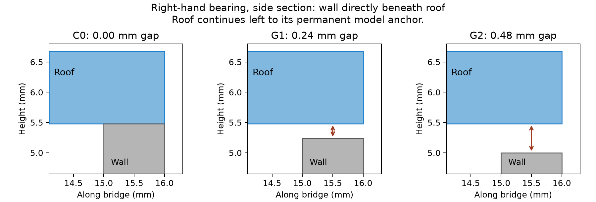
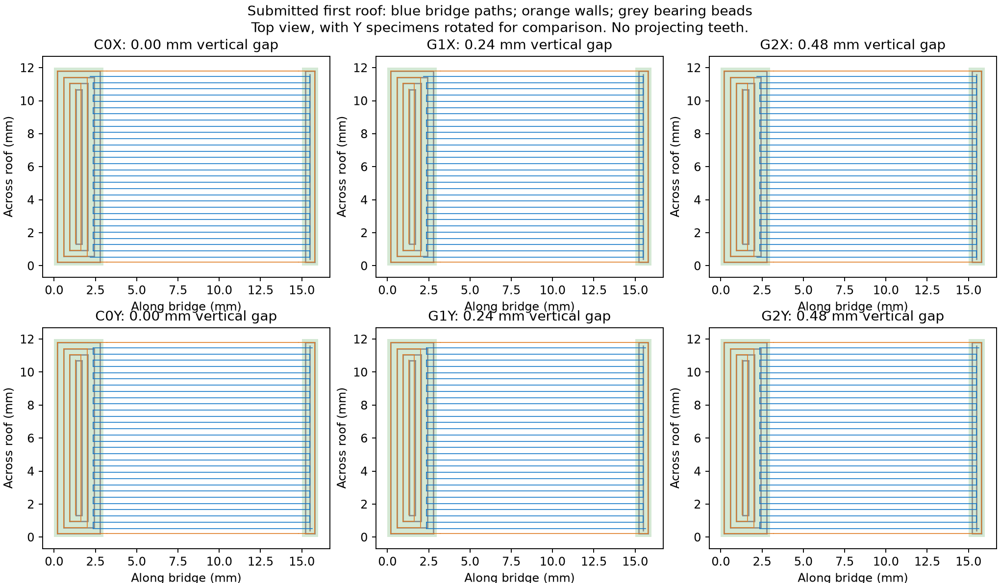

# PET-GF wall-under-roof contact and release — Mark1

This six-specimen plate tests the retained underside and removal of a vertical
wall directly beneath a roof. The customer outcome is a useful visible/sliding
surface with practical support removal. It follows the wall and vertical-gap
arrangement in the author's
[ledge calibration](https://github.com/gittrahan/support-fins/blob/511d81fc9124075cef142bfb2766bd5e8bfa777d/docs/CALIBRATION.md#gap-gapprintgap-coupon3mf).
The coupons are locally authored, not automatic PrintFins exports. Horizontal
gripping tines on sloping or side faces are a separate comparison.

Mark1 accepted **task 1340689201 at 21:30 CDT on 2026-10-14** and reported
RUNNING without errors. The native estimate is **15 min 10 s**, **4.40 g**
including added extrusion, plus printer startup/calibration. There are 28 layers.
[Launch receipt](mark1/launch.json). Physical formation, wall removal and retained
underside quality remain unreported.

| Condition | X specimen | Y specimen | Vertical clearance |
| --- | --- | --- | --- |
| Permanently joined reference | C0X | C0Y | 0 mm |
| One empty course | G1X | G1Y | 0.24 mm |
| Two empty courses | G2X | G2Y | 0.48 mm |

Facing the printer, the front row is C0X, G1X, G2X from left to right. The back
row is C0Y, G1Y, G2Y from left to right.

Every roof has a 12 mm clear span, 12 mm depth and five 0.24 mm courses. One end
is attached to a 3 mm permanent model post. The opposite end crosses a 1 mm
vertical wall wholly beneath the roof footprint. The underlying wall has a bed
foot and no projecting horizontal fingers. G1/G2 have two intentionally
disconnected mesh bodies: the anchored roof and its removable wall.

The roof underside is Z5.48; the first roof nozzle Z is 5.72. The underlying
wall's last nozzle Z is 5.48 for C0, 5.24 for G1 and 5.00 for G2. G1/G2 therefore
retain actual empty courses below the roof. C0 is a permanent connection and is
not a removable-support specimen. A permanent post at one end keeps the roof
attached while the opposite wall's contact and release are assessed.

## Native bridge paths and process

All six conditions use **one wall loop**. This makes the native first-roof
bridge raster reach across the 1 mm bearing wall. The
[submitted path review](mark1/review.json) has **30 main strokes per specimen**;
all endpoint centres and the terminal 0.25 mm at both ends are within the XY
footprints of the emitted bearing beads. Bridge fill precedes roof walls.
The first-roof perimeter also crosses the underlying wall in plan view.
G1/G2 have the stated vertical gap: XY overlap does not mean direct contact
with the immediately preceding course.

The first bridge course receives the preferred 125% native bridge extrusion,
25 mm/s and 70% part fan. Native strand spacing is retained. Cooling is off for
the first three bed layers, then fixed at 70% for all model deposition. Later
roof courses retain native extrusion and speed. All anchors have solid fill.

These are the preferred bridge settings from
[v7 R125](../flow-bracket-v7/mark1/physical-result.json), not an identical repeat:
v7 uses two wall loops, two 3 mm posts and a wider roof. C0/G1/G2 share the same
geometry and process apart from vertical wall clearance, making their within-
plate comparison the relevant gap result. X/Y expose direction differences.

The [packaging record](mark1/packaging.json) binds the reviewed G-code to the
print-only archive. All model XYZ moves are native and unchanged by the local
extrusion, speed and fan treatment. There is no manual bridge extension or
cantilever-tooth geometry. The complete native bead envelope is at least
125.5 mm inside the usable bed boundary; slicer supports, brims and skirts are off.

Polymaker Fiberon PET-GF15 uses Mark1's fixed left hardened Standard 0.4 mm
nozzle, external spool 254 (black PET-CF metadata), Textured PEI and +0.18 mm
requested trim, emitted `G29.1 Z0.16`. Temperatures remain 265°C first layer,
280°C normal and 80°C bed. The first bed layer is 0.20 mm, subsequent Z steps
0.24 mm. Timelapse and Bed Leveling are On; Flow Dynamics and Nozzle Offset
Calibration are Auto. Both printers were idle before this launch; the prior
Mark1 start was more than three minutes earlier. The production profile is unchanged.

## Assess the cooled coupons

Keep each embossed ID with its roof. Compare the underside and edge shape of
C0, G1 and G2 in each direction. On G1/G2, bend the underlying wall away by its
foot, using fingers first. Record whether it comes off cleanly, leaves bonded
material, or tears the roof skin. C0's wall is permanently joined; leave it intact.

A useful candidate forms a complete roof and allows wall removal without
tearing it, leaving no loose strands or snagging underside texture. If one gap
releases cleanly and preserves an acceptable surface in both directions, it
selects a wall-clearance candidate for a real surface. A fused one-layer gap
and a rough two-layer gap remain a material/process limit to address, not a
successful support result. Structural capacity and sliding-joint feel are not
established by this coupon. No additional fixture or purchase is requested.

## Manual reproduction

Preserve the submitted files before regenerating them. `prepare.py` writes the
editable project, meshes and manifest using the repository CadQuery runtime.
Slice with Bambu Studio `--arrange 0 --orient 0 --slice 0`, exporting
`native.gcode.3mf` to the absolute `mark1` output directory. `finish.py` applies
the named local E/fan/speed treatments, reviews native wall crossings, draws
the paths and packages a new print-only archive. The editable project alone
does not contain those local G-code treatments. These are manual experiment
tools; no build or commit check is added.
