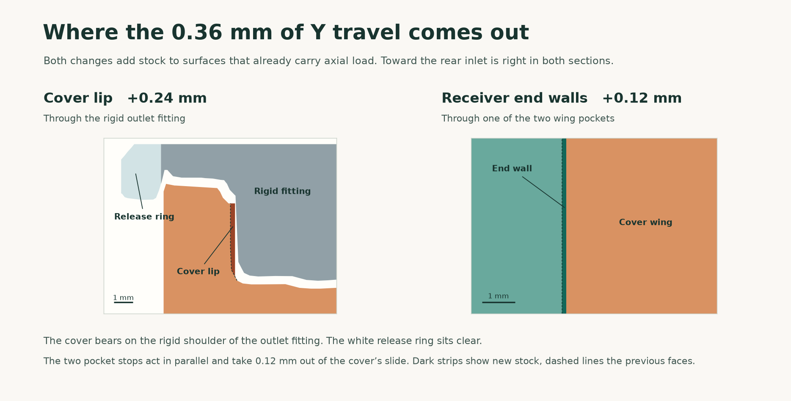

# Full Pisco snap fit on Mark2

This trial pairs a full-length cover and receiver with the real Pisco RVFUP1/4–1/4-0.3 regulator. They carry the wide, inward-curved wings and the one-notch receiver from the Mark2 comparison. Derek felt very little waggle in either coupon and thought the one-notch pair seated slightly better. The full cover has an 8 mm-wide, 2 mm-long contoured pad over the widest part of the molded housing. The neck lip, release-collet clearance, rear inlet passage and 3 mm upper bearing come from the fitted production assembly. [Filmed choice](../open-snap-section/prints/2026-11-25-mark2-flush/physical-result.json) · [Full parts and dimensions](parts/geometry.json)

## Three dots on the full Pisco

In C037 Derek could press the full one-dot pair together easily, found no perceptible wobble and felt significantly less end travel at the rigid fitting. Of the three short pairs on the same plate he preferred the three-dot snap. The full three-dot cover and receiver carry those two working profiles on the full one-dot hardware seats. Look for three recessed dots on the cover back and three on the receiver flange. [Filmed full-pair result](prints/2026-11-26-mark2-easy-entry/physical-result.json) · [Three-dot pair and bench comparison](parts/three-dot/README.md)

## Two dots and a 0.20 mm closer saddle

The first full cover sat flush and stayed firm in hand while the regulator inside could wiggle and spin. This pair uses the 2.60 mm feet and neutral catches from the two-dot coupon. The inner cradle moves 0.20 mm toward the molded regulator body, measured at the same snap position. A short lead at the outlet end eases the transition into the raised cradle. [First full pair in hand](prints/2026-11-25-mark2/physical-result.json) · [Two-dot coupon in hand](../open-snap-section/prints/2026-11-25-mark1-solid-pairs/physical-result.json) · [Full-size trial geometry](parts/two-dot-drop/geometry.json)

With the regulator installed, compare motion at its white outlet while holding the receiver, then press each cover edge to see whether both feet still sit flush. Wiggling the outlet checks radial play. Turning it checks friction against the round housing. [Saddle before and after](prints/2026-11-25-mark2-two-dot-drop/saddle-section.png) · [Mark2 print](prints/2026-11-25-mark2-two-dot-drop/print-job.json)

To reproduce this pair, pass `-- --two-dot-drop` to the Cargo command below and select `pisco-two-dot-drop` when slicing.

## Taking up the remaining Y travel

In C035 Derek feels friction when he turns the regulator and very little sideways wiggle. In the side view the rigid gray body still slides about 0.55 mm from end to end. Its molded circle and chevron both move relative to the printed opening. The 0.24 mm cover layers beside them provide the scale. [Registered frames and bench result](prints/2026-11-25-mark2-two-dot-drop/physical-result.json)

The full axial-grip pair carries the newer two-dot guide and the saddle from that filmed full Pisco. On the cover, the short-outlet lip reaches one more 0.24 mm layer toward the rigid fitting shoulder. On the receiver, the forward ends of the two wing pockets advance 0.12 mm together, taking up some of the cover's own slide. The total Y reduction is 0.36 mm. The modeled travel would approach zero in the tightest seated position with a 0.40 mm reduction. The cover clears the white release ring throughout the modeled end travel. [Measured axial stops and release-ring clearance](parts/axial-grip/fit-check.json) · [Mark2 trial and handling](parts/axial-grip/README.md) · [Mark2 plate](prints/2026-11-25-mark2-axial-grip/print-job.json)



To reproduce this pair, pass `-- --axial-grip` to the Cargo command below and select `pisco-axial-grip` when slicing.

## Starting the cover by hand

C036 shows the incoming feet stopping against the fixed rim on the last coupons. Two grooves on the aluminum outlet also move about 0.4 mm relative to the printed lip in the previous complete assembly. [Straight-push comparison](../open-snap-section/prints/2026-11-25-mark1-guide-contact/physical-result/straight-entry-comparison.jpg) · [Rigid outlet movement](prints/2026-11-25-mark2-axial-grip/physical-result.json)

The full one-dot Pisco uses the same entrance and holding faces as the one-dot coupon. A long receiver ramp gets under the relaxed 2.60 mm feet, and a 1.20 mm nominal shoulder retains each wing when seated. Backed chamfers at the ends guide the full cover into its fore-and-aft registration. A 7.5 mm-wide bearing under the aluminum outlet taper can take up some axial movement during final closure. It grows from the existing saddle and sits behind the white release ring. [Snap entry](prints/2026-11-26-mark2-easy-entry/entry.png) · [Outlet bearing](prints/2026-11-26-mark2-easy-entry/shoulder.png) · [Full assembly checks](parts/easy-entry/fit-check.json)

The full pair and all three dot-marked coupon pairs share the `pisco-easy-entry-set` Mark2 plate. [Plate key](prints/2026-11-26-mark2-easy-entry/plate-key.png) · [Bench procedure](parts/easy-entry/README.md) · [Print record](prints/2026-11-26-mark2-easy-entry/print-job.json)

## Try the pair

1. Rest the receiver on its flat roof face with the channel facing up. Start the regulator about 16 mm forward of its final position, with its long inlet neck facing the rear bore. Lower it into the channel, then slide it back until the neck enters the bore. The short outlet and its release ring face the open end.
2. Point the cover’s raised saddle lip toward the short outlet. The longer solid tail goes toward the rear bore. Bring the cover straight down over the loose receiver and press above both wings until the hooks seat.
3. Look along each crest where it meets the roof. Press alternately over the two wings, then over the center. Feel whether the regulator moves under the cover, whether a crest lifts, and whether the cover returns to the same position. Spread the exposed spring edges to clear the catches and lift the cover off.
4. In an assembled corner, remove the ASSE and meter groups in the production sequence. Tip the Pisco cover in from the side past the meter shoulder, keeping the tail just clear of the rear wall. Square it over the regulator for the last straight push. Reverse this motion for removal. [Production service sequence](../../printed-parts/enclosure/rear-equipment-caps/README.md) · [Measured paths and hardware clearances](fit-check.json)

Both wings have 2.00 mm lands and 0.80 mm inward bias before assembly. They run 37.32 mm along a 41.70 mm cover. The printed toolpaths put the local pad and the regulator into light contact by the time the crests reach their roof. On the installed regulator mesh, first contact with the pad and the receiver leaves about 0.015 mm of modeled take-up at the roof stop. The contact follows the body across the pad. The fitting and collets remain free. [Full pair fit check](fit-check.json) · [Mark2 plate key](prints/2026-11-25-mark2/plate-key.png)

## Reproduce the parts

The generator takes the working end profiles directly from the two Mark2 coupon STLs and registers them to the full production spring and pocket ends. The cover prints on its forward axial end and the receiver prints on the original enclosure roof. [Generator](pair.rs) · [Receiver print features](parts/pisco-receiver.print-features.json)

```sh
tools/run -- cargo run --release --locked -j2 --manifest-path tools/hsm/Cargo.toml \
  -p hsm-tooling --bin pisco-wide-snap
tools/run -- tools/hsm/target/release/enclosure-print-prep pisco-wide-pair \
  --printer Mark2 --bed 'Textured PEI Plate' --slice --review
```
