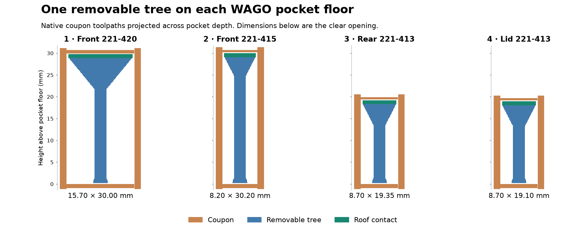

# WAGO pocket support removal

Each coupon has one blind production pocket and one removable tree. The tree sits over the pocket floor and flares into a three-course crown beneath the transverse roof bridge. The 8 mm side cheeks and blind back, 7.16 mm floor and 6 mm roof give a screwdriver a solid edge to bear against. The dots recessed into the top of the blind back identify the specimen after removal from the plate.

| Dots | Printer | Production pocket | Sites | Width × height × depth |
| --- | --- | --- | ---: | --- |
| 1 | Mark1 | Front top, MAN-A, WAGO 221-420 | 1 | 15.70 × 30.00 × 8.70 mm |
| 2 | Mark1 | Front top, MAN-B, WAGO 221-415 | 1 | 8.20 × 30.20 × 8.70 mm |
| 3 | Mark2 | Back top, WAGO 221-413, three mains and three west-wall junctions | 6 | 8.70 × 19.35 × 9.45 mm |
| 4 | Mark2 | Cold-core lid, WAGO 221-413, both banks | 4 | 8.70 × 19.10 × 9.45 mm |

The coupons use the production [removable tree](../../printed-parts/enclosure/enclosure/back-top/print_supports.rs). Its crown extends 0.24 mm past the mouth to back the outside perimeter. In the emitted toolpaths each 3.34 mm foot sits entirely over the pocket floor. The longest unbacked section of either mouth-wall road measures 0.017 mm in all four slices. Both plates use black Fiberon PET-GF15 with smooth timelapse and a cooling tower. The shortest commanded deposition time spent away from a coupon between pocket layers ranges from 28.01 to 29.28 seconds. [Mark1 front plate toolpaths](prints/2026-11-27-front-mark1/coupon-toolpaths.json) · [Mark2 rear and lid plate toolpaths](prints/2026-11-27-rear-lid-mark2/coupon-toolpaths.json)

The [coupon source](coupon.rs) produces the four STLs and their support records. The `front-wago-pry` and `rear-lid-wago-pry` entries in the [plate recipes](../../printed-parts/enclosure/trial-preparation/pieces.json) prepare the Mark1 and Mark2 projects.

The [Mark1 job](prints/2026-11-27-front-mark1/print-job.json) carries the one- and two-dot coupons. The [Mark2 job](prints/2026-11-27-rear-lid-mark2/print-job.json) carries the three- and four-dot coupons. The physical checks are whether each tree releases through the mouth, the lip and roof stay intact, and the corresponding connector seats fully.
