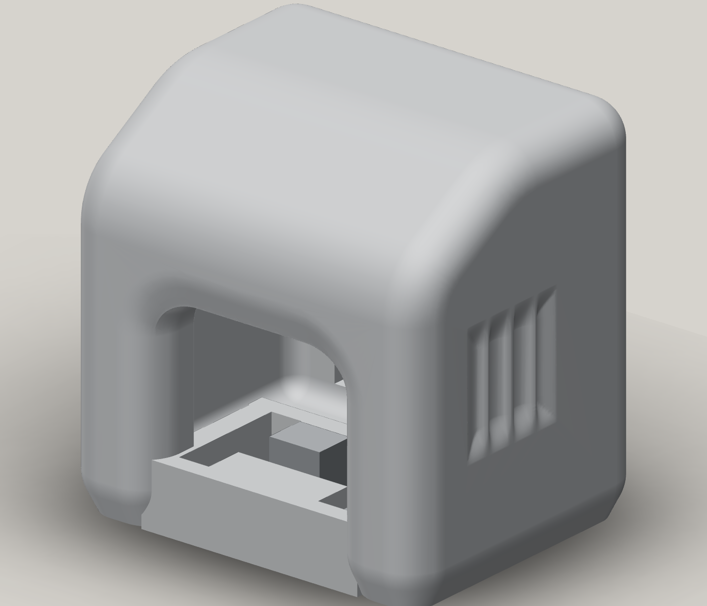

# The Pour V4 · Arch

The Pour is a **60 × 48 × 60 mm** reference object for selected printing
mechanisms in the home soda machine. Its rounded arch, display-profile crown,
fluted flank and one captive slide form a single assembled object. Nine readings
cover curved surfaces in different print orientations, the display transitions,
sliding fit, support release, a teardrop opening, seam finish and texture.

[Explore the model](https://homesodamachine.com/3d#step:printed-parts%2Fcalibration%2Fsoda-studies%2Fthe-pour.step)
· [Editable Bambu Studio project](prints/the-pour-v4-petgf.3mf)
· [Download the print kit](https://github.com/derekbreden/homesodamachine/releases/download/the-pour-v4/print-kit.zip)

The prepared editable PET-GF project uses Mark2's left 0.4 mm nozzle, a
0.20 mm first layer, uniform 0.24 mm model layers and six walls. The native
estimate is **2 h 11 min and 64.54 g**, including supports, with a complete-bead
edge margin of 123.379 mm. [Print preparation](print-preparation.json) records
the recipe and slice. The Arch is unprinted.

Print complete objects to compare recipes. Each object uses one uniform model
layer height after its first layer, one support recipe and one fixed
slide configuration. Change one chosen variable between prints and keep the
other geometry and settings fixed. Import the supplied meshes at 100% scale;
the prepared project retains their shared print-in-place arrangement.

The [feature guide](feature-guide.md) connects each reading to a setting to try
on the next complete print. The blank [reference card](reference-card.csv)
records one object's recipe and nine observations. Keep the material, lot,
date and recipe with the physical object, and compare corresponding faces under
the same light. Write a recipe ID with a marker on an existing inside side-wall
flat and use the same ID on the card.

Layer, material and support settings are edited in the single project. The
geometry generator's `--xy-air` and `--z-air` options set the slide's running and
release clearances for a whole build. `prepare_reference.py --slice` prepares the
current geometry with its one recipe in the repository's normal CAD runtime.

Physical release, movement and surface quality remain unmeasured. Confirm a selected recipe on
the relevant complete machine part; production loads, sealing, retention and
service life require their own evidence.
