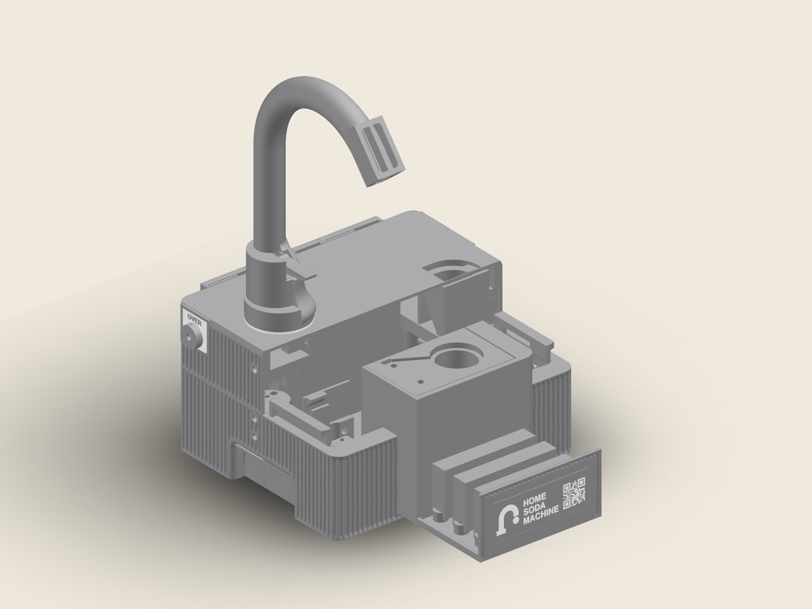

# The Pour

The Pour is a print reference shaped as a working section of the home soda
machine. The complete faucet rises from its counter plate. The fluted enclosure
opens on the machine's joints; its cartridge drawer carries the support
comparisons. Inside are the actual clips, hardware seats, passages and service
interfaces. Three captive rear shutters add a print-in-place release comparison.

The assembled reference occupies approximately 271 × 239 × 389 mm. Its 41
logical printed parts have 47 registered display volumes. The
[feature guide](feature-guide.md) explains how to open it, read each feature and
choose a local setting to try. The [source map](fullfeature-map.json) connects all
83 inventory entries to their native roles and source builders; overlapping
geometry, materials and process conditions share their actual parts.

[Explore the assembled model](https://homesodamachine.com/3d#step:printed-parts%2Fcalibration%2Fsoda-studies%2Fthe-pour.step).


## Print and handle

The [print kit](https://github.com/derekbreden/homesodamachine/releases/download/the-pour-v3/print-kit.zip) contains manufacturing STL meshes, STEP geometry,
editable Bambu Studio projects, frozen faucet inputs, source helpers and the
reading key. The complete archive is hosted in the versioned repository release;
[print-kit.json](print-kit.json) identifies every member and its digest. Import at 100% scale. Each mesh already carries its manufacturing
orientation; the assembled STEP carries the separate display pose. Keep colour
volumes registered and print the three captive flags with their rear-shell
parent in its shared frame.

Use the prepared projects for their source PET-GF, registered colour and three
separate TPU recipes. They preserve the saved Mark2 material assignments,
nozzle correction and requested trim. The kit contains eighteen editable
projects. Their saved-profile estimates total 75 h 51 min and 2.07 kg across
all plates, including supports and registered colours. The smallest complete
bead margin is 20.210 mm. Per-plate readings are recorded in
[print-preparation.json](print-preparation.json). Printer and material mapping
belong to the chosen printer. Preparation and local slicing send nothing to a
printer.

The neck contains layer-height and scarf comparisons in height bands on the
complete faucet. Two untouched short necks provide the regular-gap settings
that require separate native parents. Three bolted drawer crossmembers compare
support release on the same complete handhold profile. The native shell rails,
drawer, tee column and full-span snaps are the tactile fits. The guide gives
all gap conventions, band coordinates, service dependencies and support exits.



Record a filament, lot, date and recipe with each object. The underside carries
THE POUR, V3 and a writable BATCH / DATE field. A blank
[reference card](reference-card.csv) separates the initial result from cleanup,
freeing and the next complete-part result. Compare surfaces under the same light
and orientation, and keep one physical reference per material/recipe when that
comparison is useful.

The service section is unprinted. CAD establishes nominal geometry and sampled
service clearance; native slices establish commanded deposits and settings.
Physical release, fit, finish, sealing, force, inversion and lifetime remain
unmeasured. Accepted machine observations retain the scope of their identified
source prints in the guide.

## Generate the current master

These are manual repository tools. The geometry generator reads production CAD
interfaces and frozen faucet inputs, then emits the meshes, assembly and
explicit print plan. The preparation tool reads that plan without changing the
geometry. Source helpers require this repository and its normal CAD runtime;
the editable print projects contain their complete saved settings.

```sh
HSM_NO_BUILD_LOCK=1 tools/cad-venv/bin/python hardware/printed-parts/calibration/soda-studies/reference.py
tools/cad-venv/bin/python hardware/printed-parts/calibration/soda-studies/prepare_prints.py --slice
tools/cad-venv/bin/python hardware/printed-parts/calibration/soda-studies/package_kit.py
```

[manifest.json](manifest.json) records each physical part, its exact inputs,
manufacturing frame, material volumes and assembled pose.
[assembly-review.json](assembly-review.json) records the nominal service,
capture and passage review. [lettering-review.json](lettering-review.json) records
native deposit readings for the markings. The viewer retains the supplied print
triangles, including the separate source seated elastic cover representation.
