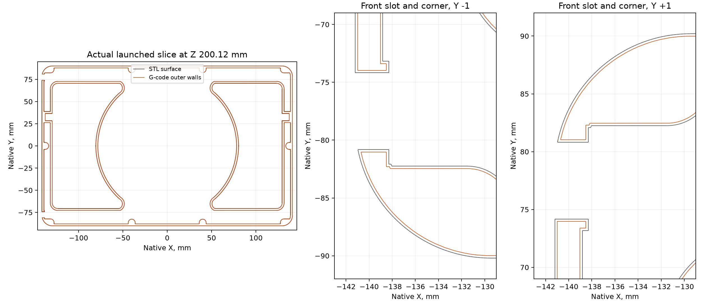

# Sent-file audit after the photographed surface defects

Derek supplied seven photographs showing a rippled, locally porous patch near
the upper corner of a long wall and rough, porous vertical slot edges. His
request was to establish whether those shapes exist in the model or slice
before diagnosing the printing process.

## Finding

No residual fluting or programmed grooves and holes matching the reported
defects were found in the recorded launch archive. The long exterior faces
are planar in its embedded mesh. The straight portions of all four slot-edge
paths remain straight through the upper wall height.

This is a digital geometry and command audit. It does not establish a machine
fault or qualify the print recipe, deposited flow, actual motion or local
feature printability. The photographed exterior finish is a failed result.

## File identity

- Mark2 task: **1375153599**.
- Archive: `2026-10-25-foam-shell-mark2-bdc6554c.gcode.3mf`.
- Archive SHA-256: `eb7cace8315b75891dfa78034024dcf391ca1559159434847b05bd49f15bce89`.
- G-code SHA-256: `997f6329859e50dde11ca60b47fa16d7cf2ed7fad870896cae647fc1cc54c13a`.
- Source STL SHA-256: `b705e3aa5eee906839456b84d7f6419a655db4197b1483d9d05efb3d23149bcd`.

The archive matches the [launch receipt](../launch.json), and the preserved
copy handed to Bambu Connect is byte-identical. The G-code's stored MD5 also
matches. All **44,578 oriented triangles** in the embedded sliced model match
the source STL, with a maximum vertex-coordinate difference below 0.000004 mm
from decimal serialization. The mesh is closed, consistently wound and has
no zero-area facets.

No same-named archive was found in the printer's root or cache directories
during the read-only storage check. File identity here is bound by the launch
receipt and the preserved sender input, rather than a retrieved printer copy.

## Surface and toolpath inspection

- First-surface probes across both long faces and the front panel find their
  specified planes. Separate probes along both middle-panel slot edges at
  nine heights from 40 to 213 mm find no change in edge position.
- All **889 layers** were read. On each of the **879 layers above the floor
  region**, the long face opposite the PRV vent is one straight outer-wall
  extrusion segment. Its normal-coordinate variation across the whole height
  is below **0.004 mm**; it contains no repeating flute motions or interrupted
  deposition pattern.
- From Z 40 mm upward, each of the four slot edges has one straight commanded
  outer-wall segment on every one of **723 layers**. Their normal coordinates
  are constant. The lower slot ends retain their specified rounding.
- The specified PRV opening on the opposite long face accounts for its local
  nonplanar moves at Z 168.44–176.12 mm.
- No outer-wall path starts were found on the slot-edge region above Z 20 mm.
  The aligned seams on the large sampled contours are on interior features,
  with approximately 0.06 mm start/end gaps. The photographed vertical edge
  damage is not a row of programmed gaps at an exterior seam there.

The section is Z **200.12 mm** in the actual launched job. Gray is the STL
surface; orange is the emitted surface-perimeter centerline, inset by roughly
half its 0.42 mm bead width. Inner perimeters are not shown. The slot shoulders
are the specified copper-cover bearings; no isolated mesh fins or periodic
notches appear in these contours.

## Geometry, motion and deposition

The [physical interpretation](physical-interpretation.md) traces the extrusion
directions around the photographed corner. Local flex and vibration of the
tall wall and free slot edge is the leading hypothesis. The designed foam
void is empty during printing, and the nozzle's short turns at the slot lip
immediately precede the rippled long face. This interpretation is an inference;
no wall motion or contact force was measured. A smooth mesh and straight
commands do not establish dynamic printability.

The inner-wall inspection also finds a separate four-move loop about 1.6 mm
long at each slot corner on 722 upper layers, with a retract/unretract and
wipe sequence around it. The exterior-only audit did not inspect those
internal starts and stops. Their contribution to local edge roughness remains
an inference; they are recorded with exact moves in the physical interpretation.

The emitted flat-face and slot-edge moves request **200 mm/s** and
**5,000 mm/s²** outer-wall acceleration. Inner walls request up to 300 mm/s
with the filament's 18 mm³/s limit; the saved default acceleration is
8,000 mm/s². The outer flat face has uniform commanded extrusion per distance.
The firmware's realized speed around a short corner is not measured here.

Fuzzy skin and scarf seams are off. Seam placement is aligned with a saved
15% gap. A saved pressure-advance override flag is not a measurement of the
printer's runtime calibration; launch used automatic flow calibration.

The shell's stiffness during printing, local toolpath order, motion and
physical deposition require consideration together. This audit does not
establish an isolated hardware fault or clear the part's printability simply
because the geometry is smooth.

The [machine-readable audit](audit.json) includes the measured regions,
checksums and hashes of the seven supplied photographs. Geometry and printer
settings were not changed during this inspection.
