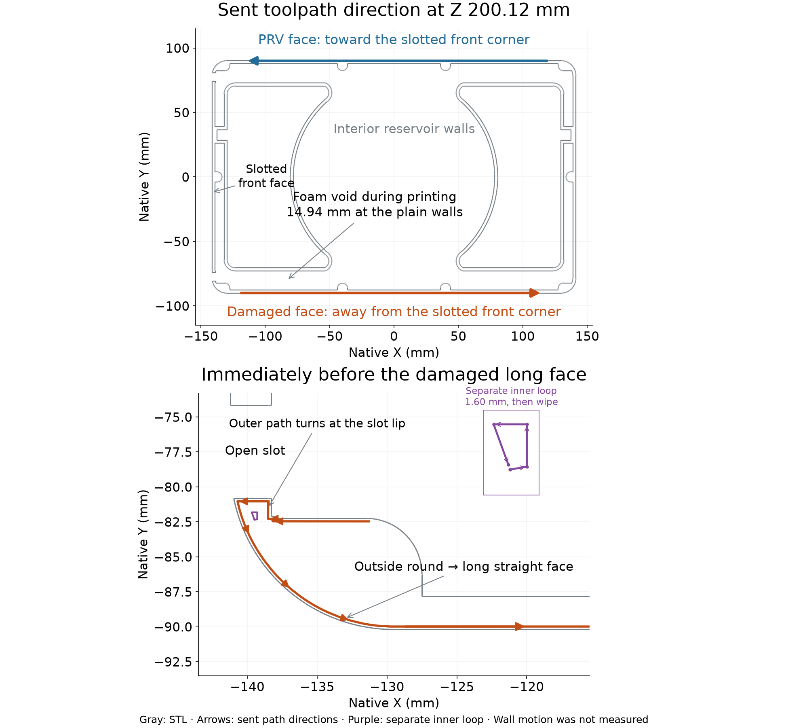

# Physical interpretation of the photographed shell defects

The leading explanation is local flex and vibration of the tall, slotted wall
under deposition forces, interacting with the nozzle's motion around the slot
and corner. This is an inference from the photographs, geometry and sent
toolpaths. Actual wall displacement, toolhead displacement, contact forces and
temperature at the depositing surface were not measured.

The [sent-file audit](README.md) establishes that the reported corrugations and
voids are not programmed into the smooth shell. Smooth coordinates alone do
not establish that this geometry will remain stationary during printing.
Geometry, toolpath, motion and deposition form one physical problem; a
recipe-versus-hardware distinction does not describe it adequately.

## Direction and geometry in the sent job

The face opposite the specified PRV opening corresponds to the long face in
photos 1–3; photo 4 identifies the other face by that opening. On the former,
the exterior path leaves the slotted front corner and proceeds toward the
rear. On the PRV face, the exterior path proceeds from the rear toward the
slotted front corner.

This direction is present in all nine retained samples, from Z 5.00 to
213.32 mm. They request the same 200 mm/s outer-wall speed and 5,000 mm/s²
acceleration. These are firmware inputs, not measurements of the realized
speed around the short turns.

At Z 200.12 mm, immediately before the damaged face, the path travels along
the inside of the front corner, around the slot seating lip, around the
outside corner, and onto a 259.30 mm straight move. The small lip moves are
0.190, 0.264, 1.250 and 2.190 mm long, with several sharp changes of direction.
The straight exterior segment is G-code line 3,505,976; the cleaner opposite
face's straight segment is line 3,506,032. Both have ordinary uniform extrusion
per distance.

The standing shell is 213.4 mm high with ordinary 2.38 mm walls. Its two front
slots are 6.65 mm wide and run open through the top, interrupting the connection
between the front panel and the two corner returns over most of the height.
The ordinary long walls have a 14.94 mm foam gap to the reservoir-pocket walls.
That gap is empty during printing. The 15% gyroid setting applies to printable
stock; it puts no bracing into this designed void. Bosses thicken local wall
sections but do not span the ordinary gap to the reservoir walls.

## Small inner-perimeter loops at the slot corners

The inner walls contain a separate four-move loop inside each corner next to
its slot. These do not appear in the exterior-only trace in the initial
audit. At Z 200.12 mm the negative-side loop is **1.601 mm long**, with only
**0.06083 mm of positive filament advance** over its entire perimeter. Its
four moves request 188.21 mm/s and 8,000 mm/s²; the short path and corners
limit the realized speed.

Before that loop, the head makes a 0.4 mm Z lift, travels to the corner,
returns to the depositing height and unretracts 0.8 mm. It prints the four
moves, wipes back around the same little contour while retracting 0.76 mm,
then retracts the remaining 0.04 mm and travels to the other corner. The
unretract replaces the preceding retract; it is not evidence of 0.8 mm of
excess extrusion into the loop.

The [inner-loop study](inner-loop-study.json) finds one such short loop per
corner on **722 layers from Z 40.04 to 213.08 mm**. Both corners receive this
sequence. It is a specific recurring start, stop, flow-recovery and wipe
sequence at the flexible edge, rather than a continuously traversed six-line
wall. It is a plausible local contributor to poor deposition and disturbance,
not a demonstrated flaw by itself. Because both corners have these loops,
they alone do not explain the different broad-face finishes.

## Mechanism supported by those observations

A depositing nozzle can load the structure even when its programmed contour
is correct. In-plane deposition drag has been measured in
[FFF experiments with reinforced thermoplastics](https://www.sciencedirect.com/science/article/abs/pii/S0266353825003112).
That establishes a physical loading mechanism, not the force magnitude for
this PET-GF job. Contact with a raised bead would add another load; contact
during this print has not been established.

The open slot provides a free edge at the location where the toolpath makes
its small turns and repeated short-loop visits. As the wall grows, the top
has a longer flexible load path
to the floor and remaining shell connections. Local flex and vibration are
therefore plausible even with a sound printer and correctly packed beads.
The assembled, foam-filled core's stiffness does not represent the stiffness
of this open shell during deposition.

The strongest ripples are near the upper front corner and weaken away from
it along the long face. That direction agrees with the nozzle leaving the
slot and corner, then depositing along the straight face. The reversed
direction on the cleaner opposite face is a useful comparison: its exposed
long face is deposited before the nozzle negotiates that front slot lip.
These observations favor a local geometry-and-motion interaction over an
unlocated hardware fault, without isolating the vibrating component.

In a simple displacement model, the material's position relative to the wall
depends on nozzle position minus wall displacement. A straight nozzle command
can therefore deposit a wavy line onto an oscillating wall. At approximately
constant travel speed, an oscillation of frequency f leaves a spatial pitch
of speed/f. Repeated excitation near the same corner can make those waves
roughly align over successive layers and resemble vertical fluting. No
frequency, displacement amplitude or stiffness has been fitted to these
photographs.

At the slot edge, deflection can also reduce overlap with the previous bead
or move that bead into the nozzle. Poorly placed material can then make the
following pass less stable. This is a plausible explanation for the porous
edge and larger voids, not proof that all the photographed defects share one
cause. Corner flow transients and local thermal conditions remain relevant
to deposition there. The digital audit found no programmed seam-gap row at
the damaged upper slot edges.

## What follows from this interpretation

The wall-packing study answered how to fit six perimeter beads into the
ordinary section. It did not establish stability at full shell height with
open slots and an empty foam cavity. The actual spatial and height-dependent
failure must be considered when choosing the process and local geometry.

The first intervention to evaluate should target the free edge's stiffness
and its excitation: bracing or temporary ties with their fit and removal
consequences considered, and gentler motion on all relevant local paths,
including inner walls. A short wall coupon would not reproduce the observed
height-dependent condition. Reversing direction alone could relocate the
visible disturbance without removing it.

The photographs and commanded G-code cannot separate wall motion, toolhead
motion and actual flow uniquely. A full-height restrained-versus-unrestrained
comparison or usable video of the affected region would distinguish the
leading hypothesis. No geometry, settings or printer controls were changed,
and no further print was launched for this analysis.

The [direction study](direction-study.json) records the sampled coordinates
and exact G-code lines. The general waves-after-an-edge appearance is also
described in [Prusa's ghosting reference](https://help.prusa3d.com/article/ghosting_1801);
it is a pattern description, not evidence of a fault in Mark2.
