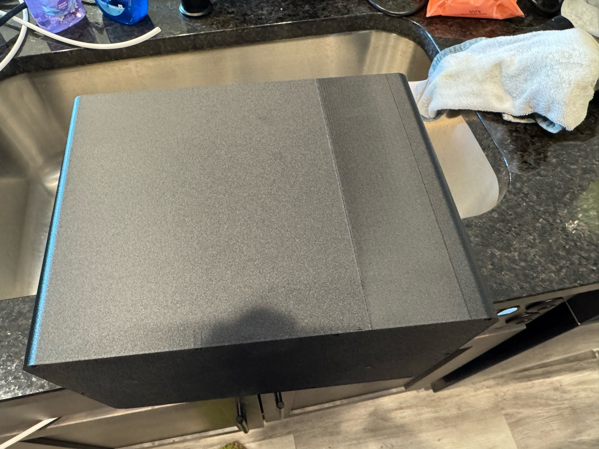

# Production cold-core shell — Mark2

**Accepted on Mark2 as task 1379343230 at 00:54:33 CDT on October 27, 2026.**
Native estimate: **31 h 37 min**, **1,449.9 g**, 889 layers.

**Completed shell accepted as a success by Derek on October 28, 2026.**
Retain the production settings below; the
[physical result](#physical-result--success-2026-10-28) records the visible seam defect.

The smooth shell has continuous 2.38 mm standing walls, a 2 mm floor and two
7.5 mm round clearance holes for the nominal 6.35 mm copper tails. Its casing
is 282.4 × 180.4 × 213.4 mm. The reservoir pocket stock and floor match the
retained shell exactly; cap, reservoir and enclosure-box exports are unchanged.
Both installed copper tail solids clear the new holes. The shell needs no
copper-slot covers or cover ledges.

| Setting | Value |
| --- | --- |
| Printer / hotend | Mark2; fixed left hardened 0.4 mm Standard |
| Material | Black Polymaker Fiberon PET-GF15 |
| Walls | Classic, 3 loops; 0.42 outer / 0.45 inner; six beads across ordinary wall |
| Layers | First 0.20 mm; ordinary 0.24 mm |
| Thick stock | 15% gyroid |
| Seam | Selected faucet A2 package; 60 mm scarf, 10% start height, 10 steps; wiping off |
| Seam location | Native X60, Y−90.2 on the uninterrupted long wall, clear of insert pockets and ports |
| Outer motion | 100 mm/s; 1,500 mm/s² |
| Inner motion | 150 mm/s; 3,000 mm/s² |
| Temperature | 265 °C first / 280 °C later; textured PEI 80 °C; chamber unheated |
| Cooling | Ordinary and auxiliary off; 70% bridges/overhangs at 50% unsupported width |
| Flow | Ratio 0.9555; maximum 18 mm³/s |
| Mark2 Z trim | User +0.04 mm; emitted G29.1 Z0.02 on textured PEI |
| Support | Tree(auto), Default; zero generated support bodies/interfaces |
| Complete bead minimum bed margin | 21.183 mm |

The A2 settings are coupled: 150% ordinary seam gap and 0% scarf gap belong
to the complete selected scarf package. [Settings](settings.json) records the
actual project configuration, including filament wipe and wipe distance 0.

[Preparation](preparation.json) binds the exact geometry and archive hashes.
The editable [production project](cold-core-shell-mark2.3mf) carries its precise
seam-enforcer facet paint. The ready-to-send archive is the local cache path
recorded in preparation.json; SHA256
`b08e84852254a382e2aba91014fca7222d1ddb9e2b49160eb9be0caec9fd93c4`.

The [native review](native-review.json) passes archive integrity, independent
source-surface comparison, emitted Z trim and complete-bead bed placement.
The [wall-path review](wall-path-review.json) finds 888 approximately 60 mm scarf
ramps, an ordinary first-layer seam, no part-wipe sequences and no upper short
inner loops at the former slot corners. [Layer data](exterior-seams.csv) records
the seam position for every layer. The [geometry review](geometry-review.json)
records the preserved stock, axes and installed copper clearance.

Copper insertion follows [cold-core assembly §5](../../../../../assembly/cold-core.md):
feed the bare ends through the holes while lowering the core, support the copper
while forming its broad curves, inspect for kinks/flattening and seal the annuli
with burnished 3M 425 collars before pouring foam. The part, seam treatment and
assembly sequence are the production design.

Density metadata uses Polymaker's [1.43 g/cm³ specification](https://fiberon.polymaker.com/wp-content/uploads/TDS_FIBERON-PET-GF15_V1.0_EN.pdf). The [metadata review](metadata-review.json) confirms that the correction leaves every executable G-code command unchanged. The [machine review](machine-review.json) records the explicit shell placement and absence of cover bodies.

The [live-model review](live-review.json) confirms that the site serves the exact reviewed shell and full-machine payloads. The [geometry change](https://homesodamachine.com/changes/2026-10-26-2029-round-copper-exits) records the front wall from one camera.

The [post-publish lint](post-publish-lint.txt) reports the retained insert features:
ten Ø4 mm blind-pocket roofs and the minimum ligament beside a corner pilot.
[Full-depth native witnesses](insert-witnesses.json) retain 1.6 mm material around
all twenty insert pilots; the corner minimum is 1.696 mm. The casing, clamp
pattern and prepared archive are unchanged by this review.

The [launch receipt](launch.json) binds the submitted archive and unchanged G-code,
left external spool mapping and four visible print options. Mark2 acknowledged
SUCCESS and reported PREPARE, print error 0 and HMS empty. The first send was
[explicitly rejected](rejected-send.json); a fresh filename/import of identical
archive bytes and a 20-second settling wait preceded the successful send.
[Startup telemetry](startup.json) records the machine after acceptance. Physical
finish and first-layer adhesion are not inferred from that status.

At **00:56:58 CDT**, the [fresh readback](startup-progress.json) reported RUNNING,
layer 0/889, with print error 0 and HMS empty. The file preparation was 100%;
startup was in progress.

## Physical result — success (2026-10-28)

Derek accepts the completed shell for the internal cold core and retains the
current production settings. The seam has a small but conspicuous visual defect,
visible in the overview and close-ups. He does not see the scarf helping the
finish. An exterior show surface would need further iteration.

The part feels solid to Derek, and he sees no reason to regard the seam as a
structural defect. He expects no interference with assembly.

The [physical-result record](physical-result/physical-result.json) binds this
assessment to task **1379343230**, preserves his full wording and identifies the
five original photographs by SHA256. His disposition: "So please make a note of
all of that and call it a success, as far as such things go."

Original photographs: [1 — seam close-up](physical-result/photos/01-seam-closeup.jpg),
[2 — seam close-up](physical-result/photos/02-seam-closeup.jpg),
[3 — wall detail](physical-result/photos/03-wall-detail.jpg),
[4 — overview](physical-result/photos/04-overview.jpg),
[5 — seam detail](physical-result/photos/05-seam-detail.jpg).
