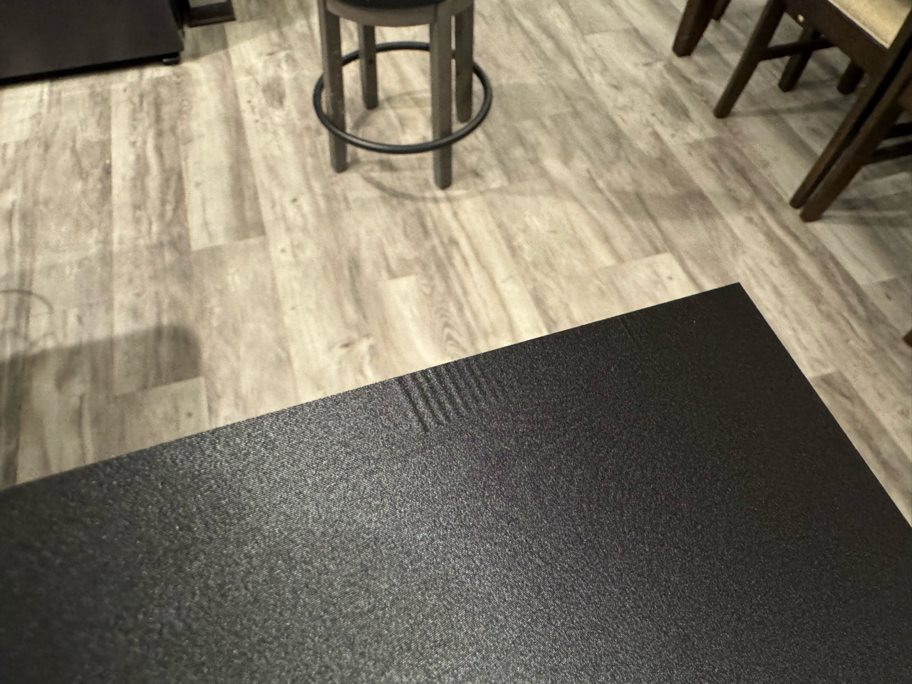
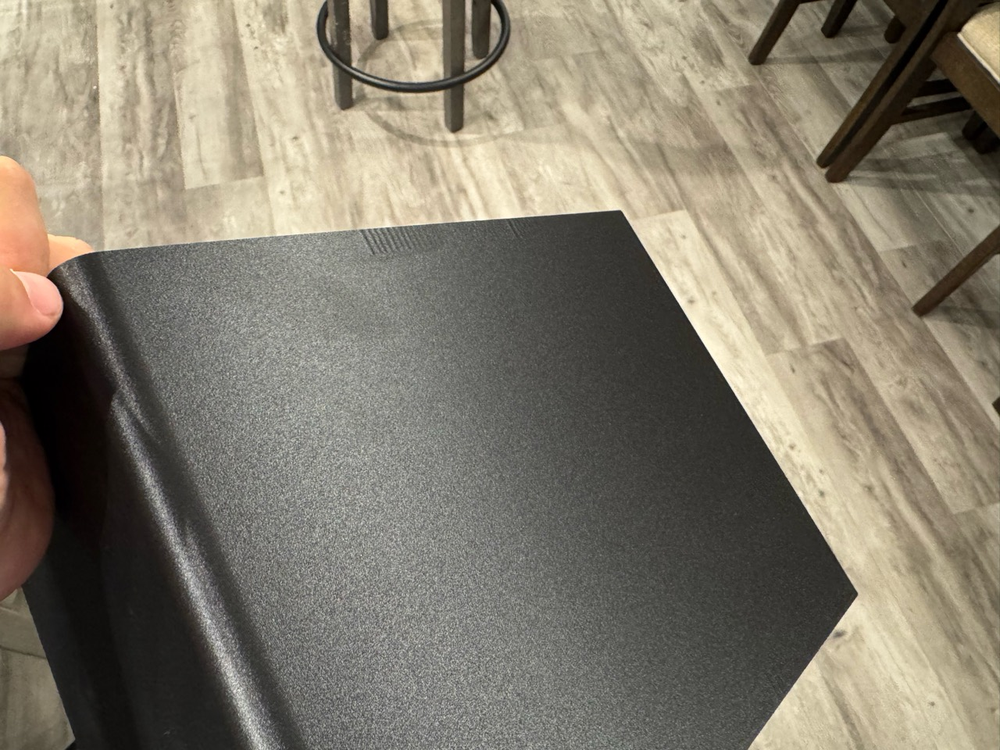
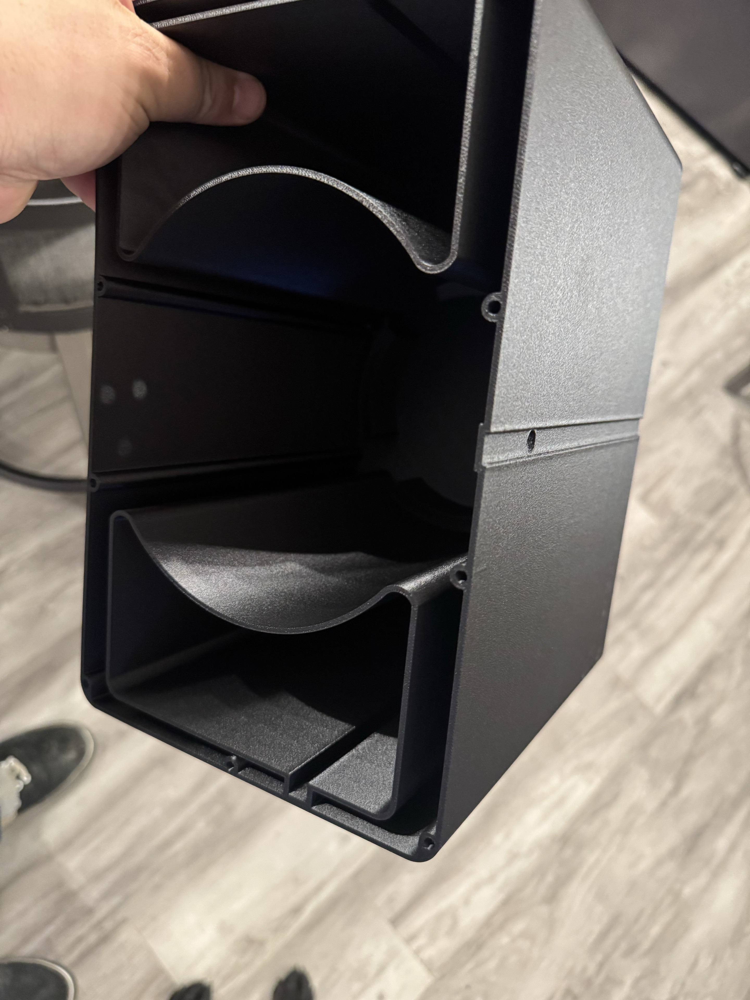

# Cold-core shell with the seam channel — Mark2

**Accepted on Mark2 as task 1386110458 at 02:57:02 CDT on October 29, 2026.**
Native estimate: **31 h 17 min**, **1,452.4 g**, 889 layers.

The shell carries the full-height 9.5 × 1.5 mm seam channel on its +Y flank and B's 8 mm
rim slot, at geometry commit `daee7e7ff`. It prints the production recipe of the
[2026-10-26 shell](../2026-10-26-mark2-round-ports-a2/README.md) with a plain seam in place of
the faucet A2 scarf package: the outer wall's seam is aligned, and a painted strip places it in
the channel's +X inside corner.

Derek reviewed the recipe and asked for it on Mark2: "Apologies, I meant mark2, your settings
look good, just different z offset for mark2, and go ahead and start it, thanks."

| Setting | Value |
| --- | --- |
| Printer / hotend | Mark2; fixed left hardened 0.4 mm Standard |
| Material | Black Polymaker Fiberon PET-GF15 from the left external spool |
| Walls | Classic, 3 loops; 0.42 outer / 0.45 inner; inner walls before the outer wall |
| Layers | First 0.20 mm; ordinary 0.24 mm; 4 top / 3 bottom shells |
| Thick stock | 15% gyroid |
| Seam | Aligned, 15% gap, no scarf; wipe on, 2 mm at 80% speed |
| Seam location | Enforcer strip on the channel's +X side wall against its inside corner: native X 4.75, Y 88.7–89.2, full height |
| Outer motion | 100 mm/s; 1,500 mm/s² |
| Inner motion | 150 mm/s; 3,000 mm/s² |
| Default / travel acceleration | 3,000 / 5,000 mm/s² |
| Temperature | 265 °C first / 280 °C later; textured PEI 80 °C; chamber unheated |
| Cooling | Ordinary and auxiliary off; 70% bridges/overhangs at 50% unsupported width |
| Flow | Ratio 0.9555; maximum 18 mm³/s |
| Mark2 Z trim | User +0.04 mm; emitted G29.1 Z0.02 on textured PEI |
| Support / brim | Tree(auto), Default; auto brim; neither generated |
| Complete-bead minimum bed margin | 21.183 mm |

[Layer data](exterior-seams.csv) records every layer's exterior seam start in the shell's own
frame. 888 of 889 layers start at X 4.96, Y 88.49, where the outer bead turns the channel's +X
inside corner. Layer 1 starts 0.2 mm up the side wall at X 5.15, Y 88.64, where the first
layer's 0.5 mm line and elephant-foot compensation move the corner.

The [review](review.json) passes archive integrity, the emitted trim (`G29.1 Z0`, then
`G29.1 Z0.02`), the 20 mm plate border and zero support roads. The
[project check](project-check.json) binds the embedded model to the current `foam-shell.stl`,
sha256 `925487a53bed2793…`, with no problems. The G-code holds no brim, support or prime-tower
moves. [Preparation](preparation.json) binds the inputs and the archive; the editable
[project](cold-core-shell-mark2.3mf) carries the seam paint.

The [launch receipt](launch.json) binds the sent archive, sha256 `16d4b9f8ec695b09…`, the left
external spool mapping and four print options: timelapse on, bed leveling on, flow dynamic and
nozzle offset calibration Auto. Mark2 reported SUCCESS and PREPARE with print error 0, then
RUNNING at layer 0/889 with HMS empty. Mark1 stood idle through the send.

## Physical result — accepted for shipping (2026-11-01)

Derek reports a very small, localized surface defect near the upper rim. The
photos show ripples on the wall; visibility depends on the lighting, from
invisible to quite noticeable. He observes that the defect lines up closely with
a hole in the shell.

**Derek accepts this defect for shipping:** "But this is a defect that we are okay
shipping with." The photographed condition is listed in
[Accepted defects and tolerances](../../../../../defects-and-tolerances.md#cold-core-shell--small-upper-wall-ripples).

Derek suspects the high layers and the other geometry printed on those layers
are involved, similar to the larger defects addressed by the seam changes. This
is his suspected cause, not a confirmed diagnosis.

The [physical-result record](physical-result/physical-result.json) binds the
report to task **1386110458**, preserves his full wording and identifies all six
original photographs by SHA256.

Original photographs: [1 — ripple close-up](physical-result/photos/01-upper-wall-closeup.jpg),
[2 — upper-wall ripples](physical-result/photos/02-upper-wall-ripples.jpg),
[3 — wall overview](physical-result/photos/03-wall-overview.jpg),
[4 — shell interior](physical-result/photos/04-shell-interior.jpg),
[5 — pocket and rim detail](physical-result/photos/05-pocket-and-rim.jpg),
[6 — end-face detail](physical-result/photos/06-end-face.jpg).
