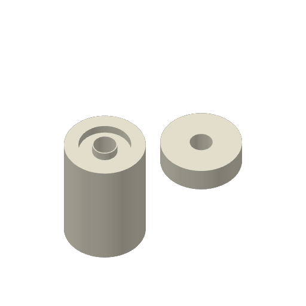

# Magnetic-float ASA Aero corner priming strip

The combined core and insert trial on Mark2, task **1304058102**,
`magnetic-float-pair-mark2-aero-v5.gcode.3mf`, is **canceled by Derek**.
Derek reported: “Hit an entirely unrelated problem this time. I stopped
it. Bed is clear. Try again same settings.” Startup adhesion and physical fit
remain unreported. MQTT showed `FAILED` at layer 0 with no print-error code or
HMS alert. A separately observed AMS feed alert has an unconfirmed relationship
to the reported problem. The full observations are in the
[launch record](pair-mark2-launch.json); the authorized retry uses the unchanged
archive in [physical trial v5](../v5/queue.json).

The [physical startup report](../v3/physical-observations.json) describes the
corner load line lifting, being dragged to the part, and the first part extrusion
lifting before adhesion begins after about two loops. Residual material in the
nozzle is Derek's hypothesis; the root cause is unconfirmed. The target
outcome is adhering extrusion from the first part loop, with the initial loose
material left on the corner strip.

## Priming strip

| Setting | Value |
| --- | --- |
| Location | Front-right, centreline X230–290 / Y15–19.95 mm |
| Footprint including bead width | 60.48 × 5.43 mm |
| Passes | 12 continuous, adjacent 60 mm lines, 0.45 mm pitch |
| Layer / line width | 0.20 / 0.48 mm |
| Speed | 20 mm/s |
| Flow ratio | 0.52, with the slicer's rounded rectangular bead section |
| Feed | About 13.70 mm of 1.75 mm filament, about 0.033 g |
| Extra extrusion time | About 36 seconds, plus travel and additional bed probing |
| Finish | 5 mm wipe along the strip, then lift; existing part retraction retained |

The normal homing, material preparation, calibration and stock 40 mm nozzle
load line are retained. The strip runs after the complete stock startup,
immediately before the part program. Adaptive bed leveling includes both the
strip and the parts: X110–291 / Y14–160 mm. The strip is inside the printable
330 × 320 mm area, outside all part footprints, with no bed exclusion overlap.
There is no added extrusion-only blob or extra retraction.

## Part recipe and frozen archive

Both frozen objects remain together, printing by layer on Textured PEI. The
recipe retains **+0.04 mm user Z trim**, emitted as `G29.1 Z0.02` after reset,
**270 / 90 / 60 °C nozzle / bed / chamber**, and **0.52 flow**. There is no
skirt, brim or support on the parts. ASA Aero White GFB02 uses AMS HT unit 128,
tray 0, mapped to the right nozzle; normal Send options are On/On/Auto/Auto.

This is physical trial **v4**, native archive revision **v5**. Geometry and
orientation remain bound to export commit
`f3cefbe360b7a8019741d177868d1e6c6770b93f`, with core SHA `63d12cbb…` and
insert SHA `c69cdc55…`. Full hashes and source verification are in the preflight.

The entire program after the machine-start block is byte-identical to the
reviewed combined plate, preserving all part extrusion, travel, speeds,
temperatures and retraction. Native geometry and part previews are unchanged.
Only startup settings, corresponding G-code and its MD5 change. The frozen
parent archive is retained. The inherited 1 h 56 min estimate excludes the
added strip and expanded probing. The native part preview does not show
startup priming paths; their coordinates are checked separately.

For this trial, startup success means the strip stays on the plate, no loose
strand reaches the part, and the first part loop adheres. These visual observations
address startup adhesion; they do not establish printed density, fit or buoyancy.
The parts and plate retain the 35 °C cooling threshold before release.

- [Preflight and priming-strip coordinate review](pair-preflight.json)
- [Preparation and exact part-program comparison](prepare.py)
- [Queue](queue.json)
- [Derek's physical startup report](../v3/physical-observations.json)

