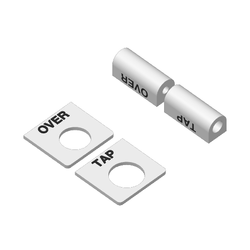

# Overflow print set

Current PET-GF editable projects follow the [localized cooling policy](../cooling/README.md).
Re-slice them for current cooling commands. Identified native archives retain
their original commands and physical-evidence scope.

This set supplies six rectangular fluid identification chips, six matching tube collars and
a snap-in DATA plate for the three-row rear enclosure wall, which prints as back-top in the
[trial preparation](../enclosure/trial-preparation/README.md). The black 4 mm OVER bulkhead receives the
white drain return. The separate [faucet print set](../faucet/vent-print-readiness/README.md)
contains the shell, counter stack, vent seals and insertion tool.
The [assembly instructions](../../assembly/asse-drain.md) list every drain plumbing
part with its Fresh Water Systems link.

The delivered editable projects are in [projects](projects/) and their sliced
archives are in [ready](ready/). The [manifest](manifest.json) binds the finalized
plates and the five finalized faucet plates to their source geometry and reviews.
The generators use `.cache/prints/2026-10-07-drain/`
as their local working directory. Prepare, read and finalize the identification plates with:

```sh
tools/cad-venv/bin/python hardware/printed-parts/drain-readiness/prepare.py labels
tools/cad-venv/bin/python hardware/printed-parts/drain-readiness/review_native.py
tools/cad-venv/bin/python hardware/printed-parts/drain-readiness/finalize_prints.py
```

The scripts use the installed Bambu Studio and submit no printer jobs. The checks
read emitted roads and bind the native archives to their source meshes by hash.

## Identification plates

The four Mark2 plates contain the chips, collars and DATA plate. Every visible label
has a 32 mm width, square upper corners, R2 lower corners and lettering space
above its fitting or jack. DATA and OVER have the same 29.789 mm Z height
and alignment.
OVER's collar has a 4.25 mm bore; TAP retains its larger supply-tube bore.
The [rear-label layout review](reviews/label-layout.json) records all seven native
label widths, lower corner radii and their placement in the complete appliance.
The black [DATA plate](../enclosure/data-ring/README.md) has white lettering and
the nameplate's broad continuous wings. Its
whole face is 1.68 mm deep; the jack mounts independently behind it.

| Project | Parts | Filament 1 / left 0.4 mm | Filament 2 / right 0.4 mm | Native archive under `ready/` |
| --- | --- | --- | --- | --- |
| [White](projects/labels-white-z004-mark2.3mf) | TAP and OVER | White PET-GF | Black PET-GF | [Native archive](https://github.com/derekbreden/homesodamachine/blob/33d50d2ecd2a0fb6b518483a44c8031e3a0c1617/hardware/printed-parts/drain-readiness/ready/labels-white-z004-mark2.gcode.3mf) |
| [Blue](projects/labels-blue-z004-mark2.3mf) | SODA | White PET-GF | Blue PET-GF | [Native archive](https://github.com/derekbreden/homesodamachine/blob/33d50d2ecd2a0fb6b518483a44c8031e3a0c1617/hardware/printed-parts/drain-readiness/ready/labels-blue-z004-mark2.gcode.3mf) |
| [Red](projects/labels-red-z004-mark2.3mf) | CO2 | White PET-GF | Red PET-GF | [Native archive](https://github.com/derekbreden/homesodamachine/blob/33d50d2ecd2a0fb6b518483a44c8031e3a0c1617/hardware/printed-parts/drain-readiness/ready/labels-red-z004-mark2.gcode.3mf) |
| [Black](projects/labels-black-z004-mark2.3mf) | Two FLAVOR chips, two collars and DATA | White PET-GF | Black PET-GF | [Native archive](https://github.com/derekbreden/homesodamachine/blob/33d50d2ecd2a0fb6b518483a44c8031e3a0c1617/hardware/printed-parts/drain-readiness/ready/labels-black-z004-mark2.gcode.3mf) |

The body and lettering keep their separate materials. Chips print face-up;
collars print flat-face-down. The saved recipe uses a 0.20 mm first layer, 0.24 mm
normal layers and no supports or brim. All objects on a plate share one layer schedule,
whose fine closing layers put a layer top on every face-up chip and DATA face and
lettering top; `prepare.py` reads those heights from the tessellated bodies. In the
committed archives, white, blue and red close the 2.00 mm chip face with one 0.12 mm layer.
The black plate closes the complete DATA face and wings at 1.68 mm with two 0.14 mm
layers, then the 2.00 mm chip face, 2.16 mm DATA lettering and 2.48 mm FLAVOR lettering
with 0.08 mm layers from 1.92 mm. The accepted Mark2
nozzle registration is `0x0`, `0.5x-0.7`. Requested +0.04 mm user trim emits
`G29.1 Z0.02` on Textured PEI.

[Native label evidence](reviews/labels.json) records archive CRC, embedded G-code
MD5, source placements and an 88.945 mm minimum margin for the complete emitted
bead footprint, including the purge tower. It establishes commanded print
geometry. Actual lettering appearance, chip fit and collar grip remain
observations on the finished pieces.



## Rear wall

The [trial preparation](../enclosure/trial-preparation/README.md) writes the rear wall as
back-top from its current mesh. Fresh rear-wall preparation retains the shared PET-GF tree support profile.
The complete emitted footprint must fit the 20 mm bed margin. Normal supports
require a specific exception under the
[support-removal strategy](../enclosure/enclosure/README.md#support-removal-strategy).
A tree-support preparation requires its own native footprint and contact review.

The [Mark1 print observation](prints/2026-10-08-current-back-top-mark1/physical-result.json)
records rejection for impracticable removal of every normal support. Installed
fit and finished surface qualification for that article remain unassessed.
The [automatic-support replacement on Mark1](prints/2026-10-10-current-back-top-bridge50-mark1/README.md)
uses Tree (auto), Default style and a 50 mm maximum bridge length, retaining
Bambu's automatic support choices. Its native cavity readings contain no
support in the declared zip-tie channels or ASSE passage. Its complete bead
footprint has a 21.40 mm minimum bed margin; mating geometry and reinforcement
match the reviewed back top. Physical cleanup,
finish and installed fit remain unassessed.

The normal-support rear-wall project, archive and reviews, and the 10-08 and 10-09
Mark1 back-top prints beyond the records linked above, are in git at d5f17da3bd.

[Identification geometry lint](reviews/identification-lint.json) records each
intentional lettering-pocket step and glyph face in the saved print frame.
[Rear-wall geometry lint](reviews/rear-wall-lint.json) records the current 689,932-facet mesh,
with no open findings and 57 answered findings.
[Rear-wall finite surface witnesses](reviews/rear-wall-lint-witness.json) identify
the nameplate's backed relief, diamond release opening and locating floor, plus
the DATA receiver's complete locating floor. Both floors retain 1.50 mm of native
stock; current interface roads lie below them with the saved 0.45 mm support gap.
The [DATA fit review](../enclosure/data-ring/fit-check.json) also verifies the
complete broad wing lands and 2 mm stock behind the exposed upper pad remainder.
These are fit and print-preparation readings, with cleanup effort and finished fit
remaining physical observations.

Existing [physical acceptance records](../enclosure/print-readiness.md#physical-evidence)
retain their original scope. These files prepare the next physical assembly;
they do not establish vent capacity, installed hose behavior, pullout strength
or product lifetime.
