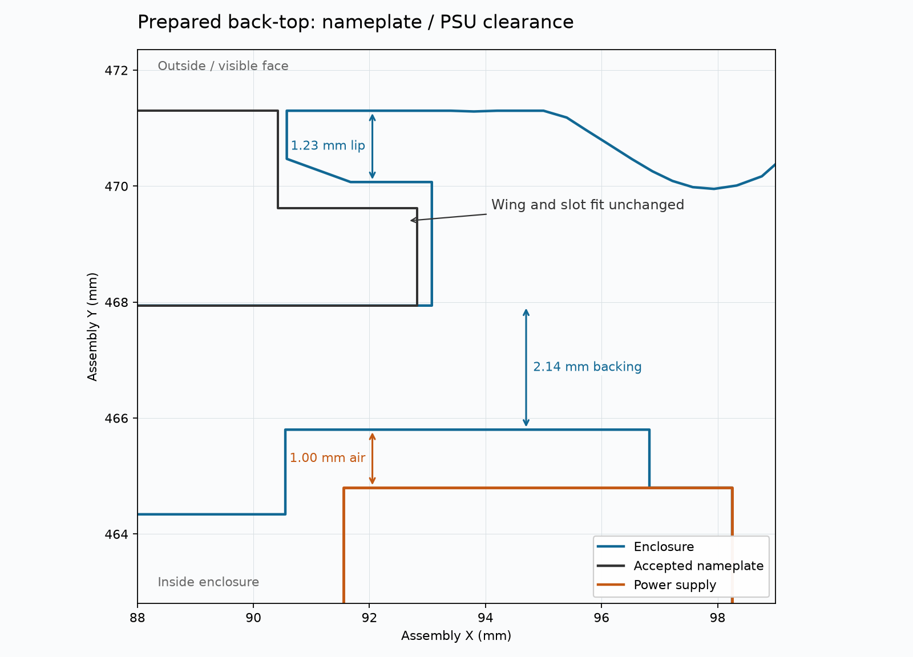

# Accepted cover interfaces in the upper enclosure

This directory retains the identified cover/nameplate integration evidence and a check
of those accepted mating interfaces against the upper-shell exports it read.
The current production geometry and print records are indexed in
[print readiness](../../print-readiness.md).

## Interface check

[`verify_geometry.py`](https://github.com/derekbreden/homesodamachine/blob/5d633291918a02e34734ef15445158dcaa97d8c8/hardware/printed-parts/enclosure/enclosure/accepted-fit-integration/verify_geometry.py),
in Git history, read the declared production Box and the front-top, back-top and pump-cap
exports and wrote [`current-geometry-check.json`](current-geometry-check.json), leaving the
retained [`geometry-check.json`](geometry-check.json) with its identified source snapshot.

The check compares the display cover and nameplate with their accepted physical parts,
checks seated fit and individual-axis clearances, display capture, support-removal exits,
the complete deeper display module, the current funnel and PSU clearance. It binds the
exports, placement sources and accepted mating parts by hash. It does not claim
combined translation extremes or full-enclosure physical fit.

The display-cover pockets are integrated into front-top. The complete deeper module
clears the shell and funnel in that check. The accepted cover's physical
fit and appearance remain evidence for that cover and receiver geometry; assembled
full-shell retention remains a separate observation.

Back-top contains the accepted nameplate mouth and wing slots. Smooth exterior lands
preserve the retaining lips through the fluted surface. Its local backing clears the
placed PSU while retaining the accepted mating geometry. Complete physical enclosure
fit remains unreported.

## Retained integration evidence

[`generation.json`](generation.json), [`source-bindings.json`](source-bindings.json) and
[`published-artifacts.json`](published-artifacts.json) identify one integration snapshot.
Their passing results apply to the recorded bytes, not automatically to later exports.
[`fluted-receiver-stock.json`](fluted-receiver-stock.json) samples 40 retaining-lip
positions and records a 1.230 mm minimum for its bound mesh.
[`psu-clearance-detail.json`](psu-clearance-detail.json) and
[`backing-proposal.json`](backing-proposal.json) retain the local backing assessment.

The [front-top v15 review](../../tee-readiness/full-enclosure-print/native-slice-reviews/2026-10-01-enclosure-front-top-flat-wings-h2c-v15/manifest.json)
identifies a stopped task and the [back-top v4 review](../../tee-readiness/full-enclosure-print/native-slice-reviews/2026-10-01-enclosure-back-top-flat-wings-mark2-v4/manifest.json)
identifies an unsent archive. [`print-hold.json`](print-hold.json) is the associated
dated instruction and task record. Current launch state comes from the current
part's native review and receipt in the print-readiness index.

The preparation, source-binding, publication, lip-stock and emitted-path scripts beside
these files describe that evidence route. Stored archives retain their printer-specific
orientation, trim, support review and source hashes. A changed mesh requires a fresh
native preparation and review under the current
[support-removal strategy](../README.md#support-removal-strategy).
