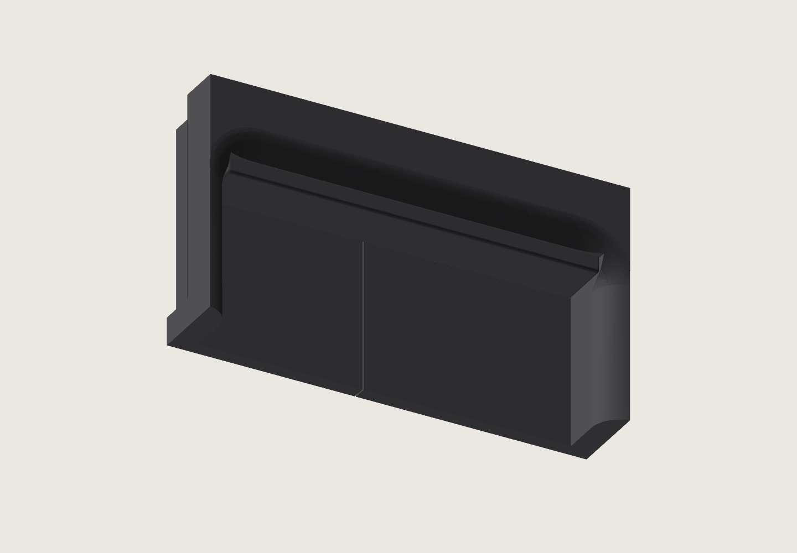

# Grip receiver and cover coupon records

The [physical acceptance](physical-acceptance.json) records easy support removal and
assembled receiver/cover fit for the identified H2C and Mark2 coupon articles. The
record binds their source meshes and print archives. It supplies no numerical
lifting-load, retention-force or repeated-flexing result.

The production enclosure uses its integral printed handhold ceilings as finger-contact
surfaces ([handhold specification](../enclosure/README.md#handholds)). Current bare-surface
finish, support cleanup, gripping comfort and loaded lifting are unqualified. Acceptance
of a faucet underside or another printed surface does not establish those properties.

The stored cover article is a 79.7 × 11.558 × 3.36 mm PET-GF strip with 2.4 mm end wings.
Its recorded receiver slots and corner reliefs belong to the bound test geometry.
The physical result establishes assembled fit; it does not establish bending the strip
into a closed production enclosure.

The records retain each test's scope:

- [Physical acceptance](physical-acceptance.json): H2C and Mark2 receiver/cover observations.
- [Bridge trial](bridge-trial-v6/README.md): identified receiver slices and support placement.
- [Mark2 plate](mark2-trial-v4/README.md): the three-piece coupon archive and launch record.
- [Second H2C cover article](h2c-second-insert/README.md): its bound preparation and launch.
- [Geometry check](geometry-check.json): the stored cover and receiver geometry.
- [Production-surface comparison](production-integration.json), [assembly snapshot](assembly-integration.json)
  and [publication snapshot](publication-check.json): the source and artifact hashes each report identifies.

The trial generators and frozen archives remain beside these records. Their receiver
geometry, support exclusions and cover placement are specific to those articles.
