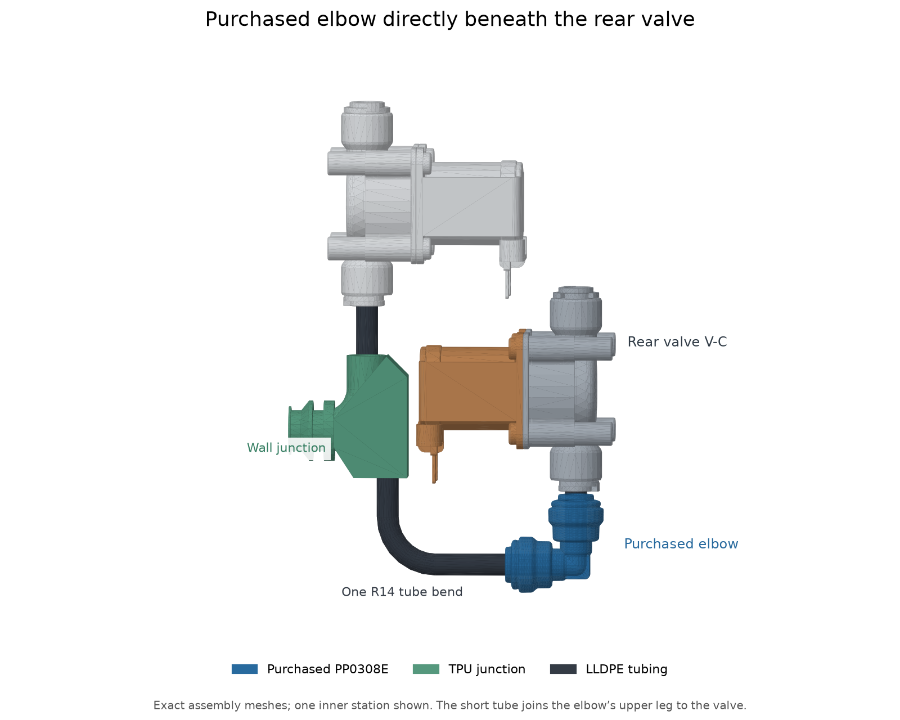

# Purchased elbows beneath the rear valves

Four purchased [John Guest PP0308E elbows](../../../../reference/jg-pp0308e-elbow/README.md) stand upright directly beneath V-C, V-D, V-G and V-J. A short straight tube joins each elbow to its valve, with a nominal 1 mm exposed gap. The forward leg faces the permanent wall junction. One R14 bend in black 1/4-inch LLDPE connects the junction's downward outlet to that leg.

The rear valve row and source crossbar stand 8 mm above their deck reference. This clears the west inner elbow from the compressor and the east outer elbow from the condenser; the latter has about 2.45 mm geometric clearance. Round Ø17.4 mm openings through the rear tray foot clear the elbows. V-A and V-B retain their cold-core seats. The reservoir-B draw tube's approach passes 10 mm farther west to clear the raised source bends, retaining R14 bends and its existing endpoints.

All four TPU junctions share one geometry: a continuous Ø4.3 mm inlet passage turns downward through R6, and one straight vertical branch reaches the upper socket. Six-millimetre circular sealing lands and their annular tube stops remain. The wall and three gravity-seated keepers locate the junctions; the straight upper links clock them.

[Native fit](native-fit.json) records all four elbow placements, the common junction geometry and the rerouted tube. [Aggregate refresh](aggregate-refresh.json) binds the changed members to their retained native component placements and verifies unchanged viewer arrays. [Shell scope](shell-scope.json) compares the native shell outside the dock and valve-tray edit region. The [front-top scene](scene-refresh.json) uses the published assembly geometry.

The nominal short valve tube is 28.7 mm, including estimated 15.7 mm elbow and 12 mm valve insertions. Actual fully seated marks govern purchased-fitting cuts. The bent tube has nominal 6.35 mm TPU engagement. Its interference grip is not positive axial capture, and pressure retention is physically unqualified. See the [assembly procedure](../../../../assembly/internal-plumbing.md).

Junction manufacturing exports stand on their broad aft web landing; all circular lands are 45 degrees from vertical. Keepers lie flat on their wall faces. Archived print projects apply only to their identified meshes. Native fit establishes geometry, not sealing, pressure capacity, support removal or lifetime.

Separate inherited display, bay-end and interlocking-flank findings remain open at their exact picks in the [front-top lint answers](../../../lint-answers/enclosure/enclosure/enclosure-front-top.lint-answers). Their geometry retains its existing fit and physical-evidence scope.
