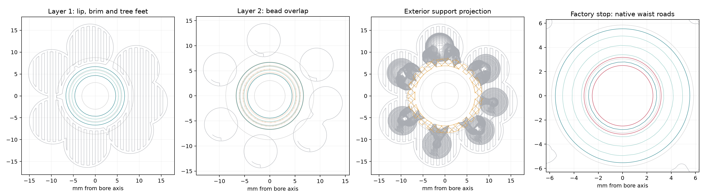

# Four permanent TPU receivers — native print preparation

Four copies of the [canonical receiver STL](../../../enclosure/enclosure-pump-receiver.stl)
stand with their front funnel rings on the bed and their bores vertical.
The preparation uses the Mark1/H2C right fixed 0.6 mm nozzle recipe retained
by the [Siraya single-elbow physical record](../../../../../../future/pump-elbow-exploration/prints/2026-10-14-compact-single-siraya85a-overhang10-engineering-z000-mark1/physical-result.json).
That record accepts the elbow's exterior quality and reports internal
stringing; it supplies no receiver acceptance.

The [editable project](2026-10-18-four-pump-receivers-siraya85a-right06-z000-mark1.3mf)
and [native sliced archive](2026-10-18-four-pump-receivers-siraya85a-right06-z000-mark1.gcode.3mf)
are prepared for review. No printer was contacted, submitted to or started.
Bambu Studio estimates **2 h 14 min / 10.53 g**, with **124 layers** and no
slicer warning. The archive contains unprocessed native G-code.

| Setting | Prepared value |
| --- | --- |
| Material | Siraya Tech Flex TPU85A Clear, SKU ST3008 |
| Printer / nozzle | Mark1/H2C, right fixed 0.6 mm, external-filament mapping |
| Plate / temperature | Glued Engineering Plate recipe, 35°C |
| Nozzle temperature | 225°C first layer; 215°C normal layers |
| Layer height | 0.20 mm first; 0.12 mm normal |
| Flow | 0.96 ratio; 2.2 mm³/s maximum; density 1.16 g/cm³ for mass estimate |
| Walls / fill | Six requested walls, including top surfaces; 100% zig-zag fill; 0% seam gap |
| Requested wall speeds | 10 mm/s exterior and overhangs; 25 mm/s interior |
| Support | Tree(auto), Default; same TPU for body and interface |
| User Z trim | Native `G29.1 Z0`, following this retained Engineering Plate recipe |

Nearest seams and wall-crossing avoidance are enabled. The native archive
contains no timelapse photo-trip commands. Its normal-layer exterior and
overhang commands are 10 mm/s; the first-layer exterior reaches 19.06 mm/s
under the retained first-layer and volumetric settings. Actual support
commands are 19.06–30.85 mm/s.

The four centers form a 36 mm square around X177.5/Y160 mm. Their automatic
tree bases require the spacing. A named support-exclusion cylinder at each
bore has radius 4.65 mm and spans Z−0.1 to Z15.1 mm. It excludes support
from the fluid passage while leaving exterior automatic support decisions
active. These four modifiers add no printed material.

The [emitted-path review](native-slice-review.json) reads the archive's
actual widths, arcs, features, object labels and travels:

| Native reading | Result |
| --- | --- |
| Complete model/support/brim bed inset | At least 117.54 mm, using conservative bead projections |
| Separation between complete bead projections | At least 2.22 mm; first-layer actual minimum 2.59 mm |
| Front and rear sealing lands | At least four complete circumferential runs on every sampled layer; wider collar sections have up to nine |
| Factory-stop waist | Five complete circumferential runs in each of four layers on all four receivers |
| Support in wet bores | None; minimum support-bead clearance to the bore through the full bead height 2.69 mm |
| Second-layer model centerlines | Entirely backed by first-layer model beads on all four receivers |
| Second-layer bead area overlapping first layer | 93.84%; the funnel adds the inward-growing strip |
| Support interfaces | Z10.04 and Z10.16 mm; 0.19 mm from the last interface top to the nominal Z10.35 rear-flange underside |



The exterior Tree(auto)/Default branches and annular interface are accessible before
wall assembly. Segment the exterior support/interface ring and peel it
radially from the 3.35 mm keeper groove. Support release, groove finish and
the receiver's flexibility during that operation have no physical result.
No support-removal tool needs to enter a sealing bore.

The Ø5.00 mm throat's 0.475 mm axial waist appears in layers 71–74, at
Z8.60, Z8.72, Z8.84 and Z8.96 mm. Every layer/object sample has five complete
circumferential roads with zero loop-end gap. The innermost road's mean
radius is 2.804–2.808 mm, inside the factory tail's nominal 3.175 mm radius.
These are commanded paths, without a measured printed stop or bearing result.

The native travel review records projected bore crossings longer than
0.3 mm on twenty-six next-layer returns. These commanded paths retain exposure
to internal strands. Wall paths and bore-support exclusion do not establish
a strand-free passage. Inspect and clear the actual fluid passage before
factory assembly; receiver dimensions, seal holding and lifetime remain
physical qualifications.

[Source bindings](source-bindings.json) bind the canonical STL, geometry
module, retained recipe and physical record, preparation/review scripts,
project, archive and figure. All reviewed functional settings survive the
native slicer's metadata normalization, and the native G-code checksum
matches. The [preparation record](preparation.json),
[native readback](native-readback.json) and [slicer result](slice-result.json)
retain their separate evidence. The [binding audit](binding-audit.json)
compares the fresh preparation's exact geometry snapshot, current canonical
wet STL bytes and all eight embedded receiver meshes. The original source
reference remains intact, with geometric differences reported explicitly.

Reproduce this preparation manually, without any printer action:

```sh
tools/cad-venv/bin/python hardware/printed-parts/enclosure/pump-dock/print-preparation/2026-10-18-receivers-siraya85a-mark1/prepare.py
tools/cad-venv/bin/python hardware/printed-parts/enclosure/pump-dock/print-preparation/2026-10-18-receivers-siraya85a-mark1/review_slice.py
```
