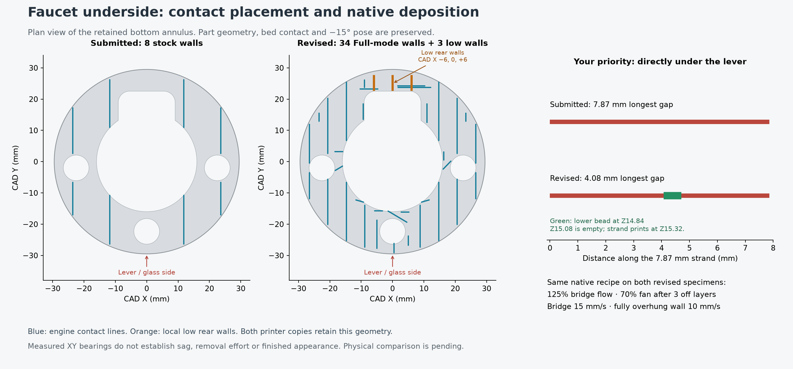

# Faucet annulus fins with the bridge recipe

This comparison addresses defect 3: a clean plate-mating rim
around the complete circumference, particularly the visible midpoint under the
lever. Both specimens retain the production **−15° X rotation**, original part
geometry and original bed contact. The crop ends at original print Z16.76, below
the upper fine-layer bands. The [Mark1 physical result](mark1/physical-result/physical-result.json)
reports tighter material but substantially better underside and front-face
finish with trees. Release of the denser fin layout is not separately reported.

[Mark1 accepted job 1340913124](mark1/README.md) at **23:53:32 CDT on
2026-10-14**, with its own +0.18 mm requested trim. It reported RUNNING at
0/70 layers without errors. The [Mark2 copy](mark2/) remains prepared and unsent.

| Facing the printer | Condition |
| --- | --- |
| A, left | 34 annulus-scoped Full-mode fin walls plus three local low rear walls; Tree(auto)/Default elsewhere |
| B, right | Production Tree(auto)/Default, including its automatic normal sections |

Both specimens use native **bridge flow 1.25**, **70% part fan after three fan-off
bed layers**, **15 mm/s Bridge moves**, and overhang limits capped at 15 mm/s.
The existing **10 mm/s fully overhung-wall limit** is retained. Cooling includes
Floating vertical shell and support moves. Ordinary supported-wall and infill
speed settings retain their production values. No G-code extrusion, fan or feed edits
are applied after slicing; the recipe is saved in the editable project.

The first bed layer is 0.20 mm, followed by 0.24 mm courses. Both copies use external
PET-GF spool 254, the fixed left hardened standard-flow 0.4 mm nozzle, Textured
PEI, 265°C first-layer/280°C normal nozzle temperature and an 80°C bed.
Mark1's start code emits `G29.1 Z0.16`; Mark2's requested +0.04 mm trim emits
`G29.1 Z0.02`. The native estimate is
**2 h 7 min 49 s**, **48.26 g**, **70 layers**.

## Contact placement

The [Support Fins engine](https://github.com/gittrahan/support-fins/tree/511d81fc9124075cef142bfb2766bd5e8bfa777d)
is pinned and unmodified. The caller selects the downward **CAD Z0 annulus**
before placement; the complete model topology remains available for seating and
collision checks. Full mode, coverage 1.0 and `downhill: true` produce 34 walls
without gripping teeth. This local contact-face selection prevents explicit fin
supports on the upper crop surfaces and inner ledges. The exact options and
contact lines are in [layout-engine.json](mark2/layout-engine.json).

Three straight, **locally generated CadQuery walls** serve the low rear annulus
at CAD X −6, 0 and +6 mm, CAD Y23–27.4 mm. They are 1.0 mm wide, with tops
following the tilted underside at a requested 0.24 mm vertical gap. Their height
ranges from 0.303 to 1.442 mm. The tool's 0.6 mm minimum squat-wall height leaves
the lowest contact band unserved; the local walls address native paths at
Z0.92 and Z1.40. These three walls are recorded exceptions, not upstream output.
There is no broad bed pad or grip contact. Their coordinates and component IDs
are saved in [preparation.json](mark2/preparation.json).

The explicit support choice is limited to A's **1,641.24 mm² bottom annulus**.
Support-block paint covers that plane and the added support surfaces to avoid
duplicate or recursive slicer supports. Automatic Tree(auto)/Default remains
enabled elsewhere. B has no support-block paint and retains the requested
0.45 mm automatic-support top gap. The fins' requested 0.24 mm gap is a local
candidate supported by the [PET-GF v8 G1 coupon](../../../../../print-tests/petgf-fins/under-roof-walls-v8/README.md),
which supported well and bent off easily. The faucet's slope and connected
support layout still require a physical removal assessment.

## Native G-code measurements

The three [user-selected screenshots](../stock-vs-tree/mark2/screenshots/) refer
to the submitted stock-fin G-code. The review follows the actual strand before
the highlighted corner in screenshot 2: the selected corner itself is only
0.126 mm long. The long preceding strand is 7.867 mm.

| Screenshot | Strand length | Stock: longest gap to a lower bearing | Prepared: longest gap to a lower bearing |
| --- | ---: | ---: | ---: |
| 1, Z14.60 | 11.344 mm | 9.856 mm | 3.817 mm |
| 2, lever-facing midpoint, Z15.32 | 7.867 mm | 7.867 mm | 4.077 mm |
| 3, Z10.28 | 9.482 mm | 9.471 mm | 5.264 mm |

These gaps use the **actual lower bead footprint two courses below** each
strand, leaving one empty course at these contacts. The stock screenshot-2
strand has no lower bearing in any of its preceding three courses. In the
prepared slice, its lower bearing is at Z14.84 and Z15.08 is empty. The detailed
[targeted measurements](mark2/rim-path-review.json) keep lower courses and earlier
same-course strands separate; the [path plots](mark2/rim-path-review.png) show
their positions.

The three long moves emit **10 mm/s and 70% fan**. Their native E amounts are
0.49821, 0.37359 and 0.45030 mm, respectively, matching the 25% flow increase
within command rounding. The submitted plate emits 11%, 17% and 16% fan on
these paths; its actual Bridge moves run at 25 mm/s through the filament speed
override. The prepared native Bridge moves all run at 15 mm/s.

The [whole-annulus review](mark2/annulus-review.json) surveys continuous native
model paths at CAD Z0.05–0.60 mm and radius 16.1–30 mm, around the annulus after
the three bed layers. Its longest path with **neither a lower bead overlap
within three courses nor an earlier same-course bead overlap** is **8.543 mm**
for A and **10.938 mm** for B. The corresponding submitted A value is
**22.432 mm**. These are geometric measurements with a maximum 0.05 mm sampling
pitch, not verified bridge lengths: an earlier neighbouring strand may itself
be unsupported. The more conservative lower-course centreline-only measure
still reaches **19.048 mm** on A where neighbouring strands provide overlap.
Both measures and every surveyed trace remain in the record. The 12 mm bridge
coupon is a comparison reference, not a qualification limit for this geometry.

The [native review](mark2/review.json) verifies unchanged parent model and
modifier members, retained build transforms, actual fan/feed commands, trim,
70 layers and at least **89.95 mm** full-bead bed-edge clearance, including
support, brim and arc paths. The [packaging record](mark2/packaging.json) binds
the print-only copy to the native G-code without edits. These checks establish
what will be commanded; they do not establish sag, appearance or release effort.

## Physical comparison

The [stock eight-fin result](../stock-vs-tree/mark2/physical-result/physical-result.json)
reports easy release and a generally uniform bottom face with sag, but worse
front appearance than trees where a contact is missing. It leaves the necessary
support count open. This 34-plus-three-wall layout tests coverage with the
bridge recipe; it does not establish a minimum or inherit the stock walls'
release result. The [finished Mark1 comparison](mark1/physical-result/physical-result.json)
does not select this radial fin layout for the base. Derek's
[curved-edge candidate](../../2026-10-15-edge-supports/README.md) uses segmented
rim arcs with trees on the remaining underside and no repeat control.

The finished photographs carry no specimen labels. The physical record keeps
Derek's direct tree-versus-fin comparison without assigning plate coordinates
to the post-removal arrangement. The customer outcome remains an intact, clean
edge that mates without catching strands or damage from removal.

This plate compares two support layouts with the **same bridge recipe**. The
submitted stock-fin plate uses a different printer, fin layout and production
material recipe, so the two plates do not form a controlled two-by-two experiment.
No production profile, complete faucet model or accepted upper finish is promoted
by this prepared coupon.

## Manual reproduction

From the repository root, using `tools/cad-venv/bin/python`, run this directory's
parent scripts in order: `prepare-revised.py`, `rim-path-review.py full-annulus`,
`annulus-review.py full-annulus`, `review-revised.py`, and `render-rim-review.py`.
The engine checkout is `.cache/support-fins-faucet` at the recorded pin. These
are manual experiment tools, with no build, commit or printer-control integration.

For the Mark1 copy, run `prepare-mark1.py`, then `rim-path-review.py full-annulus
mark1`, `annulus-review.py full-annulus mark1`, and `review-revised.py mark1`.
Preparation refuses to overwrite an accepted launch.
