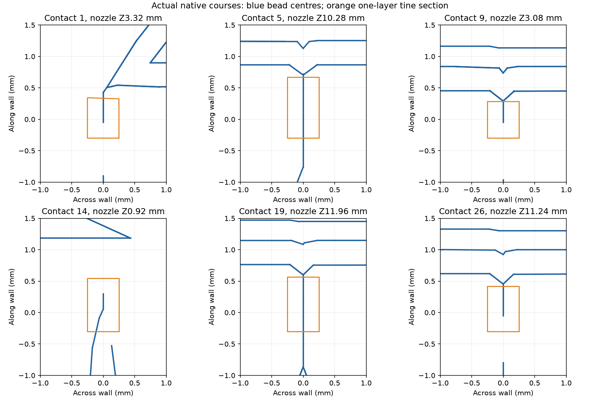

# Optional horizontal-grip comparison at the production angle

This option has **no accepted printer job**. Its
[submission record](mark2/submission-attempt.json) retains the final unchanged
printer job after the attempted send. The selected running plate is the
[stock-fin comparison](README.md).

This matched pair tests the full-circumference lower foot rim, defect 3 in the
[confirmed defect visualization](../../industrial/defects/2026-10-14.html).
The customer outcome is a clean plate-mating rim that survives support removal,
while retaining the accepted full faucet's upper finish recipe.

Both feet retain the production **−15° X rotation**, original bed contact and
original underside. The sections end at original print Z16.76, below the first
0.12 mm fine band. They do not qualify a new orientation or the upper finish.
The production part, project and shared material profile are unchanged.

| Facing Mark2 | Condition | Designed support |
| --- | --- | --- |
| A, left | Local gate override, tines enabled | Eight walls with 26 horizontal tines |
| B, right | Stock walls only | Eight walls with no tines |

## Engine and contact geometry

The unmodified [Support Fins engine](https://github.com/gittrahan/support-fins/tree/511d81fc9124075cef142bfb2766bd5e8bfa777d)
produces eight walls and zero tines at this orientation, even when tines are
enabled. Its `biteDirsAt` rule rejects a face whose horizontal inward-normal
magnitude is below 0.34, equivalent to about 19.9° from the bed. The foot's
15° planar underside has a magnitude of 0.2588.

A uses a separate local engine copy with that one threshold changed from
0.34 to 0.25. Its reach, inside-part contact test, contact-end calculation,
wall generation and layer snapping are the upstream implementations. The
[engine record](engine.json) retains the exact pin, change, stock result,
support geometry and 26 contact locations. This is a local experimental
extension of the tool's placement rule.

The supports have 1.0 mm walls, 0.6 mm contact tips, at most 12 mm requested
unsupported span and a 0.24 mm nominal vertical gap. Tines are 0.5 mm wide,
0.24 mm tall, with 0.6 mm search reach; their ends stop at the part surface.
Bed pad and sway braces are off. No long cantilever teeth are added.

At this shallow slope a one-layer contact can extend about 0.93 mm along the
underside (0.24/sin 15°). That geometric length does not establish actual weld
area or release force. Removal marks and retained rim shape are separate
assessment criteria from wall stability. The photographed defects do not
establish a tipping or peeling problem that requires grip.

## Scope and print conditions

The custom walls serve only the bottom annulus. Support-block paint is applied
only to that model plane and the added fin surfaces to avoid duplicate or
recursive supports. **Tree(auto), Default remains enabled elsewhere**, including
any automatic normal sections. This explicit local support experiment addresses
the observed scalloping and lifted strands on the plate-mating rim.

The [PET-GF v8 G1 result](../../../../print-tests/petgf-fins/under-roof-walls-v8/README.md)
selects a 0.24 mm gap candidate for an underlying 1 mm wall: it supported well
and bent off easily on that coupon. It does not qualify these sloped contacts
or establish a replacement for automatic tree-support gaps. B tests whether
the walls alone supply useful support; A tests whether adding grip is useful
and removable on this actual face.

Both conditions retain production Arachne walls, solid foot modifier, rear seam
and scarf settings, native bridge flow 1.0, native fan and native feeds. There
are no local G-code edits. The first bed layer is 0.20 mm and all subsequent
layers in this cropped region are 0.24 mm. The native slice has 70 courses,
with a 1 h 32 min 38 s estimate and 41.80 g material use.

The [native bead review](mark2/review.json) finds one geometric slice course for
each of the 26 tines. A continuous deposited bead covers the defined root and
tip test points at 24 contacts. The two lowest contacts, 7 and 14 at nozzle
Z0.92, have about 75% section coverage and fail that full-continuity test.
They are partial contacts, not verified grips. At the corresponding stock-wall
points, 20 of 26 are empty on the designated tine course; a nominal 0.24 mm
geometric gap does not ensure an empty deposited course at every station.
The trial preserves these native outcomes for physical scoring. Native bridge
beads include a 0.4 mm extrusion-height calculation within the 0.24 mm course
grid. No physical weld dimensions are established.

Mark2 uses black PET-GF on external spool 254, its fixed left hardened
standard-flow 0.4 mm nozzle, Textured PEI and +0.04 mm requested trim
(`G29.1 Z0.02`). Temperatures are 265°C first layer, 280°C normal and 80°C bed.
The plate is centered with 93.98 mm minimum clearance for all deposited beads,
including automatic supports and arc paths. Timelapse and bed leveling are On; Flow Dynamics and Nozzle
Offset Calibration are Auto. A launch receipt identifies any accepted job.

## Physical assessment

Keep A and B identified before removing supports. After cooling, use fingers
first and the existing cleanup tools if necessary. Inspect the whole rim,
including the photographed worst area, without sanding it first.

Record wall movement during the print, whether removal bends the supports
away or tears the model skin, remaining contact marks, loose strands and rim
scalloping. Compare the retained edge against the existing mounting plate.
A useful result has an intact rim with no loose or catching strands, improved
edge shape and practical removal without damage. A cleaner upper edge alone
does not establish acceptable plate fit. Physical results are pending.

This crop isolates defect 3. Defect 1's localized shoulder buildup and defect
2's tip lip remain separate observations; the tip material comparison is
recorded in the [bridge transfer study](../2026-10-14-bridge-transfer/README.md).

## Manual reproduction

From the repository root, run
`tools/cad-venv/bin/python hardware/printed-parts/faucet/finish-coupons/2026-10-14-foot-fins-current-angle/prepare.py grip`.
The script expects the recorded engine pin at `.cache/support-fins-faucet`,
creates its separate modified copy, builds both conditions, preserves the
native slice and refuses to overwrite a launched experiment. Review and package
the slice before sending the print-only archive. These are manual experiment
tools, with no build or commit checks.
