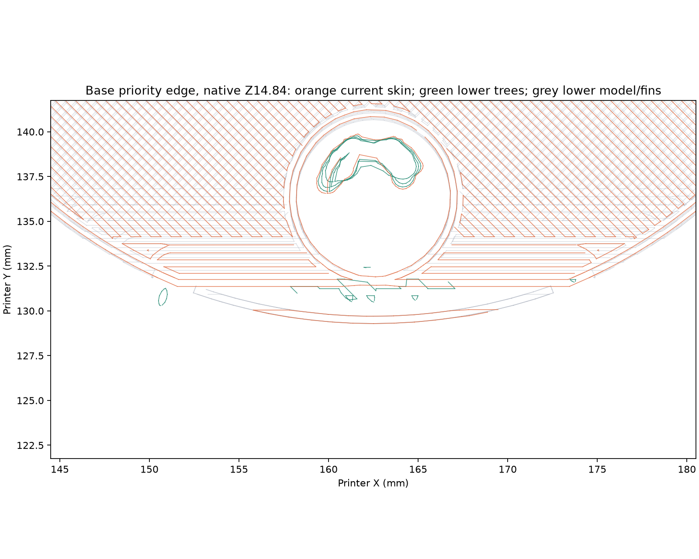
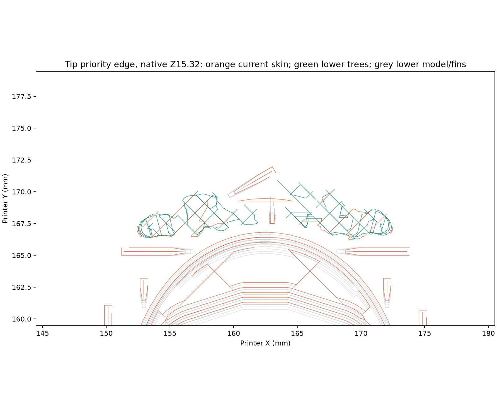

# Faucet edge supports

Two single candidates address the visible rim while retaining the tuned poses.
There is no repeated control. The customer outcome is an intact, clean visible
edge after accessible support removal, with the existing mating geometry retained.

| Printer | Candidate | Accepted job | Native estimate |
| --- | --- | --- | --- |
| Mark1 | Tip: retained eight plain fins, added local trees at the rough lip | [1341173963](tip-mark1/launch.json), 02:47:13 CDT on 2026-10-15 | 38 min 27 s, 9.61 g, 167 layers |
| Mark2 | Base: seven curved rim fins, trees throughout the remaining underside | [1341188908](base-mark2/launch.json), 02:57:08 CDT on 2026-10-15 | 1 h 10 min 59 s, 25.76 g, 70 layers |

The starts are 594.405 seconds apart, exceeding the 180-second shared-circuit
interval. Each launch uses external black PET-GF spool 254 and the fixed left
hardened standard-flow 0.4 mm nozzle. Timelapse and bed leveling are On; Flow
Dynamics and Nozzle Offset Calibration are Auto. Mark1's +0.18 mm requested trim
emits +0.16 mm; Mark2's +0.04 mm trim emits +0.02 mm on Textured PEI.

Both printers report `FINISH` on their matching jobs ([Mark2 reading](base-mark2/completion-observation.json)), with all commanded layers
completed and `print_error0`. The [Mark1 physical result](tip-mark1/physical-result/physical-result.json)
is a failure of the male-plug starting section. The
[Mark2 physical result](base-mark2/physical-result/physical-result.json) accepts
the underside as Derek's best observed faucet underside, excellent edge
support and very easy arc snap-off. Mark2 also reports HMS
`0C00-0100-0002-0017`, identified by Bambu Studio's installed message catalog as a
dirty nozzle-camera lens that may affect AI monitoring; no direct lens inspection
is recorded.

Both retain native bridge flow 1.25, 70% part fan after three fan-off bed layers,
15 mm/s bridges, and overhang limits at most 15 mm/s with the existing 10 mm/s
limit retained. Cooling includes Floating vertical shell and support moves.
Ordinary supported-wall and infill speeds retain the saved values. There are
no post-slice extrusion, fan or speed edits.

## Base: curved fins for the visible edge

The [base preparation](base-mark2/preparation.json) uses the identified foot
section at −15°, with original bed contact and a crop at original print Z16.76.
The physical [Full-mode radial-fin result](../2026-10-14-foot-fins-current-angle/full-annulus/mark1/physical-result/physical-result.json)
reports tighter material but a substantially better underside and front face
with trees. The local curved walls serve a different, explicitly requested task:
support along the visible outer boundary, with automatic trees on the interior.

Seven 41° curved walls follow CAD radius 28.65–29.55 mm around the actual
29.50 mm outer edge. Walls are 0.90 mm wide, vertical in the build frame, with
tops following the tilted underside at a requested 0.24 mm vertical gap.
Four-degree gaps separate the arcs. The lever-facing arc is centred on CAD −Y,
so the prominent front midpoint has no removal gap. The bed-adjacent rear arc
is omitted where there is insufficient height for a useful wall. There is no
broad bed pad or horizontal grip tooth.

Narrow support-blocker volumes cover only each arc's contact strip, CAD radius
28.45–29.95 mm. They avoid duplicate support directly at those walls.
Tree(auto)/Default, including its automatic normal sections, remains enabled
on the rest of the underside and in the gaps. The bottom annulus has no blanket
support-block paint. These locally generated curved walls are an explicit
feature-specific choice, not output from the straight-wall Support Fins engine.

Derek's physical inspection accepts this exact combination of curved edge
walls, automatic trees and the working cooling/speed recipe. He reports that
the arc fins snapped off very easily and produced the best faucet underside
he has observed. The [three photographs and full report](base-mark2/physical-result/physical-result.json)
retain the exact accepted job and print hashes. The
[complete faucet project](../../industrial/faucet-industrial-petgf.md) selects
the same seven arc meshes and their narrow blocker strips at the base rim.
Other rough overhang edges use the same edge-following support principle with
their own geometry; this physical result belongs to the identified base section.

The [native review](base-mark2/review.json) finds lower deposited-bead overlap
along the complete sampled outer-rim path at the critical front Z15.32 course.
Across the selected rim traces above the first three bed courses, the largest
run without lower overlap is 4.65 mm. The rear bed-adjacent courses retain a
19.44 mm no-overlap run; that measurement is not a demonstrated free bridge.
The accepted bed contact is retained. All model, support and brim beads remain
at least 121.91 mm inside the usable bed boundary.

## Tip: additional contact beneath the rough lip

The [tip physical result](../2026-10-15-tip-fins/mark2/physical-result/physical-result.json)
accepts the bottom side's appearance as the best observed, while reporting no
clear improvement on the opposite side. The [tip preparation](tip-mark1/preparation.json)
retains the same −105° joint section, original bed contact, eight plain fin
walls and original print-Z40 crop. The successful opposite-side fin treatment
is retained.

On the seam-side low starting pole, downward joint-plane facets below print
Z21 and within CAD X ±8 mm are support-enforced instead of blocked. This
allows Tree(auto)/Default to reach the rough lip. The rest of the joint-plane
block paint and the fin geometry remain. The tree top gap stays at its saved
0.45 mm. The actual selected area and facets are recorded in the preparation.

The [native review](tip-mark1/review.json) measures the same troublesome
8.48 mm outer/overhang-wall trace at Z15.32. Its largest sampled run without
lower bead overlap is 1.30 mm; native tree contacts now overlap part of that
strand. The corresponding [eight-fin reading](../2026-10-15-tip-fins/mark2/review.json)
is 4.19 mm. All beads remain at least 138.31 mm inside the usable bed boundary.

## Physical assessment

The Mark1 photos show a detached curved section and loose strands in the
male-plug region. Derek reports that the male insertion section fell over.
The [root-course review and prepared correction](../2026-10-15-tip-root-anchor/README.md)
identify no plug deposition on the bed course and no lower bearing beneath the
first Z0.44 plug strand. The rim review above did not assess that anchorage.
The corrected single candidate adds a directly bonded bed foot at the plug
start and is [Mark1 task 1342500038](../2026-10-15-tip-root-anchor/mark1/launch.json),
accepted at 12:13:00 CDT on 2026-10-15. Its physical result remains pending.
The earlier Mark2 bottom-rim appearance acceptance
keeps its scope on that identified article.

Native overlap describes commanded bearing locations, not sag, fusion, contact
marks or release effort. The base's curved-wall finish and easy release have
their own direct physical acceptance above. The failed tip does not establish
the added lip contacts' finish. Mating fit and a complete-height print with the
base arcs remain unreported.

Inspect the front edge under the lever and the tip's seam-side rim after
ordinary support removal. Preserve the adjacent finish and mating faces.
The relevant result is a clean, intact edge and a joint that closes cleanly,
using the existing parts and cleanup tools.

`prepare.py` and `review.py` are manual experiment tools with no build or
commit integration. Preparation refuses to replace an accepted launch.
The print-only packages preserve the reviewed native G-code byte for byte;
launch records bind the exact submitted files and resolved printer mappings.
