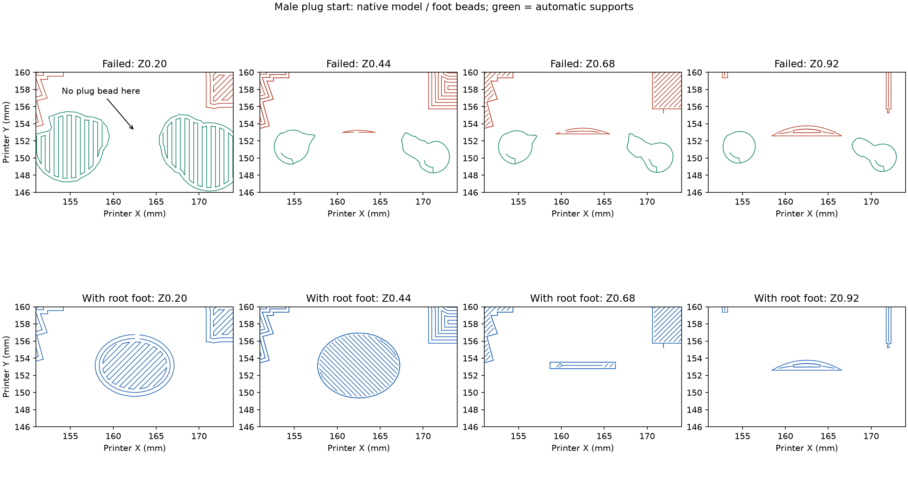

# Tip plug bed anchor

One corrected Mark1 tip candidate is prepared and natively sliced, with no repeat
control. It is **not submitted**. The supplied photographs show the failed
article and debris on Mark1's bed. Native estimate: 38 min 13 s, 9.57 g at the
saved profile density, 167 layers.

The customer outcome is an intact male insertion section and clean joint rim,
with the existing mating profile retained after print-aid removal.

## Starting-course evidence

The [failed Mark1 article](../2026-10-15-edge-supports/tip-mark1/physical-result/physical-result.json)
is task `1341173963`. Derek reports that the male insertion section fell over
and points to the detached C-shaped section. The photographs show that curved
piece beside the body and loose strands within the intended plug region.
Telemetry reports `FINISH`, 167/167 layers and no print error; physical failure
takes precedence over that completion indication.

The [native anchor review](mark1/anchor-review.json) finds no plug deposition
on the Z0.20 bed course. The first plug bead is commanded at Z0.44, G-code line
2430, with a 2.12 mm² bead footprint and zero overlap with lower deposited beads.
Its nearest lower-bead footprint is 0.63 mm away. The surrounding fins and tree
feet do not provide bearing beneath that initial strand. This identifies a
missing root bearing; static photos do not establish the initiating motion or
its time. The preceding rim-contact review did not assess this anchorage.

## Local correction

The [editable project](mark1/2026-10-15-faucet-tip-root-anchor-eight-fins-lip-trees-current105-bridge125-fan70-z018-mark1.3mf)
adds a directly bonded sacrificial foot under the plug's lowest start only:

- A 10 × 8 mm elliptical pad, 0.44 mm tall, centred at printer X162.5/Y153.15.
- An 8 × 1.2 mm contact strip above it, ending at Z0.68.
- No air gap at the plug root. The foot intentionally joins the starting layers
  at the non-show terminal end. Peel or clip it off while preserving the plug wall.

This explicit local print aid addresses bed anchorage independently of overhang
angle. The source tip, −105° pose, seam paint, eight fins and lip support paint
are preserved byte for byte. Tree(auto)/Default retains its saved decisions
elsewhere; its generated paths adapt around the added foot. No production part
geometry or full-faucet support arrangement is changed.

Native bed deposition beneath the root covers 58.22 mm² and overlaps the entire
reference starting-strand footprint. Every reviewed root course through Z1.16
has a direct bead overlap with its predecessor. The separate
[rim review](mark1/review.json) retains a largest 1.30 mm run without lower bead
overlap at the priority lip. Native full-bead bed clearance is 138.31 mm.

The machine and material settings are unchanged byte for byte: Mark1 requested
+0.18 mm trim/+0.16 mm emitted, 0.20 mm first layer, 0.24 mm subsequent layers,
125% bridge flow, 70% fan after three fan-off bed layers, 15 mm/s bridges and
overhang limits of 10/15 mm/s. No post-slice extrusion or motion edits are used.
The print-only package preserves the reviewed native G-code byte for byte.

Physical bed adhesion, foot removal, rim finish and mating fit remain untested
for this candidate. Commanded overlap does not establish strength or release.

`prepare.py --slice`, `review.py`, and
`../2026-10-15-edge-supports/review.py tip --folder <this-directory>/mark1`
are manual experiment tools, outside build and commit paths. Accepted launches
are preserved rather than overwritten.
