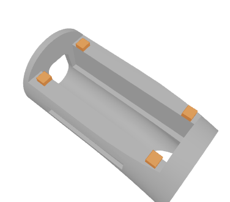
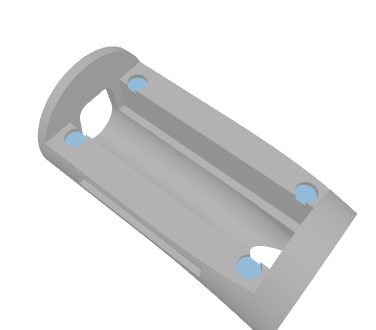
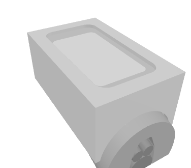
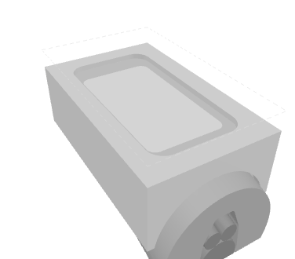
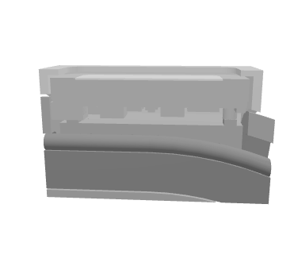
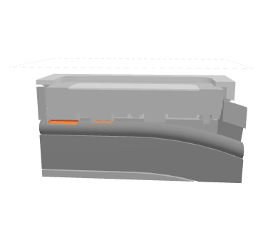

# Industrial display seat — 4.5 mm lower review candidate

The cover crown and display move 4.50 mm inward along the display normal.
The crown stands 1.82249 mm above the reference 27 mm round neck crown;
the printed reference stands 6.32249 mm above it. The cover's snap-bearing
locations and 1.30 mm bezel thickness are fixed.

This is a review candidate with its own tip and cover exports. Its modeled
component interference is unresolved. The
[complete fit print on Mark2](../../prints/2026-10-24-lowered-display-complete-mark2/README.md)
is task **1369497043**. The production files and earlier saved print projects
remain the input reference. The native geometry reading records the candidate
at review time, before submission.

| Contribution | Inward movement | Resulting foot-bearing N |
| --- | ---: | ---: |
| Printed reference | — | 11.60 mm |
| Additional tube clearance | 1.50 mm | 10.10 mm |
| Original support stock | 2.00 mm | 8.10 mm |
| Foot recess | 1.00 mm | 7.10 mm |
| **Total** | **4.50 mm** | **7.10 mm** |

The history basis is commit
[`5271aa710`](https://github.com/derekbreden/homesodamachine/commit/5271aa710fdb3ddb7bb735a7114d80cbc4ad324b):
it adds 1.50 mm to the original `wall_thickness_min` support depth of 2.00 mm
and raises the display and bezel. The 4 mm tube change is commit
[`8742c6624`](https://github.com/derekbreden/homesodamachine/commit/8742c66249d4e96f56e3635657f041b573e6ab25).
The calculation uses the complete 3.50 mm support depth, including its original
stock, then the requested additional 1.00 mm below the support bases.

The current pocket floor is N10.10. The candidate's surrounding seat is N8.10,
at the former support bases, with four recess bottoms at N7.10. This distinction
is visible in the open-cradle comparison: the full surrounding seating region
is deeper as well as the four supports being absent.

The four foot centers stay at X ±8.50 mm and S5.24 / S44.24 mm. Each recess is
Ø4.00 mm and 1.00 mm deep below the N8.10 seat. Their inner edges meet the
existing open channel. The four metal-foot envelopes have Ø3.464 mm enclosing
diameters, giving approximately 0.268 mm nominal radial clearance. Four native
planar pocket floors remain in the candidate.

The matching Industrial cover is generated with the display face and cosmetic
bezel 4.50 mm lower. Its retaining lips keep N3.30–6.30, 1.20 mm radial
engagement and the existing 0.50 mm wing extension. Nominal glass-to-bezel
clearance remains 0.60 mm; the photographs' approximate gap is a separate
physical observation. The seated geometry is the inspection reference; the
exported printable cover retains the existing inward wing preform.

The [native geometry reading](geometry-review.json) records the exact dimensions,
source hashes, four bearing floors and valid single-solid tip and printable
cover. It records zero intersection between the seated cover and tip and zero
between the display envelope and seated cover.

The conservative vendor-derived display-component envelope has 3.79049 mm
clearance to each modeled 4 mm flavor tube in the printed reference. Moving
that envelope inward by 4.50 mm creates intersections of about 12.2673 mm³
with each tube wall, approximately 0.70951 mm past first normal contact.
It also intersects the candidate tip by 14.7200 mm³. These are modeled envelope
intersections, not measurements of the physical part. The tube intersections
are highlighted in the side-section view. Tube routing and component models
retain their reference dimensions.

The [physical observation and eight photographs](../../prints/2026-10-23-black-complete-mark2/physical-result/physical-result.json)
record the reported cover gap, raised supports and apparent tube clearance.
The earlier physical acceptance records retain their identified scope. This
candidate has no physical fit or retention result.

`prepare.py` is a manual study generator. It writes `candidate-tip.step/.stl`,
`candidate-cover.step/.stl`, `geometry-review.json` and the self-contained viewer
data. `review-template.html` combines that data with synchronized before/after
views, feature highlights and dimension labels. The viewer meshes are a
visualization tessellation of the native CAD; the candidate STL uses 0.005 mm
linear deflection.
