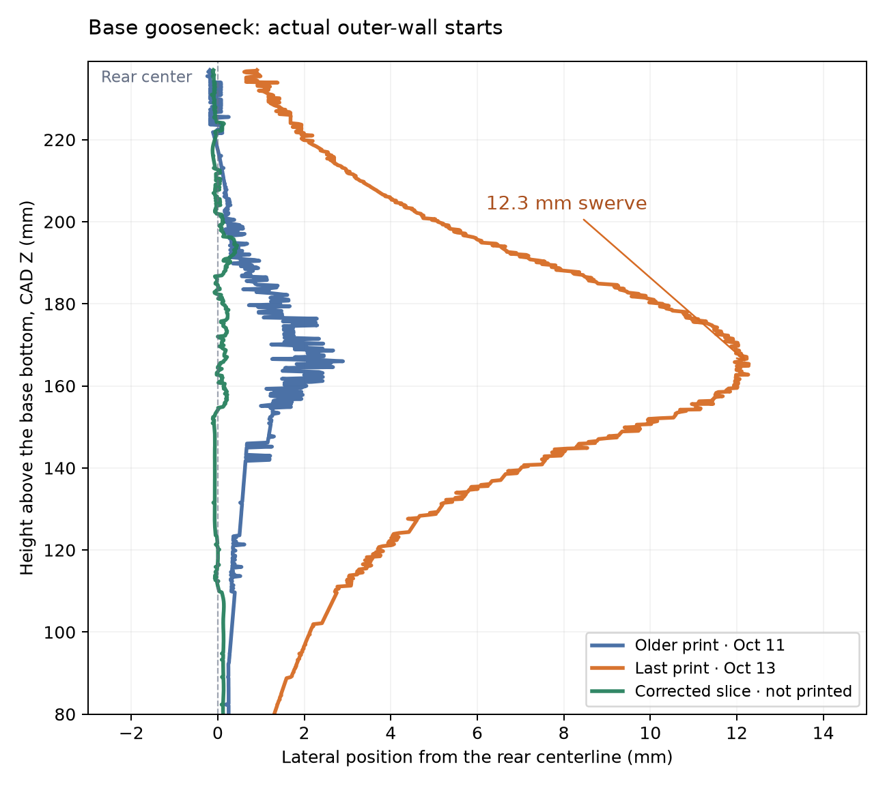

# Rear-center seam placement — Z80–237 candidate

This identified candidate paints a narrow seam-enforcer strip on the base
neck's outer rear surface at CAD X=0. Facets crossing X ±0.25 mm with centers
above CAD Z80 are selected at the rear silhouette; the mesh vertices and
triangle indices are unchanged. The selected facets span CAD Z67.70–237.33
because some facets extend below their centers. Bambu's `paint_seam="4"`
enforces seam placement.

The candidate retains A2/Back/150% on
base, tip and mounting plate, Aligned/15%/scarf off on the cover and lever,
wipe off, eight coarse lip layers, 0.12 mm shoulder bands, and the infill-only
reinforced foot. The correction applies only to the base neck's seam paint.

The [current complete preparation](../rear-center-v2/README.md) covers the
base's entire rear silhouette, including the stage shoulders, and the tip's
curved rear meridian. This record's comparison remains scoped to the
height-limited candidate identified here.

## Exact native comparison

The [seam reading](seam-review.json) follows each layer's largest projected-area
outer-wall run over CAD Z80–237. Its start identifies the beginning of the scarf
ramp. With a long scarf, the end is a different surface location; both are
retained in [seam-starts.csv](seam-starts.csv).

These saved endpoints use the bounded-connector reader and can omit final
zero-flow moves. The current manual reader retains every non-retracting
E-word move, including E0, matching the shared G-code reader. The
[complete evaluation's re-read](../rear-center-v2/README.md#native-motor-paths)
quantifies the resulting start and endpoint differences.

| Article or slice | Maximum lateral start offset from rear center |
| --- | ---: |
| October 11, Mark1 task 1329852853 | 2.895 mm |
| October 13, Mark2 task 1335906696 | 12.278 mm |
| Corrected complete slice | 0.450 mm |

The October 13 printed seam starts reach CAD X12.278, Y17.079, Z165.364
at print Z163.16, then approach the rear center again near the joint.
The [identified printed article](../../prints/2026-10-13-a2-back-mark2/physical-result.json)
has Derek's overall acceptance and tag `faucet-industrial-approved-2026-10-13`.
The [one-time base-only evaluation](../../prints/2026-10-13-rear-seam-base-only-mark2/README.md)
completed on Mark2 as task 1337160395. Its
[physical result](../../prints/2026-10-13-rear-seam-base-only-mark2/physical-result.json)
confirms the middle-neck correction and reports misplaced seams in both lower
transitions, outside the original native review range.

## Cause and isolated probes

Changing only the printed base's scarf length from 60 to 10 mm retains the
identical 12.278 mm swerve. Restoring only the foot modifier's six-wall override
reduces the swerve to 2.973 mm. These diagnostic archives were not submitted;
their deltas, hashes and measured witnesses are in
[diagnostic-probes.json](diagnostic-probes.json).

The foot's wall-count override changes Bambu's automatic seam alignment farther
up the base. Bambu's version-matched
[alignment implementation](https://github.com/bambulab/BambuStudio/blob/v02.08.02.61/src/libslic3r/GCode/SeamPlacer.cpp#L1185-L1283)
selects seam strings across layers and fits a curve; Back is a preference rather
than a fixed X=0 instruction. The controlled probe identifies the preparation
change affecting the path. Its precise internal anchor sequence is not traced.

The production foot retains 100% infill and inherited ordinary walls. The rear
enforcer provides the placement correction while retaining the wall-break fix.
The [native review](native-review.json) confirms identical vertices, triangle
indices, global and object settings, reinforcement and layer ranges against
the approved printed project. The five-part Mark2 candidate estimates
6 h 5 min 58 s and 161.06 g, with at least 44.86 mm full-bead edge clearance.

- [Complete editable Mark2 candidate](2026-10-13-industrial-faucet-rear-seam-petgf-left04-z004-mark2.3mf)
- [Complete sliced Mark2 candidate](https://github.com/derekbreden/homesodamachine/blob/33d50d2ecd2a0fb6b518483a44c8031e3a0c1617/hardware/printed-parts/faucet/industrial/seam-placement/rear-center-v1/2026-10-13-industrial-faucet-rear-seam-petgf-left04-z004-mark2.gcode.3mf)
- [Source and preparation record](2026-10-13-industrial-faucet-rear-seam-petgf-left04-z004-mark2.print.json)
- [Manual trace reader](review.py)
