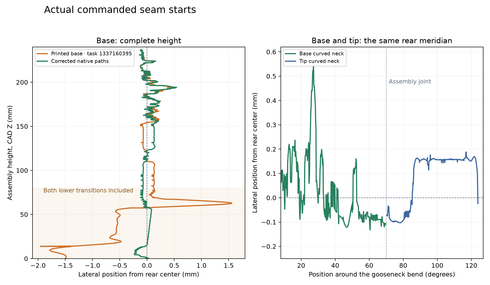

# Complete rear seam placement

The complete Industrial faucet uses rear seam-enforcer paint through the
base's entire build-pose rear silhouette, including the tilted stage shoulders.
The tip's curved outer arc has matching paint at the same assembly X=0
meridian. The tip plug and display-frame surfaces retain their automatic Back
seams. The mounting plate's exposed rim starts at X=0. The cover and lever
retain Aligned, 15% seam gap and scarf off.

The [selection](../../finish-selection.json) and
[preparer](../../prepare_print_project.py) select facets using their intersection
with the center strip and the rear boundary at each **build Z**. This follows
the contour's translation in plate Y. The base strip crosses X ±0.25 mm;
the curved tip facets intersect X=0. Selected base facets include CAD Z0–237.33,
with no height cutoff. Mesh vertices, triangle indices, object poses, eight
coarse lip layers, fine bands, cooling, temperatures, automatic supports and
infill-only reinforcement are retained.

## Native motor paths

The [manual reader](review.py) follows every emitted exterior-wall run in the
base, tip and plate, including G2/G3 arcs, zero-flow E-word moves and numerical
E-less hops within 0.02 mm in XY and 0.002 mm in Z. Each run is compared with
the source STL's actual external footprint in its build pose. Hole walls, disconnected shoulder
islands, the tip plug and terminal contours remain in the data with their own
classification; they are not substituted for the exposed rear seam.

The [complete-set trace](complete-trace/trace.json) and
[CSV](complete-trace/seams.csv) retain starts, full-height ramp ends and the
overlap endpoints read with the bounded-connector reader in `a37392aa5`.
Those endpoints can omit final zero-flow moves; they do not represent the
complete commanded wall path. The [native review](native-review.json) binds
the exact meshes, settings and archive. The base-and-tip evaluation produces
the same rear seam paths
after its centering translations. The 60 mm scarf's recorded overlap endpoint
is approximately 0.60 mm before its ramp end, consistent with the selected
150% ordinary seam gap on a 0.4 mm nozzle. That trailing end is a different location on the loop
from the rear scarf start. Re-reading with the E-word rule retains the
remaining zero-flow tail.

The manual re-read of the exact base-and-tip archive for task 1337767162
retains all 3,479 runs. Against the bounded-connector reading, starts differ
by at most 0.002 mm and final endpoints by at most 0.401 mm. The current
faucet reader and shared reader agree exactly on starts and endpoints for
their 3,455 common runs; the faucet reader also retains 24 single-move
traces. The rear-seam placement conclusions below remain valid.

| Base region | Printed base task 1337160395: maximum lateral start offset | Current native candidate |
| --- | ---: | ---: |
| Foot, CAD Z0–14 | 1.955 mm | 0.231 mm |
| Body, CAD Z14–55 | 1.307 mm | 0.083 mm |
| Lower neck, CAD Z55–80 | 1.556 mm | 0.116 mm |
| Upper neck, CAD Z80–237.4 | 0.450 mm | 0.543 mm |

The curved tip's exposed rear starts remain within 0.188 mm of center.
Approaching the joint, the base is X−0.107 mm and the tip is X−0.072 mm,
a 0.035 mm lateral difference. The plate's exposed outer rim is X=0.
The base's final narrow cap is an open terminal trace, retained separately
from its closed perimeter seam.

The [shared-reader cross-check](shared-reader/README.md) independently records
the complete base profile, the tip's plug/frame contours and the plate's
pedestals. Its selected-part paint geometry and numerical scarf connectors
match this reading. These commands run by hand and are not build steps.

## Physical evidence and evaluation

The [base-only physical result](../../prints/2026-10-13-rear-seam-base-only-mark2/physical-result.json)
confirms the middle-neck correction and reports both lower transitions still
misplaced. Its [complete-height trace](printed-base-trace/trace.json) records
the omitted lower paths. The earlier reader and paint covered CAD Z80–237;
the native evidence for that candidate did not cover the reported lower areas.

The [base-and-tip evaluation](../../prints/2026-10-13-complete-rear-seam-base-tip-mark2/README.md)
is the specifically authorized partial print of both corrected pieces. The
normal [canonical project](../../faucet-industrial-petgf.3mf) contains all five
rigid parts and keeps Mark1's default profile and trim. The Mark2 evaluation
uses Mark2's normal +0.04 mm trim. Derek's
[physical approval](../../prints/2026-10-13-complete-rear-seam-base-tip-mark2/physical-result.json)
selects the complete rear seam fix as the current planned production model,
tagged `faucet-industrial-production-2026-10-14`. The other three rigid parts
retain the accepted complete-print reference and its tag
`faucet-industrial-approved-2026-10-13`.
