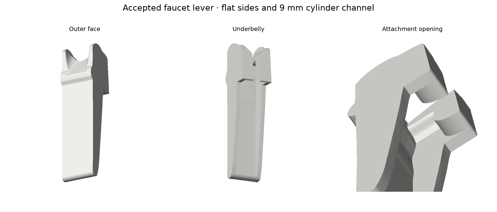
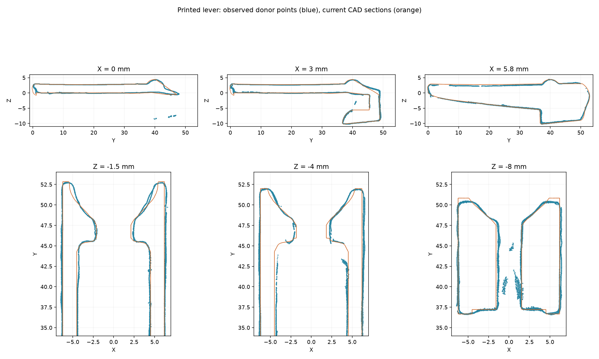

# Faucet lever · HSM-000268

A scan-derived, editable lever with **flat lateral faces and a 9.00 mm cylinder
channel**. Derek confirmed the completed white PET-GF Mark2 print on 2026-09-20:
"The lever you printed turned out great, fits and works functionally."
The primary STEP, STL, viewer payload and preview represent this accepted shape.
[HSM-000268 in the material explorer](https://homesodamachine.com/3d#material:HSM-000268)
links the part to both faucet BOMs, its model and installation documents.
The [physical acceptance record](physical-acceptance.json) binds the observation
to the exact printed mesh and uniquely named job. Quantitative strength and
endurance have not been measured.

The printed lever replaces the donor Westbrass's own lever in the build and is printed in
the faucet's finish; [faucet shell assembly](../faucet-shell/ASSEMBLY.md) fits it.



## Files

| File | Use |
|---|---|
| [lever_replica.py](lever_replica.py) | Editable CadQuery construction; `build()` returns the accepted shape |
| [lever-replica.step](lever-replica.step) | Accepted analytic solid in the local part frame |
| [lever-replica.stl](lever-replica.stl) | Accepted mesh in that same frame; source of the viewer payload |
| [lever-replica-side-down.stl](lever-replica-side-down.stl) | Accepted shape with its right side on the print bed |
| [lever-replica-petgf.3mf](lever-replica-petgf.3mf) | One lever using the shared PET-GF settings and +0.18 mm Z trim |
| [lever-replica-petgf-white.3mf](lever-replica-petgf-white.3mf) | The same lever at +0.04 mm Z trim, for Mark2 |
| [lever-black-petgf-z018-h2c.gcode.3mf](https://github.com/derekbreden/homesodamachine/blob/33d50d2ecd2a0fb6b518483a44c8031e3a0c1617/hardware/printed-parts/faucet/lever-replica/lever-black-petgf-z018-h2c.gcode.3mf) | Native H2C slice; submitted jobs are identified by hashes in the job record |
| [lever-original-wide-white-z004-mark2.gcode.3mf](https://github.com/derekbreden/homesodamachine/blob/33d50d2ecd2a0fb6b518483a44c8031e3a0c1617/hardware/printed-parts/faucet/lever-replica/lever-original-wide-white-z004-mark2.gcode.3mf) | Completed and physically accepted white lever at +0.04 mm on Mark2 |
| [print-jobs.json](print-jobs.json) | Printer completion, physical observations, material/nozzle and job hashes |
| [physical-acceptance.json](physical-acceptance.json) | Derek's fit/function confirmation for the exact accepted mesh |
| [scan-fit.json](scan-fit.json) | Donor-reference/observed-point distances, normals and mesh validity |
| [contact-datums.json](contact-datums.json) | Partial metal-cylinder fit and its scan-frame transform |
| [evidence/datums.json](evidence/datums.json) | Rigid transform from lever scan coordinates to CAD |
| [evidence/sources.json](evidence/sources.json) | Source hashes, point counts and coordinate frames |

The STEP, STL and viewer payload are generated by the part's own source. The
compressed evidence arrays retain all 369,385 fused lever points, 1,702 selected
interior points, and 202,391 Touch-Flo contact points, with their normals. Each
NPZ contains `points` and `normals` arrays in millimetres. Lever arrays are in
the local CAD frame; the Touch-Flo array is in its independent scan frame.
The scans are observations with missing surfaces, not printable closed solids.

## Frame and dimensions

X is lateral. +Y runs from the paddle tip toward the attachment, which is aft
when installed. +Z points toward the broad outer face. Z=0 is fitted to the
inner paddle plane. The Y origin is the measured forward-tip tangent and X=0
is between the fitted side planes. Matrices use homogeneous column vectors:
`local = T @ [scan_x, scan_y, scan_z, 1]`. Normals use only the rotation.

The accepted body is 12.40 mm across its parallel outer faces, with a 9.00 mm
straight channel and 1.70 mm walls. The straight channel reaches Y=44.30 mm
before `PRINTED_STOP_PROFILE` forms the cylinder pocket. It is one closed solid.
Its side-down print mesh is SHA-256
`7a3f5c7d9034c4cce0e0f39bfac6e868f6bd8d01a05add3d21951981eca296eb`.

The source retains the measured show profile, ledge lip and relief sections.
Bilateral symmetry and unobserved ledge surfaces remain construction assumptions.
The exposed fit parameters describe the canonical printed body.

The cylinder fit accepts 6,099 of 7,151 candidate points after residual trimming;
its accepted radial residual is about 0.14 mm at the 95th percentile. It does not
measure the cylinder's end-to-end span. Its frame origin is on the fitted axis
at an inspection-plane station, **not a measured lateral midpoint**. The central
protrusion is not represented by that cylinder primitive; retain the complete
Touch-Flo cloud when checking clearance.

## Observed points and current model

[scan-fit.json](scan-fit.json) reports one-sided distances from the retained
observed points to the canonical printed mesh. Flat lateral faces and the 9 mm
channel are intentional print and fit geometry. Scan distances do not qualify
unobserved surfaces, operating forces or endurance; the identified print's fit
and operation are established by [physical-acceptance.json](physical-acceptance.json).



The selected patches were independently captured twice: their aligned nearest
point distances have 95th percentiles 0.097 and 0.094 mm. This is repeat consistency,
not absolute scanner calibration. The coating thickness is unmeasured. Original
Revo projects, unfilled scan meshes, all passes and processing records remain in
`~/Documents/3D Scans/2026-09-19-faucet-lever/` and
`~/Documents/3D Scans/2026-09-19-touch-flo-interface/`. Registration and repeatability
records are also retained in [evidence/](evidence/).

## Attachment and operating constraint

Derek's observed assembly sequence is the mechanism authority:

1. Keep the bare donor outside the shell and the soda tube absent. Place the
   printed lever aft of its final position and lower it in Z.
2. Slide the lever forward around the metal cylinder until the light snap seats.
   Without the tube it resists shaking loose but remains easy to remove.
   Leave it **down at rest, not pressed**.
3. Fit the fresh TPU sleeve evenly around the square-cut tube end outside the
   donor, with the end fully against the cap. Insert this sleeved tube into
   the donor's empty top port while the attached lever stays down at rest.
   The tube prevents aft disengagement and retains the operating contact
   arrangement. With the tube absent, pressing the lever makes it slide aft
   off the metal cylinder.
4. Flip the attached lever up for donor insertion into the shell. As the donor
   advances, the shell pushes the lever forward. Once fully seated, the shell
   prevents it reaching the flipped-up position. Let it snap down to its
   unpressed rest position.

The [assembly observation record](assembly-observations.json) retains the
reported sleeve order, sliding behavior and shell-guided lever motion. The
[illustrated guide](../../../faucet-assembly-guide/README.md) and
[tube insertion tools](../../fixtures/tube-insertion/README.md) follow this
sequence.

The Sculpted and Industrial assembly views place this same solid at the existing
nominal rest datum, with its aft edge at Y=9 mm and its top at Z=52 mm. This is
an authored display placement. The assembled rigid pose, tube-contact location,
plunger stroke and force have not been measured. The physical acceptance record
applies to the printed lever's fit and operation, independently of that placement.

## PET-GF comparison print

The project takes its process and filament settings directly from the shared
[`petgf.3mf`](../../petgf.3mf), with Derek's +0.18 mm Z trim. Its H2C left
0.4 mm profile uses 265 °C first layer / 280 °C later, 80 °C Textured PEI,
0.24 mm layers, a 0.20 mm first layer, two walls, 15% grid infill and 0.9555
flow ratio. The physical setup is black PET-GF and a 0.4 mm diamond PCD nozzle.
The single external spool uses the saved PET-CF mapping for PET-GF. The trim
adds to the stock Textured PEI compensation, producing `G29.1 Z0.16` in the
submitted G-code.

The right side is on the bed. The broad outer face is vertical and has no labelled
support-interface contact. The offline slice has one bed-rooted support body
and three labelled contact islands, in the channel/head/rear relief. Remove these
through the open channel and attachment mouths with the tube absent. Physical
support removal and mating-surface finish remain print checks.

Bambu Studio's native slice estimates **16 min 38 s and 4.04 g**, including the
saved startup sequence and supports; grams use its saved density. The accepted
Mark2 job finished all 52 layers without a printer error and has Derek's physical
fit/function confirmation. The exact project/STL
hashes and slice are recorded in [the print report](lever-replica-petgf.print.json),
[readiness record](lever-replica-petgf.readiness.json),
[support audit](lever-replica-petgf.support-audit.json) and
[print job record](print-jobs.json).

The printed lever has parallel sides: 12.40 mm outside, a 9.00 mm
channel and 1.70 mm walls along the straight portion.

## Accepted model and print

The part prints on its side: local X is the print's Z. So the two side faces are
the bed contact and the top surface, and the channel between them is a bridged
gap. A slope survives on none of the three.

`lever-replica-side-down.stl` is built flat at `PRINTED_OUTSIDE_WIDTH`
and `CHANNEL_PRINTED_WIDTH`. Its channel stays parallel to Y=44.30 mm, then
follows `PRINTED_STOP_PROFILE` into the cylinder pocket. This complete geometry
has Derek's physical confirmation: the cylinder seats fully, the rod passes
through the bottom slot, and the arms lift the cylinder during operation.
The primary STEP, STL, viewer payload and preview carry the same accepted body
in the local part frame. Both faucet assemblies use this same part. Generators read `physical-acceptance.json`; they preserve its
observation and report acceptance only when the printed mesh hash matches it.

The uniquely named white archive and its project preserve the accepted
channel-fix project's mesh and placement byte for byte. Its executed machine
commands match that print except for Mark2's Z trim. The source comparison and
archive hashes are recorded in `print-jobs.json`.

Strength/endurance comparison remains separate from the confirmed functional
fit. Record any future load/cycle measurements against the exact print. For full
faucet-model integration, measure tube-installed rest and fully pressed poses
relative to the top-port axis and mounting datum, including the bearing surfaces
on the tube and cylinder. Preserve the accepted body and intact donor as controls;
fit changes belong to named contact parameters rather than global scan scaling.

## Rebuild

```sh
tools/cad-venv/bin/python hardware/printed-parts/faucet/lever-replica/lever_replica.py
tools/cad-venv/bin/python hardware/printed-parts/faucet/lever-replica/check_replica.py
tools/cad-venv/bin/python hardware/printed-parts/faucet/lever-replica/prepare_print.py
```

`prepare_print.py --slice-output /tmp/lever-comparison-slice` also runs an offline
Bambu Studio slice into an empty directory and writes the submittable archive beside
the project. `--variant` picks the machine: `black-h2c` takes Derek's +0.18 mm Z trim,
`white-mark2` takes +0.04 mm. Both take their process and filament settings from the
shared `petgf.3mf`; the filament colour is physical, on the spool. Neither connects to
a printer — submission goes through Bambu Connect, driven by `tools/bambu-ax`, and is
recorded in `print-jobs.json`.
