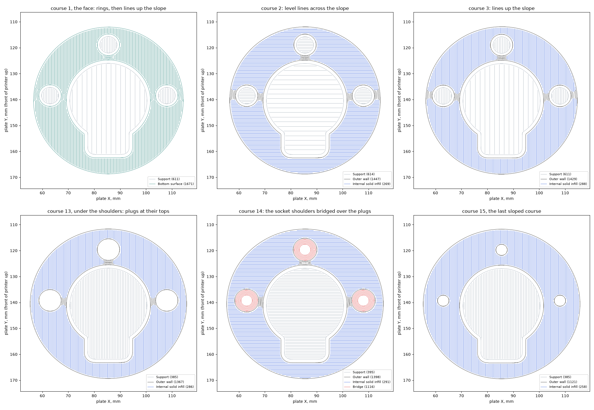
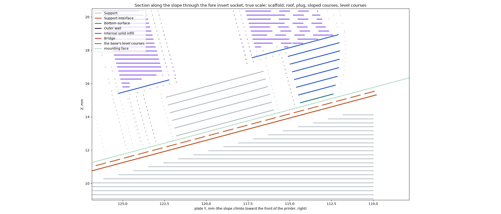

# Complete Sculpted faucet with a sloped foot and socket plugs on Mark2

This plate is prepared and has not been sent to a printer. The
[print archive](sculpted-faucet-sloped-foot-black-mark2-ready.gcode.3mf) is the complete black
PET-GF Sculpted faucet for Mark2's left hardened nozzle on textured PEI: base, tip, display
cover, above-counter plate and side-down lever. The
[editable project](sculpted-faucet-sloped-foot-black-mark2.3mf) holds the meshes and settings,
and the archive carries the motion the sloped stage wrote. The [slice review](slice-review.json)
binds the archive, [`sloped-underside.json`](sloped-underside.json) records what the stage laid
and what it kept of the plate, and [`head-replay.json`](head-replay.json) replays its moves
against the toolhead.

It answers Derek's [first message](https://github.com/derekbreden/homesodamachine/blob/727125473a61a56604e145292ffd41d6984f49a0/hardware/printed-parts/faucet/sculpted/prints/2026-11-13-sloped-underside-complete-mark2/physical-result/physical-result.json)
on the [plate before it](https://github.com/derekbreden/homesodamachine/blob/727125473a61a56604e145292ffd41d6984f49a0/hardware/printed-parts/faucet/sculpted/prints/2026-11-13-sloped-underside-complete-mark2/README.md),
whose face he found tight on the aft side and looser on the fore:

> I hope we can do some more layers like that first print layer, so that the first print layer
> turns out even better because it gets built on top of the way that we like.

> I'd like to try to continue it into the heat sets there. There's two levels of counterbore
> there, though, so we just want to go into the first one, not both of them.

> please prepare a new test print of the faucet plate for me here with the changes I'm asking for.

## What changes from the plate before it

**The foot is sloped courses.** The foot is laid as courses parallel to the mounting face, each
cut from the base's own section at its height, from the mounting face up past the shoulders of
the insert sockets. The base's level courses start on top of that slab. This is the "more layers
like that first print layer" he asks for: every course of the foot is built on the sloped course
under it.

**The level courses meet the slab without a step.** Where the slab rises through a level course,
that course thins to nothing instead of stopping with a blunt end. The blunt ends are the
slanted marks along the foot's edge in his photographs.

**Each course goes down uphill-first.** Within a course, the rings with the course's stock
uphill of them go down first, then the fill, then the rings with the stock downhill of them, so
every line climbs and none is laid with its uphill neighbour already down. Rings lap at their
joints instead of butting. The fill runs into the ring beside it rather than stopping short of
the uphill ring, which left the dark gaps along the fore side's ring. Strips too narrow for the
fill, such as between the fore socket and the rim, take rings in place of short separate dabs.
Alternate courses run up the slope and level across it.

**A plug stands in each insert socket.** Each socket holds a support plug under its shoulder,
clear of the socket's wall and rising with the foot's courses. The shoulder crosses it with
Support D's roof, air and bridge, as the first course crosses the scaffold's roof. The plug goes
into the first counterbore only: the insert's pilot above the shoulder stays empty.

**A deck stands in the bore.** The deck rises with the slab to the slab's top, and the trees
inside the base land on it.

## What is unchanged

The scaffold, the three roof courses and the first course's bridge settings are those of the
plate before it. The tip, cover, plate and lever are unchanged.

The courses, seen from above and in section:

## The toolhead over the slope

[`head-replay.json`](head-replay.json) is [`check.py`](stage/check.py) stepping every move near
the base against the [H2C head reference](../../../../../reference/h2c-toolhead/README.md), with
the plastic laid before that move as the ground. The reference's lower surfaces are estimates
from photographs, and no witness on Mark2 has measured them. Every sloped pass comes before the
plate's first layer.

The slicer was given the base with the space under its face filled down to the bed, so it lays
no support there and reads the courses above as inside courses.
[`make_union.py`](stage/make_union.py) makes that mesh; [`sloped.py`](stage/sloped.py) prints
the scaffold, roof, slab, plugs and deck where the fill was, with the course paths from
[`courses.py`](stage/courses.py).

## What this print is to answer

- Whether the fore side of the face is now as tight as the aft.
- The foot's edge where the level courses meet the slab.
- Whether the plugs come out of the sockets with the support, and the shoulders they leave.

The stage is this trial's own tool. The plate's standing recipe is in
[the Sculpted README](../../README.md).
