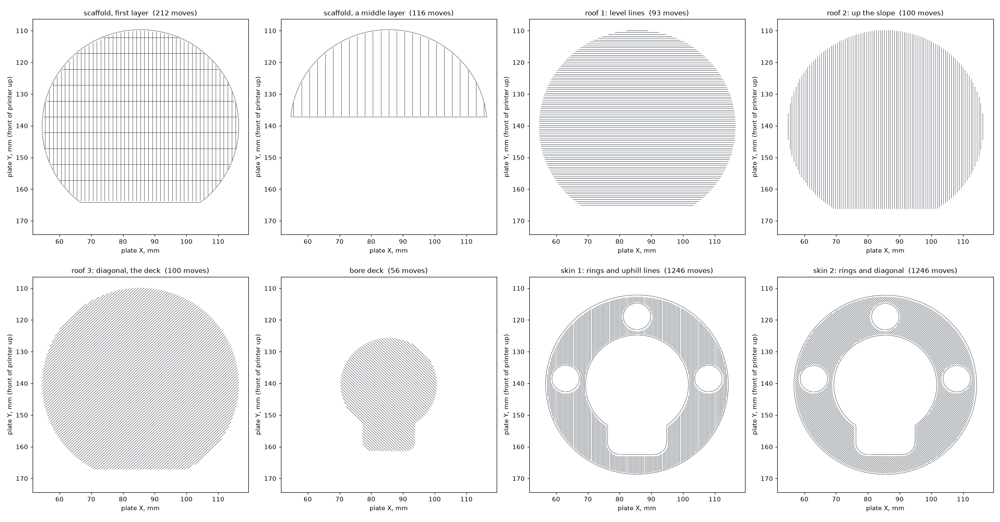
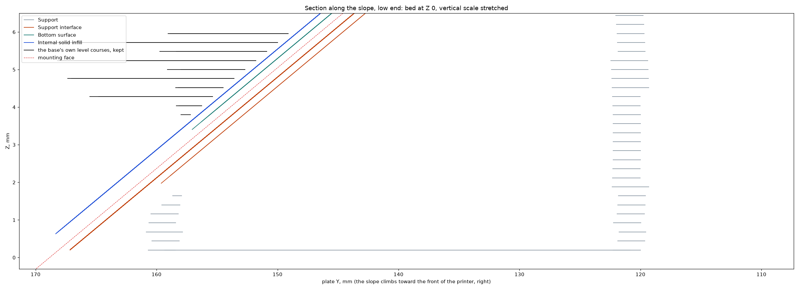

# Complete Sculpted faucet with a sloped underside on Mark2

The [print archive](sculpted-faucet-sloped-underside-black-mark2-ready.gcode.3mf) is the complete
black PET-GF Sculpted faucet for Mark2's left hardened nozzle on textured PEI: base, tip, display
cover, above-counter plate and side-down lever. The
[editable project](sculpted-faucet-sloped-underside-black-mark2.3mf) holds the meshes and
settings. The archive carries the motion the sloped stage wrote. The
[launch record](launch.json) and [slice review](slice-review.json) bind what Mark2 accepted.

## The head

The tip and the cover are the lowered head both faucet styles share, printed here for the first
time from the generator. The cover's ends are bowed by what the printed ends spring back, with a
closer arch and deeper pockets at its crown. The
[stopped plate's photographs](https://github.com/derekbreden/homesodamachine/blob/91a3b9758/hardware/printed-parts/faucet/sculpted/prints/2026-11-13-crown-pockets-aft-stop-mark2/physical-result/physical-result.json)
are what that change answers.

## The base's underside

The base leans as every base before it has, so its mounting face is a slope over the bed. A
scaffold of level layers stands under that face, printed before anything else on the plate. A
solid roof of three courses and a skin of two then follow the slope, every line laid from its
low end up. The first skin course crosses its air as a bridge, with the roof, the air and the
bridge's flow, speed and fan that [Support D](../../../../printing-the-machine/23-solid-roof-small-gap.html)
asks. The plate then prints as sliced. The base's level courses are kept where they stand over
the skin, and each travel the toolhead would carry into the scaffold is lifted over it.

The slicer was given the base with the space under its face filled down to the bed, the
preparer's `--filled-base`, so it lays no support there and reads the courses above as inside
courses. [`make_union.py`](stage/make_union.py) makes that mesh and [`sloped.py`](stage/sloped.py)
prints the scaffold, roof and skin where the fill was. The trees that stand inside the base land
on a deck the roof carries across the bore. [`sloped-underside.json`](sloped-underside.json)
records what the stage laid and what it kept of the plate. The courses, seen from above and in
section:

## The toolhead over the slope

[`head-replay.json`](head-replay.json) is [`check.py`](stage/check.py) stepping every move near
the base against the [H2C head reference](../../../../../reference/h2c-toolhead/README.md), with
the plastic laid before that move as the ground. The reference's lower surfaces are estimates
from photographs, and no witness on Mark2 has measured them. The slope climbs toward the front
of the printer, the one direction in which the reference's underside clears it. Every sloped
pass comes before the plate's first layer.

## What this print is to answer

- Whether the scaffold and its roof come away in one piece, and what the face under them looks
  like.
- The foot's edge, and the join where the level courses start on the skin.
- Whether the lowered cover snaps onto this plate's own tip and where it stands off.
- The tip's wall by its dispense end.

The stage is this trial's own tool. The plate's standing recipe is in
[the Sculpted README](../../README.md).
