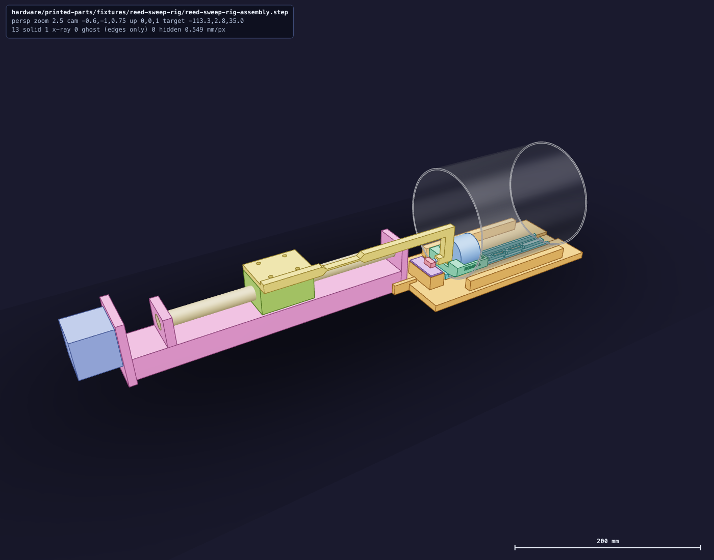
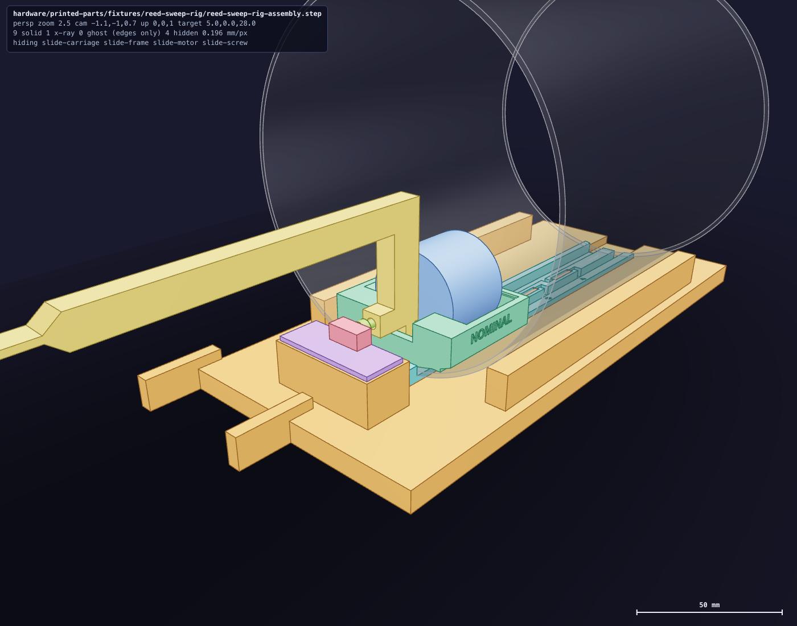
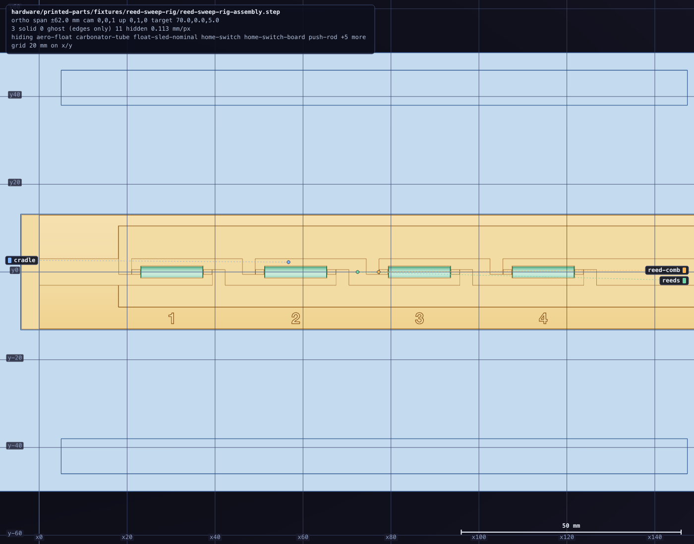

# Reed sweep rig

A bench fixture that measures where a level reed closes and opens as the float's magnet passes
it. A bought ball-screw slide pushes a finished Aero float along a bare carbonator tube, the
reeds lie under the tube's wall on a printed comb, and a controller logs every reed change
against the slide's step count. It does by motor the sweep that step 3 of the float's
[reed calibration](../../cold-core/magnetic-float/all-aero/installation.md#reed-calibration)
asks for by hand.

**Status: sliced, nothing printed.** The slide, its driver, the controller boards and the home
switch are on order ([purchases.md §12](/hardware/ledger/purchases.md)). Every fit to a bought
part comes from its maker's drawing. The [controller's program](/firmware/src_reed_rig/README.md)
and the [log reader](/tools/hsm/peripheral/src/reed.rs) are written and tested on this Mac, and
neither has met a board. The build is in the
[assembly guide](/hardware/assembly/reed-sweep-rig.md).

## How it holds what the machine holds

- **The reeds.** The tube lies on the comb, so the reed line is the tube's lowest line. Each reed
  lies in a pocket with its glass along the tube's axis, as the
  [reed bridge](../../cold-core/reed-bridge/README.md) holds it, and the tube rests on a flat land
  either side of the pockets.
- **The float.** The sled rides the bore on two square edges and carries the float in a vee, so
  the float's distance from the wall comes from the bore it is measured in. A leaf presses the
  float's bottom face onto the sled's datum wall.
- **The three sleds.** `nominal` stands the magnet's axis the machine's distance from the glass's
  centre. `near` and `far` move the float toward and away from the reeds by as much as its bore
  lets it wander on its rod.
- **The frame.** The tube's rim seats on the comb's tab, and that rim stands for the carbonator's
  bottom rim. Stations 2 and 3 are the low and the high reed at the heights the bridge seeds;
  stations 1 and 4 stand one pitch outside them.
- **Steel.** The rod is long enough to keep the slide's screw and bearings away from the magnet,
  and the three screws near the tube's mouth are stainless.

[`numbers.rs`](numbers.rs) owns every dimension, and takes the float's, the tube's and the reed
bridge's from their own files. The program writes what the log reader needs into
[`reed-sweep-rig-datums.json`](reed-sweep-rig-datums.json): each station's place along the
tube, each sled's float gap and magnet-to-glass distance, the magnet's place on the sled, the
roller's play in its slot, and the slide's travel, lead and steps. It writes what the
controller compiles into [`reed-sweep-rig-datums.h`](reed-sweep-rig-datums.h): the steps to a
millimetre, the station count, and where home and the sled's deepest stand from the tab.

## Printed pieces

| File | Qty | Function |
|---|---:|---|
| [`reed-sweep-rig-cradle.stl`](reed-sweep-rig-cradle.stl) | 1 | Slab with the comb's pocket, two keepers that stop the tube rolling, the home switch's pad, and the cheeks that take the slide's far end |
| [`reed-sweep-rig-comb.stl`](reed-sweep-rig-comb.stl) | 1 | Carries the tube on the reed line; four numbered reed pockets, lead slits, a signal groove and a return groove; its tab stops the tube's rim and the sled |
| [`reed-sweep-rig-rod.stl`](reed-sweep-rig-rod.stl) | 1 | Bolts to the slide's carriage; a flexure lets its far end rise and fall; its roller stands in the sled's slot and its finger carries the striker screw |
| [`reed-sweep-rig-sled-near.stl`](reed-sweep-rig-sled-near.stl) | 1 | Float sled, float nearest the reeds |
| [`reed-sweep-rig-sled-nominal.stl`](reed-sweep-rig-sled-nominal.stl) | 1 | Float sled, float where its rod stands |
| [`reed-sweep-rig-sled-far.stl`](reed-sweep-rig-sled-far.stl) | 1 | Float sled, float farthest from the reeds |

Each STL stands on the face it prints on. The sleds print top down, so the two edges they ride
on are top faces of the print and the lettering on their sides reads upside down on the bed.
The rod prints on its side, with its pad standing as a wall.

## Print

Black PET-GF on either printer's left 0.4 mm nozzle, from the shared
[`petgf.3mf`](../../petgf.3mf) with supports and the prime tower off. Nothing needs support: the
slices carry none.

| Plate | Pieces | Mark1 | Mark2 |
|---|---|---|---|
| Cradle | cradle | [project](ready/reed-sweep-rig-cradle-petgf-left04-z018-mark1.3mf), [slice](ready/reed-sweep-rig-cradle-petgf-left04-z018-mark1.gcode.3mf), [readiness](ready/reed-sweep-rig-cradle-petgf-left04-z018-mark1.readiness.json) | [project](ready/reed-sweep-rig-cradle-petgf-left04-z004-mark2.3mf), [slice](ready/reed-sweep-rig-cradle-petgf-left04-z004-mark2.gcode.3mf), [readiness](ready/reed-sweep-rig-cradle-petgf-left04-z004-mark2.readiness.json) |
| Small parts | rod, comb, three sleds | [project](ready/reed-sweep-rig-small-parts-petgf-left04-z018-mark1.3mf), [slice](ready/reed-sweep-rig-small-parts-petgf-left04-z018-mark1.gcode.3mf), [readiness](ready/reed-sweep-rig-small-parts-petgf-left04-z018-mark1.readiness.json) | [project](ready/reed-sweep-rig-small-parts-petgf-left04-z004-mark2.3mf), [slice](ready/reed-sweep-rig-small-parts-petgf-left04-z004-mark2.gcode.3mf), [readiness](ready/reed-sweep-rig-small-parts-petgf-left04-z004-mark2.readiness.json) |

A plate's Mark1 and Mark2 slices differ in the printer's Z trim and its spool's reported colour.
Each readiness file holds its slice's time, filament, layers, bead margin and checksums.
[`print-layout.json`](print-layout.json) lays the plates out and
[`prepare_print.rs`](prepare_print.rs) makes them. No plate has been sent to a printer.

## What has not met the bench

- The slide's carriage height, hole pattern and end plate, the switch board's hole spacing and
  lever height, and the float's own printed size are drawn from listings and from numbers, not
  from parts in hand. The rod's flexure and the striker screw take up the slide's and the
  switch's; the gauge window in each sled's back wall is there to read the float's gap.
- The driver on its carrier, its microstep switches and its current setting are untested, and
  so are the home switch's pressed level and the motor's direction. The controller keeps a
  setting for each of the last two.
- The roller's play in the sled's slot is a fixed offset between the two sweep directions. It is
  read with calipers off the printed pieces.
- Home is set a bank card's thickness off the tab by hand, and is as true as that.

## Regenerate

The program is one of the sandbox's examples, so the build reads none of it:

    tools/run -- cargo run --release --locked -j2 --manifest-path tools/hsm/Cargo.toml \
        -p hsm-sandbox --example reed-sweep-rig -- hardware/printed-parts/fixtures/reed-sweep-rig

With `--fits` after the directory it writes nothing and prints how the pieces sit instead: what
touches, what clears and by how much, at the sled's home and at its deepest. The print projects
and their slices come from the preparer, which takes `--plate` for one of them:

    tools/run -- cargo run --release --locked -j2 --manifest-path tools/hsm/Cargo.toml \
        -p hsm-print-prep --bin reed-sweep-rig-print-project -- --slice-output .cache/runs/reed-sweep-rig-slice

The pictures are `hsm render` of the assembly's payload with `--look`:

    tools/run -- hsm render printed-parts/fixtures/reed-sweep-rig/reed-sweep-rig-assembly.step \
        hardware/printed-parts/fixtures/reed-sweep-rig/views/rig.png --look --cam=-0.6,-1,0.75 --xray carbonator-tube
    tools/run -- hsm render printed-parts/fixtures/reed-sweep-rig/reed-sweep-rig-assembly.step \
        hardware/printed-parts/fixtures/reed-sweep-rig/views/mouth.png --look --cam=-1.1,-1,0.7 \
        --hide 'slide-*' --xray carbonator-tube --target=5,0,28 --distance 260
    tools/run -- hsm render printed-parts/fixtures/reed-sweep-rig/reed-sweep-rig-assembly.step \
        hardware/printed-parts/fixtures/reed-sweep-rig/views/comb.png --look --cam=0,0,1 --up=0,1,0 \
        --only 'reed-comb,reeds,cradle' --context hide --target=70,0,5 --span 62
    tools/run -- hsm render printed-parts/fixtures/reed-sweep-rig/reed-sweep-rig-assembly.step \
        hardware/printed-parts/fixtures/reed-sweep-rig/views/section.png --size 1800x1000 --bg '#e9eaee' \
        --no-fog --no-ground --tint --edges --view front --section=0,0.5,0:0,-1,0 --target=14,0,32 --span 36
