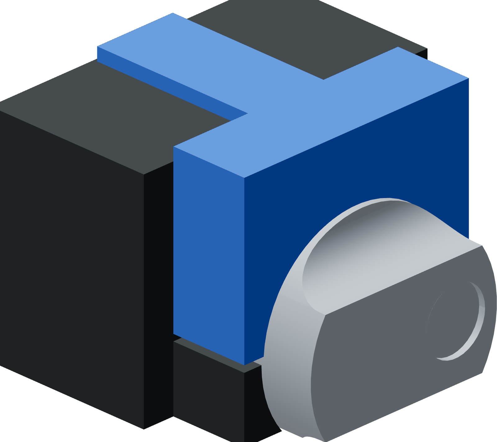

# TPU donor half-body hold-down cover

This one-piece TPU cover is a continuous inverse of the Touch-Flo's upper
half below the lever. Its cavity wraps 180° around the cylindrical portion,
follows the rounded transition, and wraps around the flat-sided portion
down to the donor's centreline on both sides. The broad flat hand face
stands 2 mm above the existing PET-GF reaction walls. A compression tongue
parks the cover in the open shank canyon.

The cover runs from the cylindrical base at donor axial coordinate 0 mm
to the 39 mm plateau below the lever attachment. The faucet lever remains
attached, down and unpressed throughout tube insertion, as recorded in the
[physical assembly observations](../../../faucet/lever-replica/assembly-observations.json).
The contact view includes the donor up to its arches. The installed lever
transform is unmeasured and is not drawn; physical clearance remains an
ordinary unloaded fit check.



| Feature | Nominal dimension |
| --- | ---: |
| Transition radius | 6 mm |
| Covered region along donor axis | 0–39 mm |
| Cylinder wrap | 180° |
| Lower wrap edge | Donor centreline, fixture Z30 |
| Flat metal contact length × width | 20 × 26.52 mm |
| Hand face above PET-GF walls | 2 mm |
| Existing canyon width | 11.8 mm |
| Retention tongue width | 12.8 mm |
| Compression allowance | 0.5 mm per side |
| Tongue entry width | 11.3 mm |
| Thread clearance below tongue | 10.25 mm |
| Tongue engagement below wall top | 8.25 mm |
| Full-width compression engagement | 7.5 mm |
| Minimum side backing | 3.25 mm |
| Backing above cylindrical crown | 10.25 mm |
| Backing above flat metal contact | 17.5 mm |
| Print bounding box | 64.5 × 38 × 26 mm |

## Print

Print one in black TPU 85A with the broad flat hand face on the bed and
the inverse half-body cavity upward. That face gives 1808.4 mm² of bed
contact. Successive cross-sections shrink as the cavity opens and the
tongue tapers to its entry tip, so the part needs no supports in this
orientation.


The editable native project is
[`ready/donor-hold-down-half-body-tpu85a-right06-z018-mark1.3mf`](ready/donor-hold-down-half-body-tpu85a-right06-z018-mark1.3mf).
The reviewed print archive is
[`ready/donor-hold-down-half-body-tpu85a-right06-z018-mark1.gcode.3mf`](https://github.com/derekbreden/homesodamachine/blob/33d50d2ecd2a0fb6b518483a44c8031e3a0c1617/hardware/printed-parts/fixtures/tube-insertion/donor-hold-down/ready/donor-hold-down-half-body-tpu85a-right06-z018-mark1.gcode.3mf).
Both use Mark1's right fixed 0.6 mm nozzle, external black TPU 85A spool
255, textured PEI, 0.18 mm layers, a 0.30 mm first layer and 100% zig-zag
infill. The user Z trim is Mark1's standard +0.18 mm; the emitted plate
compensation is `G29.1 Z0.16` after the reset to zero.

The native slice has 144 layers, no generated supports, at least 119.9 mm
full-bead bed-edge clearance and no slicer warning. Estimated use is
36.9 g and about 4 hours. The [Mark1 launch record](prints/2026-10-12-half-body-mark1/launch.json)
identifies task 1334637551 accepted on October 12 at 11:20 pm CDT with this
exact archive. The printer reported startup without errors. Physical fit
and hand-pressure results are pending. The separate
[cylindrical-base pad job](prints/2026-10-12-mark1/README.md) identifies
Mark1 task 1334447551 accepted on October 12 at 9:20 pm CDT and retains
its exact printed geometry and archive.

## Fit and use

1. Leave the faucet lever attached, down and unpressed. Seat the donor in
   its existing cradle with its metal base annulus against the reaction wall.
2. Lower the cover around the upper half of the cylindrical body,
   transition and flat-sided column, guiding the narrow tongue into the
   canyon above the threaded shank. The two tongue sides provide the
   nominal compression fit.
3. During unloaded setup, confirm that the complete inverse cavity seats
   on the donor, the tongue clears the threads and the attached lever
   remains untouched. The hand face should stand 2 mm above the PET-GF
   walls. The lower wrap edges reach the donor centreline and meet the
   cradle top plane over the cylindrical portion.
4. Hold the broad hand face down with one hand.
   Use the other hand to alternate the factory screw handles in the small
   steps described in the [fixture procedure](../README.md#fixture-setup-and-motion).
5. Unload the axial clamps and lift out the pad before lifting the donor
   and tube from the cradle.

The cover is a fit candidate. The 1 mm excess tongue width is
an interference dimension; it does not establish insertion force,
retention force or automatic donor clamping. Physical fit and manual
hold-down performance remain unmeasured. The existing base and its
axial load path retain their geometry.

## CAD and review

[`dimensions.json`](dimensions.json) records the geometry and source
bindings. [`geometry-review.json`](geometry-review.json) records one valid
solid, zero nominal overlap with the metal donor, an exact negative of
its upper-half exterior, base interference confined to the retention
tongue, and 260 supported manufacturing cross-sections. The exterior
cutter fills the internal water bore, keeping the cover outside that bore.
The
[`native readiness record`](ready/donor-hold-down-half-body-tpu85a-right06-z018-mark1.readiness.json)
binds the STL, project, archive, G-code and emitted process.

The STEP files are `donor-hold-down.step` in manufacturing orientation
and `donor-hold-down-fit.step` for the cropped contact view. The slicer
mesh is [`donor-hold-down-print.stl`](donor-hold-down-print.stl).
Generate and slice explicitly from the repository root:

```sh
HSM_NO_BUILD_LOCK=1 tools/cad-venv/bin/python hardware/printed-parts/fixtures/tube-insertion/donor-hold-down/donor_hold_down.py
tools/cad-venv/bin/python hardware/printed-parts/fixtures/tube-insertion/donor-hold-down/prepare_print.py --slice-output .cache/donor-hold-down-half-body-native-next
```

The slice directory must be empty. These manual operations submit no
print and are not part of a build, hook or watcher.
