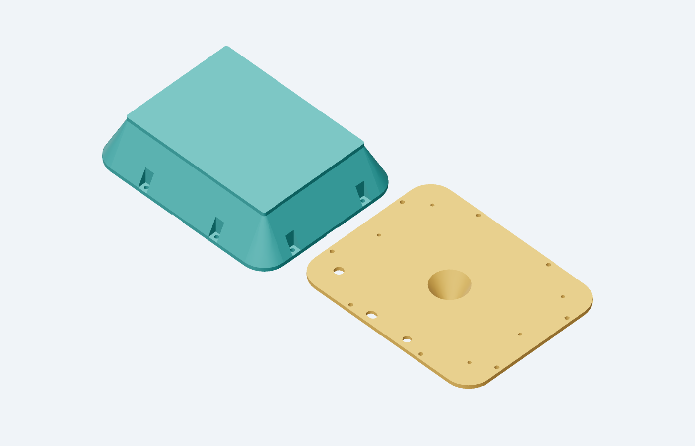
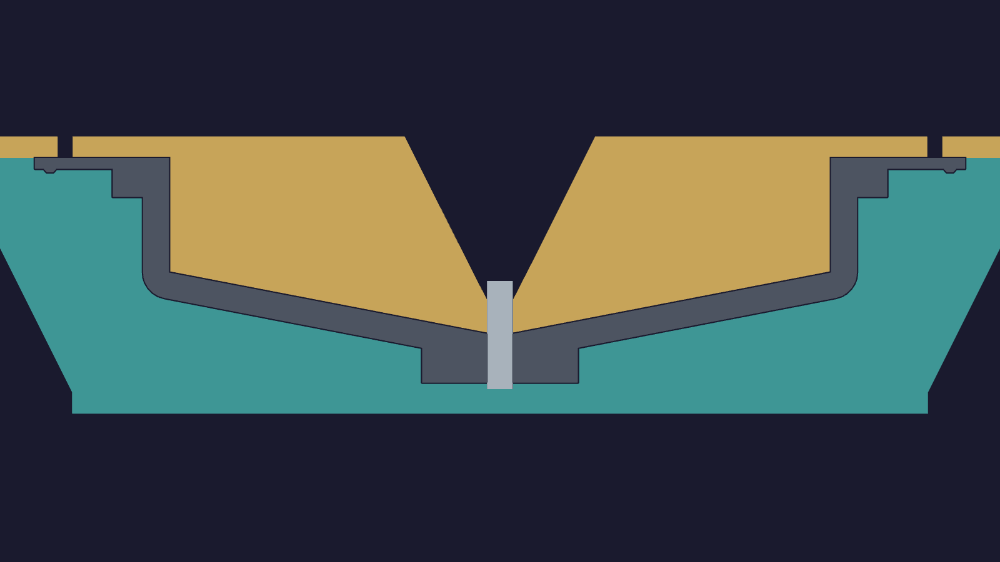

# Funnel mold

Two PETG pieces, **cavity and core**, and one **straight 6 × 25 mm stainless
steel rod** cast the complete removable [funnel](../funnel/README.md).
The rod forms a uniform 6 mm outlet. The silicone grips the 6.35 mm LLDPE
drain stub over its full 5.015 mm insertion depth; the funnel lifts off for cleaning.


The clamping flanges are **247 × 193.392 mm**, with at least 16 mm margin around
the 215 × 155.392 mm silicone apron. Their R28 corners leave a flat
197.85 × 144.242 mm cavity base and a **63.4° corbel**
supporting the flange. The core has a flat dry back and one **44.085 mm
circular tapered access hole** leading to the straight rod guide. Both flanges
are 5 mm thick. The core's 0.30 mm brim-finishing pocket retains
4.70 mm backing. Eight 5 mm holes take M4 × 20 bolts, 9 mm OD washers and nuts;
Eight shallow pockets give side access to the cavity bolt heads. Their short
ceilings receive removable Snug support; the corbel and core access taper
print without support. Two locating pegs orient the halves.
Four edge notches admit a blunt opening tool.

## Rod and guides

Use a smooth [uxcell 6 × 25 mm 304 stainless dowel](https://www.amazon.com/dp/B07Z18CKCY).
The 25-piece pack was Prime-listed at $8.99 on 2026-10-05. This is reusable
shop tooling, supplied separately from the two prints. Its factory end chamfers
sit outside the silicone forming span.

The core has a straight **6.4 mm open guide**, 7.7 mm long after the shell's
finishing allowance. The cavity has a **6.4 mm lower seat**, 1.5 mm deep, with
5 mm floor backing. The rod rests on this floor and projects **4.235 mm** above
the guide. Close the empty mold and drop the rod through the open dry back.
It must reach the floor and lift out freely. Clear support residue or binding
high spots without enlarging the forming bore.

The open guide lets air and small amounts of silicone enter the accessible dry
back. Trim cured guide overflow at the bowl throat and lower-seat flash flush
with the block bottom. Keep the guide clear during filling and vacuum cycling.



## Finish and cast

1. Remove the accessible bolt-pocket supports. Drill two **1.5 mm infill
   breather holes** in each body's bare dry side, using a depth stop:
   cavity side walls at **X = ±98.925 mm, Y = ±30 mm, Z = 2.5 mm**,
   drilling **3.2 mm horizontally inward**; core flat back at
   **XY = (−40, −30) and (40, 30)**, drilling **1.8 mm inward**.
   XY is relative to the brim centre and Z is above the cavity bottom.
   The side entries keep cavity breathers clear of a flat tray. These holes
   pierce the six-wall or six-layer skins into the gyroid; leave them uncoated.
   Sand and seal the mold forming faces, using their 0.30 mm
   net finishing reserve. Keep the parting lands, locating features, clamp holes,
   rod guides and lower stop bare. Dry-close on the lands and check the rod's
   drop-in fit. Clean the steel rod; apply a light release film to it and both
   forming faces. Use the actual finishing/release stack on a same-stack cure
   and release sample before the full pour.
2. Mix the [BBDINO 40A silicone](silicone.md) at the container's ratio. The
   batch allocation follows [the generated casting volume](design.json), plus
   10% for mixing and port flash. Degas in a separate cup with expansion room.
3. Set the rod in the cavity's lower seat. Fill around it, then lower the core
   slowly over the rod until the bare lands meet. Tighten opposite flange
   stations gradually. Top up through the 11 mm fill hole; keep all five 4 mm
   vents and the open rod guide clear. Use a catch tray.
4. If vacuum cycling the filled mold, put the complete mold and tray inside the
   chamber. Keep fill, vents, rod guide and infill breathers connected to chamber air.
   Keep the side breathers clear of silicone overflow.
   Evacuate and vent slowly while the silicone is fluid, then top up and cure
   at ambient pressure. Follow the material record's five-hour demold hold and
   24-hour full-use hold at 23 °C, and the actual container instructions.
5. Remove the flange hardware. Open opposing notches a little at a time and peel
   the brim to admit air. Lift the core straight off the rod, then peel the
   casting and rod out of the cavity. Support the block and slide the released
   rod out along its axis. Trim seat, guide, fill and vent flash. Keep the 6 mm
   cylindrical bore, flat bearing face and underside roof-contact rib intact.
6. Clean the funnel and fit it over the drain stub until the brim and block are
   seated, with the apron smoothed onto the roof. Check the normal filling,
   lift-out and refitting operation. Clean
   the rod and tooling before another cast.



The [illustrated Letter guide](../../../mold-guide/README.md) covers the general
finishing and casting procedure; use this directory's native files and dimensions
for the apron tooling. The tooling uses equalized chamber pressure and gravity filling. The maximum
57 mm silicone head produces about **0.63 kPa**. The sparse interior breathes
through the drilled dry-side holes; wall count and infill percentage do not
establish a stiffness or lifetime rating. The [print log](print-log.md) records
a successful 15% infill mold with Snug supports on September 16.

The acquired [5-gallon chamber](../../../ledger/tools.md) is recorded with a
**299.72 mm interior diameter and height**. The rounded mold fits within a
**291.28 mm circle**, leaving **4.22 mm radial clearance**. With the specified
M4 × 20 closure hardware it is about **73.35 mm high**. Use a catch tray no
larger than 260 mm across and keep it clear of the breathers. The
[chamber check](chamber-check.json) binds these dimensions to the native parts
and the acquired chamber record; physical insertion is not recorded.

## Print files and checks

[Cavity STL](cavity.stl) · [Core STL](core.stl) · [Native dimensions and closure/release readings](design.json)

PETG Translucent Clear through Mark1's AMS HT-A, right 0.4 mm Standard nozzle, 0.88 flow,
5.61702 mm³/s maximum volumetric speed, 0.20 mm first layer, 0.24 mm layers
above, **six walls, 15% gyroid infill, six top/bottom layers** and Snug normal
supports for the bolt pockets. The cavity
prints upright; the core prints inverted on its dry back. The Textured PEI
recipe uses **+0.04 mm requested trim** (`G29.1 Z0.02`). First-layer
walls/infill run at 20/30 mm/s with an 8 mm outer brim. Probing clump checks
remain Off. The apron tooling has no saved production slice or physical
casting result. Its larger footprint needs a fresh native plate layout and
support review before printing.

The generator's [design record](design.json) records closure with the intended
fill, vent and rod-guide mouths capped for analysis, straight rod withdrawal,
core lift and complete nominal casting equality with the funnel. The guide
remains open in the native parts. The [overflow review](../funnel/overflow-review/README.md)
binds the apron to its current source and assembly exports.

The [physical print log](print-log.md), [October 6 slice and cavity retry](native-slice-reviews/2026-10-06-mark1-retry-z004-v2/README.md),
[matching core launch](native-slice-reviews/2026-10-07-mark1-core-matching-cavity-v1/README.md),
[rod check](rod-check.json) and [closure check](containment-review.json) retain
their identified artifact scope.

```sh
tools/cad-venv/bin/python hardware/printed-parts/zone-c/funnel/funnel.py
tools/cad-venv/bin/python hardware/printed-parts/zone-c/funnel-mold/funnel_mold.py
tools/cad-venv/bin/python tools/funnel-mold-print/review_rod.py
tools/cad-venv/bin/python tools/funnel-mold-print/review_containment.py \
  --output hardware/printed-parts/zone-c/funnel-mold/containment-review.json
tools/cad-venv/bin/python tools/funnel-mold-print/review_chamber.py
```

After publication, run `tools/funnel-mold-print/review_geometry.py --models hardware/printed-parts/zone-c/funnel-mold` in the
recorded print orientations and address its findings.

## Sources
[value](NAME) texts are updated by:
- `/tools/funnel-mold-print/verify_print.py`
