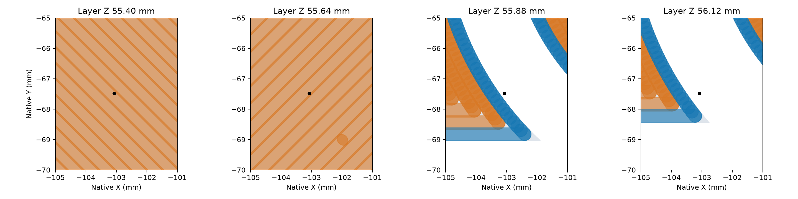

# Front seal forming corner: native paths

The cavity has one ranked thin-material finding at X−103.074, Y−67.485,
Z55.619: a 0.6 mm² patch at the curved sealing-rib/front-root transition.
The local forming geometry is retained with the evidence in [review.json](review.json).

The complete cavity was sliced locally with the identified saved mold settings:
0.4 mm nozzle, 0.24 mm layers, six walls and 15% gyroid. A quarter-turn about
Z places its longer dimension along the bed's Y direction; print-up remains +Z.
No printer received this project. This study qualifies neither a production
plate nor support removal.



Gray is the native section, blue the outer-wall footprint and orange the
remaining model paths. The black dot marks the lint pick's XY location across
the four sections. The corner grows from solid infill and top layers into
0.42/0.45 mm inner and outer wall paths. In the defined window, the nominal
footprint overlap with the preceding layer is 98.9–100% through the critical
wall layers. [The layer readings](path-readings.json) preserve the measured
sections, path widths, coverage and overlap.

The nominal footprints round the theoretical tip: the maximum uncovered
section-vertex distance is 0.344 mm, and local section coverage is 95.6–100%.
These are commanded-path measurements. Actual deposition and the finished
forming surface after sanding/coating have no physical qualification.

The compact record binds the source STL, saved settings, inspection project and
G-code by SHA-256. The large derived G-code and inspection archive stay in
`tmp/funnel-runoff/corner-slice/`. These manual scripts reproduce the local study
from the repository root:

```sh
tools/cad-venv/bin/python hardware/printed-parts/zone-c/funnel/overflow-review/corner-path-study/prepare_corner_slice.py
/Applications/BambuStudio.app/Contents/MacOS/BambuStudio --slice 0 --arrange 0 --orient 0 \
  --outputdir "$PWD/tmp/funnel-runoff/corner-slice/native" \
  --export-3mf cavity-inspection.gcode.3mf \
  "$PWD/tmp/funnel-runoff/corner-slice/cavity-inspection.3mf"
tools/cad-venv/bin/python hardware/printed-parts/zone-c/funnel/overflow-review/corner-path-study/analyze_corner_paths.py
```
