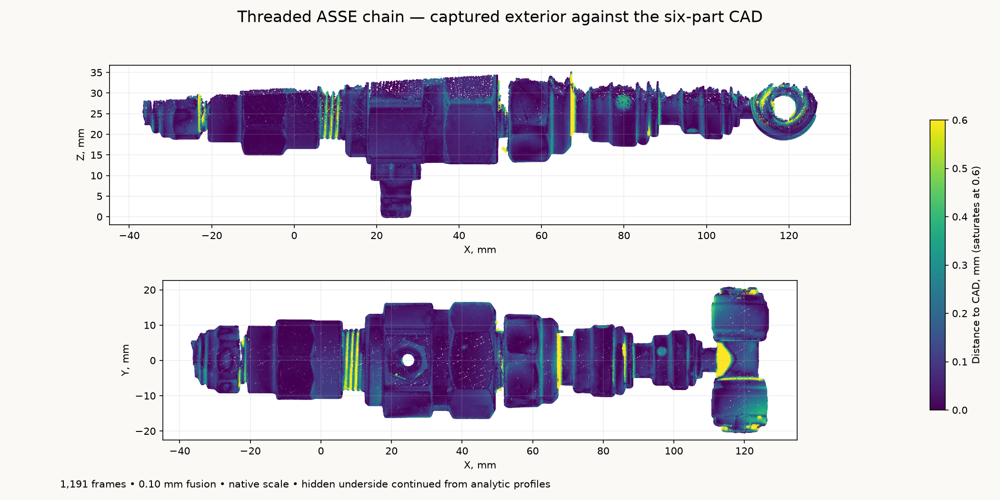

# Threaded ASSE chain

The planned threaded water-inlet chain, captured as an assembled sample:

**PP010822E → GAGIRA reducing coupling → Multiplex ASSE 1022 → PI4512F6S →
PP061208W → neoFit ATBU444-E branch stem tee.**

The STEP contains six named exterior bodies in their captured positions. It
retains the coupling's round bands and wrench section, the drafted flare nut,
plastic adapter steps and collets, the exposed stems, and the tee's two socket
mouths. The [bare ASSE reference](../multiplex-asse1022/README.md) supplies its
separately scanned exterior. `ports()` supplies the inlet, two tee outlets and
vent, with their outward directions.

| Feature | Reference, mm |
| --- | ---: |
| Overall envelope | 163.77 × 41.09 × 41.94 |
| Inlet collet centre | −36.547, 0.335, 27.676 |
| Tee +Y mouth centre | 118.508, 20.469, 28.034 |
| Tee −Y mouth centre | 119.060, −20.168, 26.417 |
| Vent tip | 24.650, 0.070, 0.000 |

The frame is the bare ASSE's: +X follows flow, its inlet rim is X = 0, and the
vent tip is Z = 0. Each attached component retains its fitted local axis; the
tee run is slightly inclined in this pose. Decimal places identify reproducible
datums, not independently calibrated dimensional accuracy. The model describes
the captured assembly and does not establish final tightening or insertion stops.

## Capture and measurement

Derek painted and putty-mounted the chain on the rotating turntable. Revo Scan
6.3.2 recorded **1,191 frames**, MINI 2 High Accuracy / Feature / Normal, colour
and base removal off, automatic depth exposure, and a 120–250 mm range.
Native fusion at **0.10 mm** produced **1,056,991 points**. No isolation, native
cloud smoothing, hole filling or rescaling is applied.

The single retained native project, raw frame database, calibration files,
preview, fused cloud and SHA-256 manifest are in
`~/Documents/3D Scans/2026-10-29-asse1022-threaded-chain/`. The same directory
holds the registered cloud, portable STEP/STL and rendered preview.

[`analyze_capture.py`](analyze_capture.py) identifies the marker-table plane
away from the narrow chain, fits the exposed ASSE flats and vent, then performs
rigid registration to the separate bare-ASSE observations. Only that body and
vent participate in registration. The fitted adapters remain independent
observations. A fixed plane 15.5 mm above the table removes putty and markers;
**929,429 points** remain. No observations are rejected by distance to the CAD.
[`scan-evidence.json`](scan-evidence.json) retains the transforms, source hashes,
selections, registration residuals and axial profiles.

[`fit_components.py`](fit_components.py) locates circular axes from surface
normal rays, models the coupling's undrafted flats, and fits the tee run from
both socket collars. Outward-facing surface samples in 0.2 mm axial bins supply
97.5th-percentile radius profiles. A three-bin median and a 0.06 mm radial
piecewise-linear approximation produce compact analytic profiles. These steps
change the fitted model, not the preserved native cloud.
[`reference-parameters.json`](reference-parameters.json) records the profiles,
poses, draft fits and their residuals.



[`scan-model-check.json`](scan-model-check.json) compares 119,046 observations at
0.30 mm sampling with the six-body CAD tessellated at 0.025 mm. The median
distance is about **0.066 mm**, the 95th percentile about **0.375 mm**, and
**96.8%** lie within 0.50 mm. Small collet features, drafted-nut transitions,
mouth interiors and the tee junction contain larger local differences. These
are scan/model discrepancies, not manufacturing tolerances.

Putty-hidden underside sectors continue the fitted analytic forms. Thread
grooves use the bare ASSE's crest envelopes. Mouths, buried joint volumes and
unseen stem continuations use display closures or stated nominal dimensions;
they are not material, mass, internal hydraulic, sealing or retention inputs.
Paint thickness and absolute optical scale are not independently calibrated.

```sh
tools/cad-venv/bin/python hardware/reference/asse1022-threaded-chain/analyze_capture.py
tools/cad-venv/bin/python hardware/reference/asse1022-threaded-chain/fit_components.py
tools/cad-venv/bin/python hardware/reference/asse1022-threaded-chain/asse1022_threaded_chain.py
tools/cad-venv/bin/python hardware/reference/asse1022-threaded-chain/validate_capture.py
```

The model generator also accepts `--stl /absolute/output/path.stl`.
